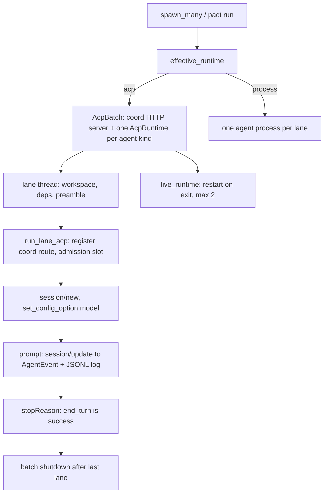

# The ACP lane runtime and the pact-acp protocol client

## Current design

Two layers make up this area. `pact-acp` is the Agent Client Protocol client (#329, #330); `pact-core/src/acp_runtime.rs` is the lane runtime built on it (#331). Instead of one agent CLI process per lane, pact starts one agent process per agent kind and opens one ACP session per lane, each with its own `cwd` and MCP servers. Measured on Copilot CLI (#306): 8 lanes cost 50.9 s and 2,456 MB as separate processes against 5.6 s and 445 MB as sessions in one `copilot --acp`.

`pact-acp` has three layers. `protocol` is the typed subset (`initialize`, `session/new`, `session/prompt`, `session/cancel`, `session/close` out; `session/update`, `session/request_permission` in), with anything unmodelled kept as raw JSON on `SessionUpdate::raw`. `client` is the async half: one `AcpClient` per agent process, requests multiplexed by id, permission requests answered inline (`allow_always` over `allow_once`, else cancel), updates fanned out per session. `runtime` is the blocking `AcpRuntime` that lane threads call. pact advertises no `fs` or `terminal` capabilities, so the agent uses its own tools like a headless run. MCP servers are HTTP only, which is why pact-coord has an HTTP mode. A dead process fails every pending request with `RuntimeExited` and never leaves a lane waiting.

Runtime choice: `--runtime` is `auto` (default), `process` or `acp` (#331, #337). `effective_runtime` resolves `auto` to `acp` when every agent in the batch reports `supports_acp` (today only Copilot), else `process`. An explicit `acp` with an agent lacking it fails up front. A dry run prints `runtime: auto -> acp`. The admission reserve is sized from the resolved runtime (#332).

Batch flow: `spawn_many` starts an `AcpBatch` before any lane thread (the in-process coordination server on its own two-thread tokio runtime, plus one `AcpRuntime` per agent kind). Each lane thread does workspace, deps and preamble as usual, then `run_lane_acp`: register the lane's coord route, take an admission slot, `session/new`, select the model, `prompt`. Every `session/update` becomes an `AgentEvent` (`event_for_update` tags unmodelled kinds `acp.<sessionUpdate>`, the CLI suppresses the noisy ones unless `--verbose`, `ChunkCoalescer` joins message chunks, #339) and the raw update is appended to the lane's JSONL log first. `stopReason` is the outcome, and `end_turn` is the only success. Coordination status comes from the coordination database (`coord_connect` rows), not from parsing the agent.

Model: an ACP lane selects its model with `session/set_config_option` after `session/new` (#374). `spawn_many_in` first checks every requested (agent, model) pair on a throwaway session, so an unknown id fails before any lane starts. The lane and the planner record the model the agent reports, following later `config_option_update`s, and warn when it differs from the request. The run record keeps `model` and `effective_model`. Process lanes pass `--model` and record only the request.

Failure and teardown: the agent process is shared, so teardown never kills it. A lane's `acp_session` makes `stop_agent` write `meta/<id>.cancel`, which a per-lane watcher in the `spawn-many` process turns into `session/cancel` (waits up to 5 s; no-op if the lane's pid is cleared or dead). If the shared process dies, `live_runtime` replaces it for lanes that have not started, at most `MAX_ACP_RESTARTS` (2) times per batch (#412). The lane that was mid-turn stays failed, "exited mid-turn", with its writes left in the tree. Tests use `fake_acp_agent`, never a real CLI; `session/cancel` mid-turn is not yet measured on the real CLI.

### Superseded decisions

- `--runtime` default `process`, `acp` opt-in (#331): superseded by #337, default `auto`, resolved per batch by `effective_runtime`.
- Memory reserve assumed one process per lane under ACP (#331): superseded by #332, a runtime-aware default of 400 MiB for `acp`.
- `auto` fell back to `process` when a model was set (before #374): superseded by #374, `auto` stays ACP because the model is selected through the session.
- A dead shared process failed every queued lane (#331): superseded by #412, replacement up to two times per batch.
- Every unmodelled update printed as an untyped `Other` (#331): superseded by #339, `acp.<kind>` tags plus a suppression list, with raw updates still logged.

## History

The sections below are the issue-by-issue record, moved verbatim from
the old single DESIGN.md. Read them for the why; the summary above is
the current design and wins where they disagree. New decisions in this
area go at the end of this file.

### ACP lane runtime: one agent process, one session per lane (issue #331)

Parts 1 and 2 (#329, #330) built the pieces; this wires them into
`spawn`/`spawn-many` as `--runtime acp` (`SpawnOptions::runtime`,
`pact.toml` `defaults.runtime`). The decision and the numbers behind it
are in the pact-acp section and issue #306: eight cold `copilot -p`
processes versus eight sessions in one `copilot --acp` is 50.9 s and
2,456 MB versus 5.6 s and 445 MB on the same trivial task, and that
per-process startup is the whole remaining gap between pact's shared-tree
run (31.3 min) and Copilot's own in-process sub-agents (15.8 min).

Shape, chosen so nothing above the run phase changes. `spawn_many`
starts an `AcpBatch` before any lane thread: the in-process coordination
server (pact-coord's HTTP mode on its own two-thread tokio runtime, the
one runtime pact-core owns) and one `AcpRuntime` per agent kind in the
batch, each with one lean home for the whole process. A failure there is
one batch-level error for every task, like a shared-tree batch that
cannot be created. Each lane thread then does exactly what it did
before up to the run phase (workspace or lane creation, dependency prep,
the shared-tree preamble) and calls `run_lane_acp` instead of
`run_and_stream`: register the lane's coord route and get its URL, take
the admission slot, `session/new` with `cwd` = the lane's path and
`mcpServers` = that URL, record the session id (as both `session_id` and
`acp_session`) and the shared process's pid, then `prompt` and translate
every `session/update` into the `AgentEvent`s the process path emits
(`agent_message_chunk` to `AssistantText`, `tool_call` to `ToolUse`,
everything else to `Other`, never dropped), appending each raw update to
the same per-lane JSONL log. `stopReason` becomes the run outcome
(`end_turn` is the only success; the summary is `stop reason <x>`, the
counterpart of the process path's `exit code <n>`), the `-run.json`
carries `runtime: "acp"` and the shared process's resolved launch, and
the batch shuts the processes and the server down after the last lane
joins. Verified live against Copilot CLI 1.0.90 through the real `pact`
binary: two shared-tree lanes in one process, each calling
`pact-coord-claim_files` and `release_files` through its own route,
`pact history` showing `coord_connect`/`claim`/`release` per lane id,
both files correct, 10.5 s end to end.

Coordination status under ACP is read from the coordination database
rather than parsed from the agent: the agent streams no MCP connection
events over ACP, but pact-coord logs `coord_connect` on every
`initialize` (#235), so "did this lane's MCP client ever reach the
server" is a lookup of `connected_agent_ids`, which is more reliable
than the event-stream status the process path has to settle on.

Teardown is the one place the shared process changes semantics. A lane's
`agent_pid` names the shared process while it runs, and killing that pid
would take every other lane with it. So `Workspace` gained `acp_session`,
and `remove_workspace`'s `stop_agent` takes a different path for a lane
that has one: it writes `meta/<id>.cancel` naming the session, and the
`spawn-many` process, which alone holds the agent's stdin, runs a watcher
thread per lane that turns the marker into `session/cancel`. `stop_agent`
waits up to 5 s for the marker to be consumed before removing the tree
(the counterpart of `kill_if_alive` waiting for a killed pid to vanish),
clears an unconsumed marker rather than leaving stale state, and does
nothing at all when the lane's pid is cleared (its run ended) or dead,
which the first live teardown showed mattered: without that check every
finished lane paid the 5 s wait for a process that had already exited.
The test for this uses the test process's own pid as the shared one; a
regression that killed it would never reach its assertions.

Known limits, deliberately not addressed here: `--max-concurrent` and
the memory reserve still assume one process per lane (#332 makes the
reserve runtime-aware); only Copilot has an ACP mode today, so a mixed
batch under `acp` fails up front with the agent named; cancellation
depends on the agent honouring `session/cancel` mid-turn, which the
fake cannot exercise and the real CLI has not been measured on.

Arm Q then ran the full benchmark under `acp` (issue #308): 17.2 min
against 15.8 for Copilot's in-process sub-agents and 31.3 for pact's
previous best, with 11% less peak memory, 45% less mean memory, 27%
less CPU, 8% more cost and 25% more tests at the highest coverage of
any arm. On that evidence the default became `auto` (issue #337):
`effective_runtime` resolves it to `acp` when every agent in the batch
reports `supports_acp` (a side-effect-free capability check, separate
from `build_acp_launch` because the lean launch prepares a home) and to
`process` otherwise, since a mixed batch cannot put a CLI without an
ACP mode into a shared process. The CLI resolves once the batch's agents
are known, sizes the memory reserve (#332) from the result, and says
`runtime: auto -> acp` in a dry run so the resolution is never silent.
An explicit `--runtime` is passed through untouched; asking for `acp`
with an agent that lacks it still fails up front with the agent named.

The first long run also showed what the stream looked like (issue
#339): every unmodelled `session/update` became an untyped `Other` that
the CLI's suppression could not name, so thought fragments, tool
progress, context-fill ticks and session metadata all printed, and
`agent_message_chunk` fragments printed one `[assistant]` line each. Two
small mechanisms, both keeping the rule that `Other` is never dropped:
`event_for_update` tags its values `acp.<sessionUpdate>` so the existing
`SUPPRESSED_OTHER_EVENT_TYPES` list can carry the seven kinds that run
showed to be volume (an ACP kind pact has never seen still prints, and
`--verbose` prints everything), and `ChunkCoalescer` joins consecutive
message chunks into one `AssistantText`, flushed by the next update of
any other kind or the end of the turn, so a lane's message reads as the
process runtime's complete `assistant.message` does. The per-lane JSONL
log is written before either and keeps every raw update.

Sharing one process means sharing its failures (issue #412). When
`copilot --acp` exited (a crash, an OOM kill, an expired login), the
lane mid-turn failed, and so did every lane queued behind it, each
failing to open a session on a process that was gone: one fault in
lane 1 of 12 threw away the run. `AcpBatch` now keeps each agent's
process behind a lock and `live_runtime` replaces it when a lane about
to open a session finds it exited, so the queued lanes run on the
replacement. The lane that was mid-turn stays failed, reported by name
as "exited mid-turn" with its partial writes left in the tree, since
resuming it would need `session/load`. A process that keeps dying is
replaced at most twice per batch (`MAX_ACP_RESTARTS`); after that the
remaining lanes fail with a message that says so, because a third
death points at the environment (auth, memory) rather than at one
lane's turn. The batch's closing line says how many restarts happened.
A turn that fails while its process is still alive is now that lane's
failed outcome too, rather than a launch error that lost the lane's
name in the report.

### The model a lane actually ran on (issue #374)

On 2026-10-02 every `pact run` lane ran on `claude-haiku-4.5` while
everyone believed it was `claude-opus-5`: Copilot's catalog had dropped
the requested id and the agent swapped in a default at session start,
announcing it only in a `config_option_update` pact threw away. ACP
sessions describe their model as a config option (id `model`, or
category `model`), with the values on offer and `currentValue`. So an
ACP lane with a model now selects it with `session/set_config_option`
after `session/new`; a model the agent does not offer is an error, and
`spawn_many_in` checks every requested (agent, model) pair on a
throwaway session before any lane launches, so a typo or a retired id
costs nothing. Every lane, and the planner, records the model the agent
reports: the value after selection, replaced by any later
`config_option_update` during the turn. When that differs from the
request the lane prints a warning and the run record keeps both
(`model` and `effective_model`, shown by `pact inspect` and `pact list
--json`). Process lanes still pass `--model` and record only the
request, since a process CLI reports no model in a form pact parses.
With selection in place the fallback above is gone: `auto` stays ACP
when a model is set.

### Why a protocol client instead of N processes (issues #306, #330)

Measured on 2026-10-01 with Copilot CLI 1.0.90 on the lean profile and a
trivial one-file task (`C:\Users\Zekar\pact-bench\acp_probe.py`):

| lanes | N separate `copilot -p` processes | one `copilot --acp`, N sessions |
|---|---|---|
| 1 | ~6 s, ~300 MB | 5.6 s, 299 MB |
| 4 | 24.5 s, 1,285 MB | 4.9 s, 384 MB |
| 8 | 50.9 s, 2,456 MB | 5.6 s, 445 MB |

Per-process cost is linear and all startup: about 6 s and 330 MB per
lane. Per-session cost inside one process is flat: about 20 MB and no
startup. That gap is what was left between pact's shared-tree run
(31.3 min) and Copilot's own in-process sub-agents (15.8 min) on the
capture-hub benchmark, and it is why the arm P run came within 112 MB of
exhausting memory. The Agent Client Protocol
(<https://agentclientprotocol.com>) is how an agent process exposes many
independent sessions, each with its own working directory and MCP
servers, which is exactly a pact lane. Copilot ships it as `copilot
--acp`; Gemini CLI speaks it natively; Zed ships adapters for Claude Code
and Codex. So one client here can eventually replace one bespoke stdout
parser per agent CLI in pact-agents.

### Shape

Three layers, each the smallest that does its job. `protocol` is the
typed subset pact uses: `initialize`, `session/new`, `session/prompt`,
`session/cancel`, `session/close` outbound; `session/update` and
`session/request_permission` inbound. Everything the agent sends that
pact does not model travels as a raw `serde_json::Value` on
`SessionUpdate::raw` rather than being dropped, so callers can read
fields pact never anticipated without pact growing a type for each.
`client` is the async half: one `AcpClient` is one agent process, with
JSON-RPC requests multiplexed by id, the agent's own requests answered
inline by a permission policy, and `session/update` fanned out to the
channel registered for that session. `runtime` is the blocking facade
pact-core's lane threads will call: an `AcpRuntime` owns the process and
a two-thread tokio runtime, and `prompt` blocks the calling thread while
delivering updates to a callback on that same thread, so the orchestrator
above it stays as synchronous as it is today.

Decisions made on evidence from the probes rather than from the spec:

- pact advertises no `fs` or `terminal` client capabilities. With them
  off, the agent uses its own file and shell tools, which is what makes a
  session behave exactly like a headless `copilot -p` run. The probe
  showed no `session/request_permission` traffic at all with
  `--allow-all-tools` on the process, but the client still answers it,
  because an unattended lane has nobody else to ask: the default policy
  picks `allow_always` over `allow_once` over anything, and cancels if
  nothing allows.
- `McpServer::http` carries `"type": "http"`; the stdio shape stays
  untagged, matching ACP v1's wire format. Copilot rejects stdio servers
  from the client outright (its log: `Rejecting non-http/sse MCP server
  "pact-coord" from client`), which is what made pact-coord grow an HTTP
  mode (issue #329).
- `StopReason` has an `#[serde(other)]` arm. The spec lists five reasons
  today; a sixth must not turn into a parse failure that looks like an
  agent crash.
- When the process exits, the reader task fails every pending request
  with `RuntimeExited` carrying the exit status and the last twenty
  stderr lines, closes every session's update stream, and makes later
  requests fail the same way immediately. A lane thread must never wait
  on a dead agent; the test `an_agent_that_dies_mid_turn_...` kills the
  fake after its first `tool_call` and checks that the update sent before
  the crash was still delivered, that the prompt failed, and that the
  next call fails without blocking.
- `session/close` answered with -32601 is success: an agent without the
  `close` capability has nothing to free, and pact should not treat a
  capability gap as a lane failure.
- `prompt` drains the update channel with `biased` priority before
  polling the turn's response, then drains once more after the response
  arrives, so a chunk the agent emitted just before `stopReason` is
  delivered before `prompt` returns rather than at the start of the next
  prompt.

Verified against the real CLI once by hand (`examples/copilot_probe.rs`,
never from the suite): `initialize` 2.2 s, two sessions in 1.1 s each,
both prompted concurrently and ending `EndTurn` in 3.3 s with the right
file contents, `session/close` honoured, 7.2 s total including startup.
Session ids are Copilot's own UUIDs, so each lane's session persists in
the lean home's session store and cost accounting keeps working.

### Testing without an agent

`fake_acp_agent` is a test binary that speaks just enough ACP: it
creates sessions, treats each prompt's text as a JSON task naming files
to write into the session's `cwd`, streams `usage_update`, `tool_call`,
`tool_call_update` and two `agent_message_chunk`s, optionally sends a
`session/request_permission` first and honours the answer, optionally
exits mid-turn, and logs every method it receives when `FAKE_ACP_LOG` is
set. The one awkward part is that it is single-threaded: while waiting
for a permission answer it buffers any other message that arrives and
replays it after the turn, which is enough for two sessions prompted
concurrently to both complete. The integration tests drive the blocking
`AcpRuntime` from real threads, because that is the surface pact-core
will use.
