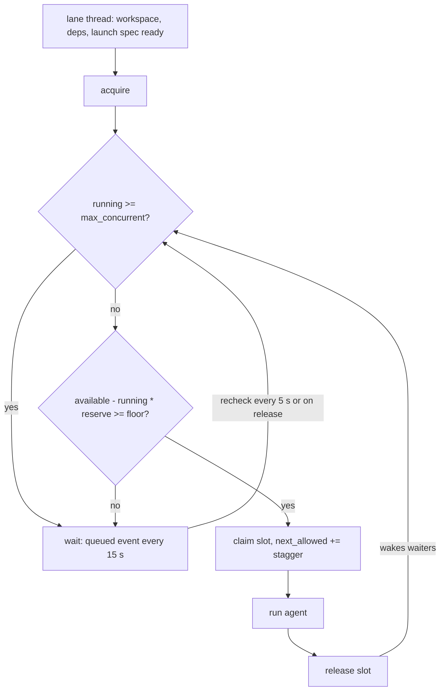

# Admission control and per-lane memory reservation

## Current design

`Admission` (`crates/pact-core/src/admission.rs`) is the gate every lane in one `spawn-many` or `pact run` batch passes before its agent starts (#285). One instance is shared by all lane threads, the way the `Supervisor` is. It bounds only the running phase: worktree creation, dependency prep and launch-spec building happen up front for every lane, so a queued lane starts the moment a slot frees. A slot is taken right before the agent runs and released as soon as it is gone. Single `spawn` is not gated.

The decision is a pure function, `decide(running, policy, available_mb)`:

- If `running >= max_concurrent`, wait for a slot.
- Otherwise compute `projected_free_mb = available - running * per_lane_reserve_mb` (saturating at zero). If it is below `min_free_mem_mb`, wait for memory.
- Otherwise admit. A `min_free_mem_mb` of 0 skips the memory check; a `per_lane_reserve_mb` of 0 restores the instantaneous check.

`acquire` wraps `decide` in a mutex and condvar loop that re-checks every 5 s, or sooner when a slot is released, and repeats a "queued: ..." phase event at most every 15 s. Claiming a slot also reserves `next_allowed = max(now, next_allowed) + stagger`, so two waiters that both see room still launch `stagger` apart. Zero admissions is a valid state: a machine below the floor keeps lanes queued rather than paging, and Ctrl-C is the escape.

Defaults, from `AdmissionPolicy::for_runtime`: `max_concurrent` 2, `min_free_mem_mb` 1500, `stagger` 2000 ms. The per-lane reserve depends on the runtime (#320, #332): 1200 MiB for `process` lanes (an agent CLI plus the test run it triggers later) and 400 MiB for `acp` lanes (the agent process is shared, so a lane only grows by its own test run or build). The CLI picks the reserve default after `auto` resolves to a runtime, and only when neither the flag nor `pact.toml` sets one. All four values are `spawn-many` flags and `pact.toml` `[defaults]` keys.

The same arithmetic sizes `pact run` plans (#356): `lanes_that_fit` counts the lanes whose reserves fit above the floor, plus one, exactly as `decide` will at launch time. `suggested_units` caps that by logical cores and clamps it to 2..16.

Limits kept on purpose: no cap on a test runner's own parallelism, no coordination across two concurrent `pact` invocations on different repos (each batch has its own `Admission`, except `pact fleet`, which shares one across repositories), and no steady-state governor that pauses a lane that outgrows its reserve. The reserve is a projection and double-counts a lane that has already grown, which errs toward fewer lanes.

Concurrent checks, the memory peaks #320 measured, are bounded separately and machine-wide: lanes run their tests, type-checks and lints through pact-coord's `run_check`, which waits for one of `--check-slots` OS-lock slots (default 2) shared by every pact process (#461, see coord.md). That is what #320's "cap on concurrent verification commands" proposed; the pause/resume governor is not built.

### Superseded decisions

- The floor compared against instantaneous available memory only (#285): superseded by #320, which subtracts `per_lane_reserve_mb` for every running lane before the comparison.
- One per-lane reserve of 1200 MiB for every runtime (#320): superseded by #332, which sizes it per runtime (1200 for `process`, 400 for `acp`).
- "It does not count the memory running agents would grow into" (#285): closed by #320.

## History

The sections below are the issue-by-issue record, moved verbatim from
the old single DESIGN.md. Read them for the why; the summary above is
the current design and wins where they disagree. New decisions in this
area go at the end of this file.

### Admission control (issue #285)

Until #285, `spawn_many` started one OS thread per task and launched
every agent at once: no cap, no memory check, no gap between launches.
Measured per-process footprints on the owner's 13.7 GB laptop
(2026-09-29/30, 0.6 GB free at the time with a browser open): a lean
Copilot agent 326 MB, a lean Claude agent 423 MB, a default-config agent
1.0-1.4 GB; `vitest run` 1.5 GB, `next build` 1.9 GB, `eslint` 0.7 GB.
Five default agents each running a test suite is more than the machine
has, which is exactly the "my computer slows down and doesn't handle
running multiple agents" the owner described and why they ran one agent
at a time. Providers add their own reason to spread launches out:
bulk-starting ~10 Claude Code sessions makes the 4th onward fail on the
server side (anthropics/claude-code#53922), and Copilot CLI hard-caps
subagent concurrency at 2 for non-usage-based accounts
(github/copilot-cli#4940).

`Admission` (`crates/pact-core/src/admission.rs`) is shared by every
task thread in one batch, the way `Supervisor` already is. It bounds the
*running* phase only: worktree creation, dependency prep, and building
the launch spec all happen up front for every task (about a second each
in link mode), so a queued task launches the instant a slot frees rather
than paying its setup then. A slot is taken right before
`run_and_stream` and released as soon as the process is gone, before
metadata is written.

The decision is a pure function (`decide`): a slot must be free first,
then available memory (per `sysinfo`) must be at or above the floor.
The pure function is what the unit tests pin; `acquire` wraps it in a
mutex/condvar loop that re-checks every 5 s (sooner when a slot is
released) and repeats a "queued: ..." `Phase` event at most every 15 s
so the live stream says why nothing new is starting. **Zero admissions
is a valid state**: a machine below the floor keeps every task queued
rather than launching into paging, and the user's Ctrl-C is the escape.
`--min-free-mem-mb 0` disables the memory check entirely (the
end-to-end tests use it so a CI runner's free memory can't decide
whether they pass). The stagger is a reservation, not an observation:
claiming a slot records `next_allowed = max(now, next_allowed) +
stagger` under the lock, so two waiters that both see room still launch
`stagger` apart.

Defaults (`max_concurrent = 2`, `min_free_mem_mb = 1500`, `stagger_ms =
2000`) were chosen for this laptop and are deliberately conservative;
the review that shaped this ("prove two lean agents beat one lean agent
before adding concurrency machinery", 2026-09-29) argued for exactly
that. All three are `spawn-many` flags and `pact.toml` `[defaults]`
keys. Single `spawn` is not subject to admission.

What this does *not* do, on purpose for now: it does not cap a test
runner's own parallelism (a separate change sets `VITEST_MAX_FORKS`);
and it does not coordinate across two concurrent `pact` invocations
against different repos (each batch has its own `Admission`). It used to
also not count the memory running agents would grow into; that is what
the per-lane reservation below adds (issue #320).

The end-to-end test runs four fake agents under `--max-concurrent 2`,
counts presence files they hold open while alive, and fails without the
cap (observed 3 alive at once). It asserts only the upper bound: that
the cap still lets two run together, and that a waiter says "queued",
are asserted deterministically in the unit tests instead, because on a
loaded CI runner two 1.5-second fake agents can finish before the next
two are even spawned.

### Per-lane memory reservation (issue #320)

The floor check read *instantaneous* available memory at each admission.
A lean agent sits at 0.3-0.45 GB while authoring and then runs a
1.5-1.9 GB test suite or type-check later, so N decisions made within a
few seconds of each other all saw the same ~5 GB free and all admitted,
and the lanes then peaked together. Measured twice on the 13.7 GB
benchmark laptop with `--max-concurrent 8 --min-free-mem-mb 500`: free
RAM dropped to 296 MB (E1, isolated lanes) and to **112 MB** (arm P,
`--shared-tree`, where all eight launch within seconds because the tree
is prepared once). No OOM either time, but one more process would have
paged or died, and a killed lane mid-write is the failure pact exists to
prevent. `--shared-tree` makes this sharper, not just more likely: the
gate was evaluated eight times against the same number.

`per_lane_reserve_mb` (default 1200, flag `--per-lane-reserve-mb`,
`pact.toml` `defaults.per_lane_reserve_mb`, `0` disables) is subtracted
once per already-running lane before the floor is compared:
`decide` admits when `available - running * reserve >= floor`. On the
benchmark laptop with ~5 GB free and the defaults that yields 3 lanes
(5000, 3800, 2600 admit; 1400 < 1500 waits), which is exactly the
lane count the owner had measured as safe by hand before any of this
existed; a machine with 16 GB free admits 8. The reservation is a
*projection*, so it is deliberately conservative: a lane that has
already grown is double-counted (its real use is in `available` and its
reserve is subtracted again). That errs toward fewer lanes, which is the
side to err on, and `0` is one flag away for a machine with real
headroom.

Considered and not built here: a steady-state governor that samples
memory while lanes run and pauses the newest lane's process tree
(`SIGSTOP` / `NtSuspendProcess`) below the floor. It would govern the
case the reservation cannot (a lane that grows far past its reserve),
but pausing an agent CLI mid-HTTP-stream risks a provider-side timeout
that ends the lane's turn anyway, and the mechanism is platform-specific
enough to need live verification against each CLI. The reservation
removes the measured failure with a pure-logic change and deterministic
tests; the governor stays open on #320 for the residual case.

The reserve is a statement about what a lane still grows into, so its
default has to know what a lane *is* (issue #332). Under the process
runtime a lane is a whole agent CLI plus the test run it later triggers,
and 1200 stands. Under the ACP runtime (#331) the agent's memory is one
shared process, and a lane's own growth is its test run or build alone.
Arm Q measured it: eight ACP lanes peaked at 3.9 GB together, about
490 MB each at the batch's peak, with 3.3 GB still free; the process
default would have admitted five of them on that machine and queued
three, for no reason the memory could show. `AdmissionPolicy::
default_per_lane_reserve_mb(runtime)` is 1200 for `process` and 400 for
`acp`; `for_runtime` builds the default policy with it; the CLI uses it
only when neither the flag nor `pact.toml` sets a reserve, and the dry
run says which default it took. The unit test replays arm Q's numbers
through `decide` for both runtimes. The figure is a measured point, not
a derivation: the next benchmark on a bigger suite recalibrates it.

### `PACT_MIN_FREE_MEM_MB` and the test suite (issue #451)

Admission applies to every real lane launch, and about 40 test call
sites launch lanes without `--min-free-mem-mb 0`. On CI that is fine; on
the dev machine, below 1.5 GB free, those tests queued forever
("queued: 1131 MB of memory available, need 1500 MB"), and one
`cargo test --test acp_runtime` held the machine's shared build gate for
40 minutes. Rather than repeat the flag at every call site, the floor
gained an environment default below the flag and `pact.toml`:
`PACT_MIN_FREE_MEM_MB`, which `.cargo/config.toml` sets to 0 for
everything cargo runs, the same way `PACT_COORD_DIR` isolates the
coordination databases (#416). It also lets CI and containers, whose
memory readings are often misleading, set the floor without a
`pact.toml`. `pact ui` keeps its own flag default.
