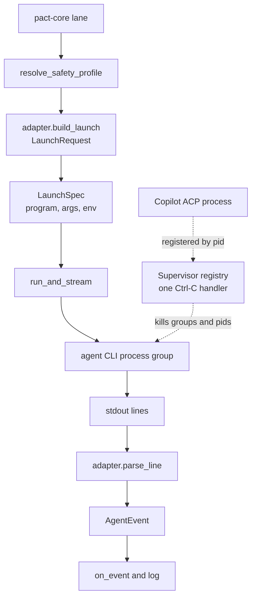

# Agent adapters, safety profiles, models and process supervision

## Current design

`pact-agents` turns one task into one headless agent CLI process and turns that CLI's output into a shared event stream. There are five adapters behind the `AgentAdapter` trait: Claude Code, Copilot CLI, Codex, Gemini and Antigravity (`agy`, #9). Each adapter does two things. `build_command` / `build_launch` produce a `LaunchSpec` (program, args, env), and `parse_line` maps one raw stdout line to zero or more `AgentEvent`s (`Init`, `CoordStatus`, `AssistantText`, `ToolUse`, `Result`, `Other`). Unknown shapes become `Other`, never dropped. `Phase` is the one synthetic variant: `pact-core` emits it around workspace creation, dependency prep and the agent run so a long step is visibly alive (#241).

**Launch.** `LaunchRequest` carries the task, safety, coordination config, workspace, a per-workspace `agent_home`, a pact-assigned `session_id`, the `lean` flag and an optional `model` (#284, #387). `push_model` appends `--model <id>` in every `build_launch`. Lean is the default (`--no-lean` restores the old command line). Copilot lean uses a relocated `COPILOT_HOME` holding only `config.json` and `settings.json`, `--disable-builtin-mcps`, `--no-auto-update` and `--deny-tool` rules for dependency installs and builds (#284). Claude lean adds `--strict-mcp-config`, `--session-id` and a tighter `--allowedTools` list (#288). Copilot is the one adapter with an ACP launch (`copilot --acp`, `build_acp_launch`).

**Safety.** `--safety` is a raw pass-through to each CLI's own vocabulary, plus three portable aliases (`strict`, `workspace-write`, `unrestricted`) that `resolve_safety_profile` maps per agent right before `build_launch` (#161). Defaults: Claude uses a curated `--allowedTools` list that includes `mcp__pact-coord__*` (#103, #104); Copilot always passes `--allow-all-tools` and has no gradient; Codex uses `--dangerously-bypass-approvals-and-sandbox` because no sandbox mode completes writes headlessly; Gemini uses `--approval-mode yolo --skip-trust`; `agy` uses `--dangerously-skip-permissions` plus `--add-dir <workspace>` and a `--mode` override. Coordination MCP config reaches each CLI differently: a JSON file flag (Claude, Copilot), inline `-c` overrides (Codex), `.gemini/settings.json` in the workspace (Gemini), and a process-global `agy mcp add` (Antigravity, racy under concurrent `agy` lanes).

**Run.** `run_and_stream` spawns the agent in its own process group with stdin closed (#184), logs every raw line, and drives `parse_line`. Stdout and stderr are read on detached threads and the loop exits when the direct child exits plus a short grace period, not when the pipe reaches EOF, because a grandchild can hold the pipe open (#237, #253). After exit it kills the group again to sweep survivors. On Windows `windows_shim` resolves `.exe` and npm `.cmd` shims to a direct spawn so `cmd.exe` cannot truncate a multi-line prompt (#210). When an adapter emits no `Result` (Codex), the exit code decides success.

**Supervision.** Every `Supervisor` is a handle on one process-wide registry with one Ctrl-C handler. It tracks child process groups and bare pids (the shared ACP processes), and `kill_everything` kills each whole tree (#366).

**Models.** `--model`, then `--tier` (looked up per agent in `pact.toml` `[tiers]`), then `defaults.model`, then the CLI default. An unknown tier or a tier with no entry for the agent is an error (#387). ACP lanes set the model per session with `session/set_config_option` and reject a model the agent does not offer (#374, #415).

### Superseded decisions

- A new `Supervisor` installed its own Ctrl-C handler per `run_and_stream` call: superseded by #366, one process-wide registry that also holds bare ACP pids.
- Fixing the Windows inherited-pipe hang with a named pipe or `PROC_THREAD_ATTRIBUTE_HANDLE_LIST`: superseded by #253, which stops waiting for pipe EOF and polls the direct child instead.
- Waiting for pipe EOF as the end-of-run signal (#237 as first shipped): superseded by #253.
- Wrapping every Windows spawn in `cmd /C`: superseded by #210, direct spawn through `windows_shim` with `cmd /C` only as a fallback.
- Copilot trimmed with `--disable-mcp-server` flags (measured in #284): superseded within #284 by the per-agent `COPILOT_HOME`.
- Claude lean via `--bare` or `--safe-mode`: rejected in #288 (API key required, disables pact-coord); `--strict-mcp-config` replaced them.
- Codex built from docs with `--ask-for-approval`: superseded by the live-verified bypass flag; `safety_override` is a `--sandbox` value.
- Gemini as the route to Gemini models: superseded by the separate Antigravity adapter (#9); `GeminiAdapter` stays, with only `init` live-verified.
- A requested model forced the process runtime and refused `--runtime acp` (#387): superseded by #374 and #415, which set the model per ACP session.

## History

The sections below are the issue-by-issue record, moved verbatim from
the old single DESIGN.md. Read them for the why; the summary above is
the current design and wins where they disagree. New decisions in this
area go at the end of this file.

### AgentEvent normalization

`AgentEvent` is shared across every adapter (Claude Code, Copilot CLI,
Codex, Gemini), even though each CLI's actual output schema is different --
each adapter's own `parse_line` maps its specific shape onto this enum.
`Other` is a catch-all for anything not explicitly modeled, but it's still
surfaced to callers, never silently dropped: an unrecognized event is far
more likely to be a real message an adapter hasn't been taught about yet
than something safe to ignore.

`CoordStatus` is a separate variant, not bundled into `Init`, because Claude
Code reports every MCP server's status inside its one init event, but
Copilot CLI reports them as their own standalone events, and a line can
report several servers at once. Each adapter's `parse_line` emits zero or
more `CoordStatus` events per line as its own schema demands; the
connectivity check that consumes them (`pact-core`) doesn't need to know
which shape produced them.

### `Phase` events and the end-of-run summary (issue #241)

A real production `spawn-many` run produced **zero output for ~22
minutes** during dependency prep -- indistinguishable, from the
outside, from a hang. On top of that, the run's final output was just
each workspace's raw "done: 
" line, no indication of how long
anything took or whether the shared npm content store had actually
helped.

**`AgentEvent::Phase(String)`** is the one variant in this enum that
doesn't come from an agent CLI's own output at all -- it's synthetic,
emitted directly by `pact-core`'s `spawn_with_supervisor` around each
phase of a single spawn: right before `create_workspace` ("creating
workspace"), right before and after `pact_deps::prepare` ("preparing
dependencies", then a summary of what happened), and right before
`run_and_stream` launches the agent ("running agent"). Printed
unconditionally by the CLI (`[phase] <text>`, or `[label:index] [phase]
<text>` under `spawn-many`) -- deliberately not gated behind
`--verbose`/`should_print_other` the way adapter chatter is, since the
entire point is a visible heartbeat during a phase that would otherwise
produce nothing at all.

This doesn't turn the 22-minute stall itself into fast progress -- that
was issue #233's job (the content-store lock timeout, fixed separately)
-- it turns 22 minutes of silence into "preparing dependencies" staying
on screen the whole time, which is enough to tell a stall from a hang.
A finer-grained live progress bar (bytes downloaded, percent complete)
was considered and left out: `pact_deps::prepare` has no natural
sub-phase hooks to report through without a much larger refactor of
`prepare_npm`'s own internals, and a static "still working on this"
marker already answers the actual complaint (no signal at all) without
that cost.

**The end-of-run summary** (`spawn-many`'s per-workspace listing) now
prints two more lines per successful workspace, both from data that
already existed but was never surfaced here: `duration: Ns` (from
`RunMetadata.started_at`/`ended_at`, issue #12) and `dependencies:
<manager>: <outcome>` (from `ManagerPrepReport`, issue #12/#160's
`store_hit`, via the new `dependency_summary_line` -- distinct from
`dependency_phase_summary` in `pact-core`, which renders the same data
for the *live* phase marker instead of the final listing, slightly
different wording for each context). Both come from data files that
already existed (`pact inspect <id>` could always show this) -- the
fix is presenting them by default at the point a real user is actually
looking, not requiring a second command per workspace after the fact.

**Deliberately not done, per the issue's own proposed direction (d)**:
writing the summary to `meta/` as JSON so it survives a wedged
terminal. `RunMetadata`/`ManagerPrepReport` already persist per-workspace
(exactly this data, just not aggregated into one file) and survive a
wedged terminal today via `pact inspect`/`pact status --json` after the
fact -- a *separate* aggregate summary file would duplicate that
persistence for marginal benefit over querying the existing sidecars,
not attempted here.

### Process group kill

`Supervisor` (below) covers the Ctrl-C path; `kill_if_alive` in `pact-vcs`
(used by `teardown`) covers killing a specific workspace's agent process on
demand -- both need to reach an agent's *whole* process tree, not just the
directly-spawned PID, since a Bash tool call spawns a child shell that a
plain `Child::kill()` leaves running. On Windows, `taskkill /F /T /PID`
terminates the full descendant tree in one call. On Unix,
`pact_agents::run_and_stream` spawns every agent process via
`command_group`'s `group_spawn` (`process_group(0)`), making the child its
own process group leader, so its pgid equals its pid -- meaning the
already-recorded pid alone is enough to kill the whole group via
`kill(-pid, SIGKILL)`, without needing to persist a separate pgid. The Unix
path is implemented from documented POSIX process-group semantics and
`command_group`'s own source, and is CI-verified on real Linux/macOS
runners (`crates/pact-agents/tests/group_kill.rs`, issue #6) -- but a real
agent's own process tree on real Unix hardware remains unconfirmed, since
this project's primary dev environment is Windows.

The Unix test spawns `sh -c "sleep 60 & wait"` as the parent (direct child
of the test process), with the backgrounded `sleep 60` as the grandchild
whose survival is what's actually being checked; it counts survivors with
`pgrep -f "sleep 60"` (matching the full command line, so it finds that
specific backgrounded process, not unrelated `sleep` calls on a shared CI
runner).

### Supervisor

`Supervisor` tracks every live child process group across however many
concurrent `run_and_stream` calls share it, so one process-wide Ctrl-C
handler can kill all of them (registering the whole group, not just the
tracked child -- see "Process group kill" above for why) instead of the
single-shot, one-child assumption `run_and_stream`'s old self-installed
handler made. Single-`spawn` and `spawn-many` both go through a
`Supervisor` now: `spawn` just creates its own with exactly one registrant
for the duration of that one call, so its observable behavior (one
handler, killing one child, installed and torn down within a single
`run_and_stream` call) is unchanged; only the mechanism moved from a bare
function into this small object so `spawn-many` can share one across N
threads.

The Ctrl-C handler recovers a poisoned mutex guard (`unwrap_or_else(|p|
p.into_inner())`) rather than bailing out of the handler: a prior panic
while holding the lock (e.g. inside another thread's own cleanup) must not
make every other live child unkillable on Ctrl-C. A failure to install the
handler at all (e.g. an outer caller already installed one) is logged, not
fatal -- the agent process(es) just won't be killed on Ctrl-C in that case.

That "logged, not fatal" case turned out to be the normal one (issue
#366). `ctrlc` allows one handler per process, and `pact run` creates
several supervisors in one process (the planner's, one per
`spawn_many_in`, one per repair round), so only the first supervisor's
children were reachable; every lane's agent survived a Ctrl-C. The ACP
runtime's shared agent process was never registered anywhere, and
`std::process::exit(130)` runs no destructors, so its `kill_on_drop`
never fired either. Now every `Supervisor` is a handle on one
process-wide registry, created with the handler on first use, and the
registry also holds bare pids (`register_pid`, used for each shared ACP
process from start to shutdown) that the handler kills with their whole
tree. The handler's body is `kill_everything`, tested directly in its
own test binary since sending a real Ctrl-C to a test process would
reach the test runner too. Slots are indices into the shared registry
and are never reused, so a long `pact ui` session accumulates one empty
slot per finished lane; that is a few bytes each.

### Orphaned grandchild cleanup, and a deeper pipe-inheritance root cause (issue #237)

A real production `spawn-many` run found 7 `copilot` processes still
alive after `spawn-many` itself finished and `pact`'s own process had
already exited -- holding the terminal's stdout pipe open, so the
caller's shell never got its prompt back. `Supervisor` covered the
Ctrl-C path (above); there was no equivalent cleanup on the *normal*
exit path at all.

**What shipped:** `run_and_stream` now calls `kill()` on the tracked
`GroupChild` again immediately after `wait()` returns for the direct
agent process -- a no-op in the common case (nothing left to kill), and
a real sweep of any surviving group member when there is. On Windows,
the spawn also opts into `command_group`'s `kill_on_drop(true)` (a Job
Object flag, only exposed on Windows without the crate's `with-tokio`
feature, which pact doesn't enable): the OS itself kills every process
still in the job when the job handle closes, which happens automatically
even if pact's own process exits abruptly (crash, `SIGKILL`) rather than
normally -- a stronger guarantee than anything a userspace `Drop` could
give. Verified fast and real:
`crates/pact-agents/tests/orphan_cleanup.rs`'s
`killing_a_process_group_after_its_primary_already_exited_still_reaches_a_grandchild`
proves the exact call `run_and_stream` makes (`kill()` on a group whose
tracked primary has already exited) still reaches a real grandchild
process, reusing `group_kill.rs`'s proven parent/grandchild command
construction.

**What this does *not* fix, found and verified while building the test
above.** An adversarial test (`fake_parent_with_grandchild`, this
package's second `[[bin]]`) spawns a grandchild with its own stdio
explicitly set to `Stdio::null()`, then exits almost immediately --
modeling a real agent CLI's MCP-server sidecar. On Windows, that
grandchild still inherited pact's own piped stdout **write handle**: 
`std::process::Command`'s Windows implementation sets
`bInheritHandles=true` and duplicates *every* currently-inheritable
handle in the spawning process' table into the child, not just the three
explicitly configured stdio handles -- so the pipe's write end stayed
open in the grandchild's process table even though the grandchild's own
configured stdout was `Stdio::null()`. `run_and_stream`'s read loop
cannot see EOF on that pipe until *every* handle to its write end is
closed, so it blocked for the grandchild's entire remaining lifetime
(confirmed: `run_and_stream` took 120.57s to return against a 119s-
remaining `ping -n 120` grandchild -- not an approximation, the measured
number). By the time the post-wait `kill()` above runs, the grandchild
is already gone on its own; there is nothing left to sweep. This is
**worse** than "an orphan survives after pact exits" (the fix above
targets that) -- it's "pact's own process cannot finish running at all
until the grandchild does," which matches the original report's exact
symptom (the shell never returned a prompt) more precisely than the
orphan-survival framing the issue was originally filed under.

This is a real, previously-undocumented root cause, not a narrow edge
case: it reproduces with the *simplest possible* grandchild (a single
`ping`/`sleep` invocation via plain `std::process::Command`, no shell
tricks), meaning it's the **default** Windows behavior for any
subprocess an agent CLI spawns normally, not something specific to
Copilot's own implementation. `command_group`'s job-object wrapping
isn't the cause -- it spawns via ordinary `std::process::Command::spawn`
(confirmed by reading `command-group`'s own source) and assigns the
result to a job afterward; the handle leak happens one level up, in how
Rust's std itself creates the piped `Stdio` and hands its write end to
the direct child.

**Fixed in issue #253, and not the way this section originally proposed.**
The first idea considered -- replacing the anonymous pipe with a named
pipe opened non-inheritable, or scoping what the direct child inherits via
`PROC_THREAD_ATTRIBUTE_HANDLE_LIST` -- turned out not to actually solve
this on its own: Windows preserves a handle's inheritable flag across
inheritance, so a handle that reaches the agent process still arrives
marked inheritable *inside* the agent's own handle table, and the agent's
own subsequent `CreateProcess` calls (however it spawns its sidecar) can
still hand it down to a grandchild regardless of how carefully pact
scoped the original grant. Actually preventing that would mean pact
performing handle surgery on a process it doesn't own the code of --
spawning the agent suspended, remotely duplicating its stdout handle to a
non-inheritable copy via `DuplicateHandle` across process boundaries, and
patching the still-suspended process's own cached handle value before
resuming its first thread. That's real, documented Win32 capability, but
it leans on internal-layout assumptions (`RTL_USER_PROCESS_PARAMETERS`)
beyond what a small Rust CLI should take on for this.

Instead, the fix accepts that the handle may leak and stops caring: OS
handle security can restrict what the *direct* child receives, but can't
stop that child from re-exposing an already-inherited handle to its own
children, so `run_and_stream` no longer treats "the pipe hit EOF" as the
signal that the run is over. Both stdout and stderr are read on detached
background threads (not joined -- joining would just move the hang from
the main loop into the join call); stdout lines are pushed through an
`mpsc` channel, and the main loop calls `recv_timeout` in a
`CHILD_EXIT_POLL_INTERVAL` (50ms) loop, racing each line against a
non-blocking `Supervisor::try_wait` poll of the *direct* agent process.
The loop exits as soon as that direct child exits, whether or not the
pipe has actually seen EOF -- a lingering grandchild's copy of the write
handle is no longer this process's problem to wait out. The existing
post-wait `kill()` sweep (above) still runs afterward and still reaches
the grandchild in the common case (it's still in the same job/group), so
nothing is left orphaned either.

Verified by turning the adversarial test from a documented limitation
into real regression coverage:
`run_and_stream_returns_promptly_despite_a_windows_grandchild_that_
inherited_the_stdout_pipe` asserts `run_and_stream` now returns in well
under 10 seconds against the same `fake_parent_with_grandchild` (previously
measured at 120.57s), *and* that the grandchild marker process is gone by
the time the function returns -- both the hang and the orphan are covered
by one test.

### run_and_stream

Every raw stdout line is appended to `log_path` as-is (not the
re-serialized `AgentEvent`) so schema drift or fields the parser doesn't
know about yet aren't lost -- then parsed and handed to `on_event`.
`on_pid` is called once, immediately after spawning, so the caller can
persist the PID before this function blocks -- that's what lets a
`teardown` invoked from a different process find and kill a still-running
agent.

stderr is drained on its own thread into the same log file (prefixed
`[stderr] `) rather than left inherited or piped-but-undrained -- either
of those risks interleaved garbage in the terminal or a full-pipe deadlock
if the child writes enough of it.

`parse_line` is adapter-supplied and returns zero or more events for one
raw line, not exactly one, because not every adapter's schema maps one
line to one event: confirmed necessary for Copilot CLI, whose
`assistant.message` events can carry both response text and one or more
tool calls in the same line. Claude Code's schema happens to be
one-event-per-line, but this function doesn't assume that of anyone.

Not every adapter emits an explicit `Result`-shaped event -- Codex's
`turn.completed`, confirmed directly, carries no success/failure signal at
all, so it never produces one. Falling back to `success: false`
unconditionally when none was seen would misreport every successful Codex
run as a failure; the process's own exit code is the honest fallback
signal instead.

### Agent subprocesses get an explicitly closed stdin (issue #184)

The `Command` built here never called `.stdin(...)` at all, meaning every
spawned agent process inherited pact's own stdin handle verbatim -- a
terminal, a pipe, whatever pact's own parent process happened to have.
pact only ever feeds an agent via its task/`-p` argument, never via
stdin, so an inherited, ambiguous handle serves no purpose and risks a
CLI behaving differently than a genuinely headless invocation would.
Found real-agent-verifying the Arbiter Write-fresh redesign (issue #106):
one real `claude -p ...` invocation printed "no stdin data received in
3s, proceeding without it" on stderr and the agent then reported
receiving an apparently-empty task, despite a real, non-empty `-p` value.
Not reproduced on every run, so likely dependent on the parent process's
own stdin state at spawn time rather than deterministic -- but the
underlying gap (stdin never explicitly closed) was real regardless.
`.stdin(Stdio::null())` now makes the "no stdin, ever" contract explicit
instead of leaving it to whatever the parent process happened to have.

### Windows multi-line prompt truncation (issue #210)

From an outside Windows Copilot stress-test report: every agent spawn on
Windows used to be wrapped in `cmd /C <program> <args...>` (the same
rationale as `cmdutil::run`'s Windows `.cmd` shim resolution, see
`pact-deps`'s own section on this) -- but `cmd.exe`'s own command-line
reader treats a raw embedded newline as ending the current line, **no
matter how the argument is quoted**. Confirmed by hand with a harmless
local `.cmd` shim (not a real agent call): a 2-line task prompt through
`cmd /C echoargs -p "<2-line-text>" --output-format json --allow-all-tools`
arrived at the child as exactly `["-p", "<line 1 only>"]` -- both the
rest of the prompt *and every flag after it* silently vanished. Since a
multi-line task prompt is a very common shape (numbered steps,
multi-sentence instructions), this silently dropped `--allow-all-tools`/
`--additional-mcp-config`/`--output-format json` on a real fraction of
Windows spawns, running the child in each CLI's interactive default
instead (burning real API credits) while `cmd /C`'s own exit code 0 still
made pact report `exit_success: true`. Not Copilot-specific: `codex.cmd`
and `gemini.cmd` are the byte-identical npm `cmd-shim` template as
`copilot.cmd` (confirmed by reading all three installed shims directly --
only the final script path differs), and `claude.exe` was wrapped in the
same `cmd /C` unconditionally too -- all 4 adapters were exposed.

**The report's own suggested fix ("modern Rust resolves PATHEXT natively,
just drop the wrapper") is empirically wrong for this project's actual
environment -- verified by hand before considering it, not taken on
faith.** Tested directly on rustc 1.96.1 (well past the claimed Rust
1.60 cutoff): a bare `Command::new("<name>")` for a real `.cmd`-shimmed
program fails outright with `program not found` -- matching this
project's own already-documented finding (`pact-deps` > Windows `.cmd`
shim resolution). Dropping the wrapper as suggested would have been a
straight regression, breaking every Windows spawn rather than fixing the
multi-line case. Also tested and ruled out: pointing `Command::new`
directly at a resolved `.cmd` file path (Rust's own "BatBadBut"
mitigation rejects it: `batch file arguments are invalid`), the
interactive-`cmd.exe` caret-newline line-continuation escape (`^` +
`\n`, doesn't survive `cmd /C`'s re-tokenization), and `%VAR%`-expansion
indirection (same truncation, plus loses quoting).

**What actually works, confirmed by hand:** a genuine native `.exe`
target spawned with no `cmd.exe` in the chain at all preserves an
embedded newline in an argument perfectly, every subsequent flag intact
-- the truncation is 100% specific to `cmd.exe`'s own line-oriented
reparsing, not a fundamental Windows/Rust argv-passing limit. All 3
current `.cmd`-shimmed agents are npm's own standard `cmd-shim` template
verbatim (`... & "%_prog%" "%dp0%\<relative-script>.js" %*`, `%_prog%`
being the shim's own sibling `node.exe` if present, else bare `node` from
PATH) -- the same technique Node's own `cross-spawn` library uses for
this exact class of problem on Windows.

New `pact-agents::windows_shim` (windows-only, `#[cfg(windows)]`)
resolves `program` to a directly-executable target before `cmd.exe` is
ever involved: a real `.exe` found on PATH needs no wrapper at all (fixes
`claude.exe` with zero added complexity); a `.cmd`/`.bat` shim matching
the standard npm template gets parsed for its real interpreter + script,
spawned directly (fixes Copilot/Codex/Gemini). Anything that resolves
neither way falls back to the old `cmd /C` wrapper exactly as before, so
nothing regresses for an unrecognized shape. `process::build_agent_command`
is the single call site, `#[cfg(windows)]`/`#[cfg(not(windows))]` split so
non-Windows platforms are unaffected (unchanged direct `Command::new`).

Verified for real at every layer, not just unit-tested against
synthetic fixtures: the shim parser's tests use the byte-for-byte real
template captured from the actual installed `copilot.cmd`/`codex.cmd`/
`gemini.cmd`; a `#[ignore]`d manual-verification test (`cargo test --
--ignored`) resolves all 4 real installed agent CLIs on this machine and
confirms the resolved interpreter/script actually exist; and a full-stack
proof spawned the real `node.exe` this project's `copilot` resolves to
(via PATH, since this machine's copilot install has no sibling
`node.exe`) against a harmless echo script with a real multi-line
argument plus trailing flags -- all arrived at the child completely
intact, with zero `cmd.exe` involved.

### MCP config format confirmation

`write_mcp_json_config`'s JSON shape was confirmed to work for both Claude
Code's `--mcp-config` and Copilot CLI's `--additional-mcp-config @<path>`
by deliberately pointing both real CLIs at a broken command and observing
a loud, non-silent failure -- not just inferred from documentation.

### Adapter-specific quirks

### Claude Code safety default

`ClaudeCodeAdapter`'s default is `--allowedTools` (a curated safe-operation
allowlist covering file read/write/edit/search plus the VCS and
package-manager commands a coding task actually needs), not
`bypassPermissions` -- confirmed directly that an explicit `--allowedTools`
list makes Claude Code deny an out-of-scope tool call cleanly and
immediately in headless mode, rather than hang waiting for an approval
prompt no TTY can answer. `bypassPermissions` alone was the *documented*
fix for the hang; this is a real, verified safer alternative that isn't
all-or-nothing. The allowlist (`DEFAULT_ALLOWED_TOOLS`) isn't
user-configurable yet (see Known limitations in docs/usage.md) -- the point
for now is proving the mechanism is genuinely safer than the old
bypass-everything default, not claiming this exact list is final.

`--allowedTools` is always passed, harmless alongside an explicit
`--permission-mode` override too (including `bypassPermissions` itself).
`safety_override`, when given, is passed as a raw `--permission-mode`
value; when absent, no `--permission-mode` flag is passed at all --
confirmed that Claude Code's own baseline default mode, combined with the
allowlist, is what produces the clean-deny-not-hang behavior this default
relies on. The MCP config is rendered to a `{"mcpServers": {...}}` JSON
file and passed via `--mcp-config` -- confirmed against the real CLI: a
malformed config is rejected with a loud error before the session starts,
so getting the file wrong is never a silent no-op.

**`--safety plan` isn't a strict workspace-isolation guarantee (issue
#103).** Confirmed by hand during the 2026-07-23 stress-testing campaign:
a real `pact spawn --safety plan` against an edit task correctly left
the target file untouched (plan mode really is read-only for the repo).
But Claude Code's own plan-mode feature separately wrote a real file to
the **host user's** `~/.claude/plans/<generated-slug>.md` -- outside the
isolated `.pact-<repo>/workspaces/<id>` worktree entirely, invisible to
`pact teardown`, never cleaned up. Not something pact's own code causes
or can prevent -- Claude Code CLI's own architecture decides where plan
documents go, apparently always this fixed global location regardless of
cwd -- so the fix here is a documented caveat (CLI help text, README),
not a code change: don't treat `--safety plan` as a guarantee that
*nothing* happens outside the workspace, only that the target repo isn't
edited.

**The coordination MCP tools need their own allowlist entry (issue
#104).** The 2026-07-23 Claude Code stress-testing campaign found that
`DEFAULT_ALLOWED_TOOLS` never included `mcp__pact-coord__*` -- meaning
`claim_files`/`release_files`/`send_message`/`check_messages` were
silently denied by Claude Code's own permission gate on every real,
default-safety spawn, even though the MCP server itself connects and
registers its tools correctly. Confirmed the fix directly, not just
reasoned about it: a real 2-agent `spawn-many` at plain default safety
now completes claim/broadcast/check/claim end-to-end with the correct
conflict detected, zero denials. `mcp__pact-coord__*`'s wildcard syntax
was itself confirmed against a direct `claude --allowedTools "...
mcp__pact-coord__*"` invocation in the exact same default permission
mode this adapter already uses (not `bypassPermissions` -- the
curated-allowlist safety posture didn't need weakening to fix this).

### Claude Code output schema

`parse_line` is modeled directly against real output captured from
`claude -p --output-format stream-json --verbose` (see README), not
secondhand docs. One event in, one event out in every case observed so
far, but it returns a `Vec` to match the shared `AgentAdapter` interface
other adapters need.

`parse_assistant` reports the first recognized content block (text or
tool_use) rather than collecting all of them into a `Vec`, since in
practice Claude Code emits one block per line in stream-json mode.
Anything genuinely mixed falls back to `Other` with the full message
preserved.

**A "wait for X, then Y" task can end its turn before Y happens (issue
#107).** Found incidentally during the 2026-07-23 stress-testing
campaign, while testing process-kill behavior: given a task phrased
exactly that way, Claude Code ran the wait as an async background bash
task and ended its own turn without ever actually waiting for it or
doing `Y` -- its final message honestly described the *plan* ("I'll be
notified when it finishes, and then I'll create done.txt"), not a
completed action. `pact` correctly reported this as `done`, matching the
same established principle as A5/A8 in the campaign's own findings (pact
reports the agent's own completion, not whether the user's goal was
satisfied) -- but there's no continuation mechanism in headless mode, so
`Y` never happens once the process exits. Not a pact bug -- a real,
non-obvious trap in how a headless agent can interact with "wait for X"
phrasing when its own CLI has an async-task capability. Documented as a
task-writing caveat (Known limitations in docs/usage.md), not fixed in code,
since there's no code-level lever to pull here.

### Codex adapter

`CodexAdapter` is live-verified against a real installed `codex`
(codex-cli 0.144.3) -- this was NOT true when the adapter was first
written (built from OpenAI's docs alone, on a machine without Codex
installed), and the docs turned out to be wrong on the exact safety flag.
Fixed and confirmed end-to-end, including a real MCP tool call through
this project's own coordination server, not just a bare launch.

**Safety flag**: the docs described a separate `--ask-for-approval` flag
with `never`/`on-request`/`untrusted` values -- that flag does not exist in
`codex exec --help` for the installed version. What actually works,
confirmed directly: `--sandbox workspace-write` alone still refuses to
write files in non-interactive mode (the agent reports back "approvals are
disabled" and gives up rather than hanging -- a good failure mode, but not
a working one). The only flag that produces a real, completed file write
is `--dangerously-bypass-approvals-and-sandbox`, which -- true to its name
-- skips both approval prompts and sandboxing in one flag, rather than two
independent axes as the docs implied. `safety_override`, if given, is
treated as a `--sandbox` value (`read-only`/`workspace-write`/
`danger-full-access`) instead of the bypass flag -- confirmed that a plain
sandbox mode without the bypass flag still won't let the agent actually
change anything in headless mode, so this is mainly useful for a
deliberately read-only/inspect-only run, not a safer "still gets work
done" middle ground the way Claude Code's `acceptEdits` is.

**MCP config**: passed via inline `-c mcp_servers.<id>.command=`/`-c
mcp_servers.<id>.args=` overrides (confirmed working end-to-end: a real
`claim_files` call through this project's own coordination server returned
the correct JSON) rather than `$CODEX_HOME/config.toml` -- that file also
holds Codex's auth/session state, not just config, so pointing
`CODEX_HOME` at a per-workspace directory would plausibly break headless
login.

**Output schema**: modeled against real output captured from `codex exec
--json` (see README), not secondhand docs -- including a real
tool-call-forcing task and a real MCP tool call, the same standard as the
Claude Code and Copilot CLI adapters. One real gap: unlike Claude Code's
`result.is_error` or Copilot's `result.exitCode`, Codex's `turn.completed`
event carries no success/failure signal at all -- a turn can "complete"
whether or not the requested task actually happened (confirmed: a
file-write task under a sandbox mode that refused the write still produced
a normal `turn.completed`). So this adapter never emits
`AgentEvent::Result` itself; success is determined from the process's
actual exit code instead (see "run_and_stream" above -- this finding is
why that fallback no longer assumes failure by default).

### Gemini adapter

`GeminiAdapter` is built from a real installed `gemini` CLI
(`@google/gemini-cli` 0.50.0, confirmed via `--help` and by actually
running `gemini mcp add` and inspecting the file it wrote), but **not
live-verified against a real authenticated session** -- this environment
has no Gemini API key or Google Cloud auth configured, and `gemini -p
"..."` fails immediately with "Please set an Auth method...". That means
the streaming JSON event schema is inferred from the CLI's own naming
conventions, not captured from real output the way every other adapter's
schema was -- treat it the same way this project treated Codex before it
was installed: real until proven otherwise, not real because it compiles.
See issue #9.

**Safety default**: no confirmed non-hanging alternative exists for this
adapter (unlike Claude Code) -- whether `--approval-mode default` denies
cleanly or hangs in headless mode couldn't be tested without real auth.
`yolo` (auto-accept everything) is the only thing that can be stated with
confidence won't hang, so -- same honest category as Copilot CLI and Codex
-- that's the default, not claimed as a verified safer option.
`safety_override`, if given, is passed as a raw `--approval-mode` value
(`default`/`auto_edit`/`yolo`/`plan`, confirmed from `gemini --help`).

**The untrusted-directory approval downgrade (found on a later
verification pass, issue #9):** `--approval-mode yolo` alone isn't
actually yolo mode -- confirmed directly, running it against a fresh
scratch repo Gemini CLI hadn't seen before printed `Approval mode
overridden to "default" because the current folder is not trusted.` to
stderr *before* even reaching the auth check, then would have hung
waiting for interactive confirmation in a real authenticated session
(the exact hang class this codebase already tracks carefully for Copilot
CLI's `--allow-tool`). `--skip-trust` (confirmed present and doing
exactly this in `gemini --help`'s own text: "Trust the current workspace
for this session") fixes it -- re-run with the flag added, the downgrade
message disappears, leaving only the expected, unrelated auth failure.
`build_command` now always includes `--skip-trust` alongside whatever
`--approval-mode` value is in effect, default or overridden -- an
unattended `pact spawn --agent gemini` has no human available to accept
a trust prompt any more than it has one available to accept a tool-call
confirmation, so both need to be preempted, not just the one that was
originally assumed to matter.

**MCP config**: the one genuinely different mechanism among all four
adapters. Confirmed directly (by running `gemini mcp add --scope project`
and reading the file it produced) that Gemini CLI reads
`.gemini/settings.json`, relative to its *own working directory*,
automatically -- no CLI flag hands it over at all, unlike Claude
Code/Copilot CLI's `--mcp-config`/`--additional-mcp-config` or Codex's
inline `-c` overrides. The file's shape is identical to Claude Code and
Copilot CLI's `{"mcpServers": {...}}` (confirmed: the same
`write_mcp_json_config` helper works unchanged), just written to a fixed
path under `workspace_path` instead of wherever `coord.config_path` says.
No flag is needed to point Gemini at it -- it reads `.gemini/settings.json`
from its cwd automatically, which `run_and_stream` already sets to
`workspace_path` for every adapter.

**Output schema**: modeled on the shape common to the other three
streaming-NDJSON adapters (an init/session event, assistant text,
tool-call events, a final result), using field names guessed from Gemini
CLI's own vocabulary (`-o stream-json`'s wrapper type is unknown, so this
guesses a flat `{"type": ...}` shape like Claude Code's and Codex's).
Deliberately defensive: any line that doesn't parse as JSON, or whose
"type" isn't one of these guesses, surfaces as `Other` rather than being
silently dropped -- exactly because this schema is unverified and *will*
need correcting once run against a real session.

**Partial live verification (2026-07-30, issue #9)**: real auth now
available (Google discontinued the old "Sign in with Google" / Gemini
Code Assist OAuth path for individuals in favor of its new Antigravity
product line -- confirmed directly from the CLI's own failure message,
`This client is no longer supported for Gemini Code Assist for
individuals`; the still-maintained path for headless `gemini` is a plain
AI Studio API key via `GEMINI_API_KEY`), which made a first real
`pact spawn --agent gemini` possible. Confirmed for real: the adapter's
mechanics all work end to end against actual `gemini` output --
`--skip-trust`/`--approval-mode yolo` launch cleanly, a real `{"type":
"init", ...}` event arrives and parses as `AgentEvent::Init` exactly as
coded, and the coordination "never reported a status" warning fires
correctly (expected, since the task never called an MCP tool). One real
schema gap found: `gemini`'s actual output includes a
`{"type":"message","role":"user","content":...}` event (an echo of the
prompt back on the stream) that `parse_line` doesn't explicitly match --
harmless today since the catch-all correctly routes it to `Other`, not a
bug, but worth naming as confirmed real shape rather than still-guessed.

**Still unconfirmed**: every real spawn attempt (three, across two
sessions) hit the AI Studio free-tier key's request quota before
producing a real assistant/tool-call/result event -- `TerminalQuotaError:
You have exhausted your daily quota on this model` with `limit: 20`,
confirming this key's cap is a low fixed per-day count, not the ~1000/day
figure associated with the (now Antigravity-only) OAuth path. That means
the `assistant_message`/`tool_call`/`result` branches of `parse_line` are
still guesses, exactly as before -- only `init` (and the newly-seen,
already-correctly-ignored `message` echo) moved from guessed to
confirmed. Also noted in passing, not yet investigated: `-m
gemini-2.5-flash` was silently not honored -- the quota error reported
`model: gemini-3.5-flash` instead, a model never requested. Re-attempt
once the daily quota resets (or with a paid/billed key) to close the
remaining gap in issue #9.

### Antigravity adapter (issue #9) -- the real, live-verified resolution

`agy`'s own CLI first had to be *found*: registered in the Windows User
PATH registry (`AppData\Local\agy\bin`), but invisible to this session's
own shell processes, which had inherited their environment before that
PATH entry was added -- a stale-inherited-environment issue, not a real
absence, confirmed by reading the registry directly
(`[System.Environment]::GetEnvironmentVariable("Path","User")`) and
invoking the binary by its full resolved path once found.

**A genuinely different tool, not a `gemini`-CLI replacement.** `agy
models` lists Gemini, Claude, and GPT-OSS backends all selectable via
`--model` -- confirming this is Google's own multi-model successor
product (Antigravity), not a wrapper around the standalone `gemini` CLI
above. `GeminiAdapter` (`gemini.rs`) is left as-is, still honestly
labeled unconfirmed for its own remaining gaps -- `AgyAdapter` is a
fifth, separate `AgentKind::Antigravity`, not a repurposing.

**Live-verified end-to-end, not built from `--help` text alone**: a real
`pact spawn --agent agy` against a scratch repo ran a genuine tool-using
task (write a file with specific content) to completion, and the file's
actual on-disk contents were confirmed correct by hand. Real, confirmed
CLI surface: `-p`/`--output-format stream-json`/`--dangerously-skip-
permissions`/`--mode {accept-edits,plan}`, all from a real `agy --help`
and exercised for real, not guessed.

**Two real bugs found and fixed while building this** (both the class
this codebase's "confirm by hand" discipline exists to catch, not
hypothetical edge cases):

1. **`write_to_file` defaults to `agy`'s own internal scratch directory**
   (`~/.gemini/antigravity-cli/scratch/`), ignoring the process's actual
   working directory entirely -- confirmed directly: a first real run's
   output file landed there, not in the pact workspace passed as cwd.
   Would have silently broken the entire per-workspace isolation model
   (an agent editing files outside its own worktree) if shipped
   unverified. `--add-dir <workspace_path>` fixes it, confirmed by a
   second real run landing the file correctly inside the workspace.
   `build_command` now always includes it.
2. **`conversation_id` sits at the `step_update` event's top level**, a
   sibling of `"init"`, not nested inside it -- a first guess (pattern-
   matched against the nesting shape the other adapters happen to use)
   put it under `"init"` instead, and a real spawn's `[init] session`
   line printed empty until corrected against the actual raw log.
   Related, found in the same log: a real tool call fires *two*
   `step_update`s for one invocation (`state: "ACTIVE"` then `"DONE"`,
   same `tool_name`/`tool_info` both times) -- only `ACTIVE` is now
   surfaced as a `ToolUse`; the `DONE` duplicate is dropped, or every
   real tool call prints twice in the live CLI view (confirmed: it did,
   before this fix).

**MCP config is process-global, a real structural difference from every
other adapter, not a workaround needed.** `agy mcp add <name> <command>
[args...]` writes to one `~/.gemini/config/mcp_config.json` shared by
*every* `agy` invocation on the machine -- confirmed by adding a test
entry via `agy mcp add` and finding where it actually landed (`grep -rl`
across likely directories, since it's not documented). Unlike Claude
Code/Copilot CLI (`--mcp-config <path>`/`--additional-mcp-config @<path>`
per spawn), Codex (inline `-c` overrides), or even the standalone
`gemini` CLI (a fixed path, but still scoped per working directory),
there is no per-invocation config mechanism at all. `build_command`
calls `agy mcp add pact-coord <coord.command> <coord.args...>`
synchronously before returning, re-registering (`agy mcp add` is
documented as "add or update," confirmed by hand) this workspace's own
`pact mcp-serve` invocation under the fixed name `pact-coord` -- correct
for one `agy` spawn running at a time, but a real, disclosed
race under true concurrency: two or more simultaneous `agy` spawns each
overwrite the same global registration, and which workspace's
coordination server a given `agy` process actually ends up talking to
depends on registration timing, not which workspace it's running in.
Not hidden -- flagged in docs/usage.md's Known limitations, and
`spawn-many --agent agy` with more than one concurrent task should be
treated as unsafe for coordination until Antigravity ships a
per-invocation config mechanism of its own.

**No coordination-status event observed at all** in a real spawn's raw
log (unlike Claude Code/Copilot's explicit `mcp_servers_loaded`-style
events) -- `pact` falls into the same "never reported a status" honest
warning path already built for Codex, not a new gap this adapter
introduced.

**Cost**: Antigravity's own account banner reads "Starter Quota," not a
per-token price -- `adapter_rate` (`spawn-many --dry-run --estimate-cost`)
treats it as quota-bounded like Copilot's flat-rate plans, not confirmed
against a published per-token rate the way Claude/Codex/Gemini are.

### Copilot CLI safety default

Unlike Claude Code, no confirmed non-hanging alternative to
`--allow-all-tools` exists yet (see the README and issue #2's
investigation): `--allow-tool` works for in-scope actions, but a task
needing a tool outside that list hangs (confirmed directly, 50s/zero
output) rather than denying cleanly the way Claude Code's `--allowedTools`
does. Until that's investigated further, `--allow-all-tools` stays the
only working default -- stated plainly in
`default_safety_description` rather than implying parity with Claude
Code's safer one. It also has no gradient (unlike Claude Code's six
permission modes): Copilot CLI's own `--help` states it's "required for
non-interactive mode", so `build_command`'s `safety_override` parameter
has nothing meaningful to override here.

### Copilot CLI output schema

`copilot.rs`'s `parse_line` is modeled directly against real output
captured from `copilot -p ... --output-format json` (see README),
including a real tool-call-forcing task to confirm `toolRequests`' field
names -- `name`/`arguments`, not Claude Code's `name`/`input`. Unlike
Claude Code (one content block per line), Copilot CLI can bundle response
text *and* one or more tool calls into a single `assistant.message` event
-- confirmed directly: a file-writing task produced one line with
non-empty `content` alongside a non-empty `toolRequests` array. Returning
a `Vec` from `parse_line` is what makes that safe to represent without
dropping either half. The MCP config passed via `--additional-mcp-config
@<path>` is the same `{"mcpServers": {...}}` shape Claude Code uses
(confirmed identical) -- the `@` prefix means "load from file" per Copilot
CLI's own docs; without it the argument would be parsed as an inline JSON
string instead.

### Safety profiles (issue #161)

From an outside code review (2026-07-24, triage discussion): `--safety`
was a raw pass-through to whatever vocabulary the specific agent CLI
uses -- Claude Code's `--permission-mode`, Codex's `--sandbox`, Gemini's
`--approval-mode`, and Copilot ignoring it entirely (no gradient). A user
wanting "the safest sane setting for unattended use" across agents
needed to know all four vocabularies. Resolved direction from that
discussion: add three pact-level profile names as **aliases** layered on
top of the existing raw pass-through, never a replacement -- any other
value (`acceptEdits`, `read-only`, ...) keeps flowing through to
`build_command` completely unchanged.

`pact_agents::resolve_safety_profile(agent, safety)` is the single
resolution point, called right before each of the three places that
already call `adapter.build_command` (`spawn_preview`,
`spawn_with_supervisor`, Arbiter's `attempt_arbiter_resolution`) --
deliberately *not* resolved once at the CLI layer, since `spawn-many`
shares one `--safety` string across a batch that can mix agent kinds;
resolving per-adapter right where the agent is already known handles a
mixed-agent batch correctly for free, with no CLI-layer change needed at
all beyond documenting the three names in `--help`.

Mapping, confirmed by hand via free `--dry-run` previews across all four
adapters (no real agent spend needed to verify a resolved command
string):

| profile | Claude Code | Codex | Gemini | Copilot |
|---|---|---|---|---|
| `strict` | `--permission-mode plan` | `--sandbox read-only` | `--approval-mode plan` | `--allow-all-tools` (unchanged) |
| `workspace-write` | *(no flag -- pact's existing curated-allowlist default)* | `--sandbox workspace-write` | `--approval-mode auto_edit` | `--allow-all-tools` (unchanged) |
| `unrestricted` | `--permission-mode bypassPermissions` | *(no flag -- pact's existing full-bypass default)* | *(no flag -- pact's existing yolo default)* | `--allow-all-tools` (unchanged) |

Two deliberate non-uniformities, not oversights:

- **Codex's `workspace-write` doesn't currently get real work done.**
  Confirmed by hand (see "Codex adapter" above): even a plain `--sandbox
  workspace-write`, without the bypass flag, still refuses to write
  files in headless mode -- the agent reports "approvals are disabled"
  and gives up. `workspace-write` here is faithfully a deliberately
  read-only/inspect-only run for Codex today, not a safer "still gets
  work done" middle ground -- that's Codex's own current CLI
  limitation, not something this aliasing layer can paper over.
- **Codex's and Gemini's `unrestricted` is the same as their existing
  default**, and **Copilot's three profiles all resolve to the same
  no-op.** Both are honest, not lazy: pact's existing defaults for
  Codex/Gemini are already the only mode confirmed to complete real
  headless work at all (no safer alias exists to offer instead, per each
  adapter's own DESIGN.md section), and Copilot's CLI genuinely offers
  no distinct restricted mode through this adapter to alias in the first
  place.

The "explicit safety override" warning (`spawn`/`spawn-many`) shows what
a profile name actually resolves to for the chosen agent (e.g. `strict
-> plan`), since that mapping isn't obvious from the profile name alone
-- a raw, non-profile value still just echoes back unchanged.

### Copilot lean profile (issue #284)

Every `copilot -p` pact spawned inherited the user's whole `COPILOT_HOME`:
seven user-level MCP servers on the owner's machine (three of them
Playwright/Chrome bridges), the built-in `github-mcp-server`, an
auto-update check, and the shared `permissions-config.json` and session
store. Measured 2026-09-29/30 with Copilot CLI 1.0.89 on the same trivial
prompt:

| Launch | Wall | Peak process-tree RSS |
|---|---|---|
| user's `COPILOT_HOME` | 57.0 s | 1,372 MB |
| `--disable-mcp-server` x7 `--disable-builtin-mcps` | 9.0 s | 461 MB |
| per-agent `COPILOT_HOME` = {`config.json`, empty `mcp-config.json`} | 6.3 s | 326 MB |
| fresh `COPILOT_HOME` with no `config.json` | fails | "no authenticated GitHub host available" |

End to end through pact against a real Next.js repo (worktree + linked
`node_modules` + a real model call + result): 11.7 s lean versus 81.0 s
with `--no-lean`.

The last table row is the load-bearing fact: Copilot's *login pointer*
(`loggedInUsers`/`lastLoggedInUser`) lives in `config.json`, while the
token itself lives in the OS credential store, so copying `config.json`
alone authenticates a fresh home and copies no secret. `settings.json`
is copied too, because it carries the user's default model (dropping it
would silently change which model runs). Not copied, deliberately:
`mcp-config.json` (the whole point), `permissions-config.json` and the
session store (isolating them per agent is what avoids the concurrent
overwrite race in github/copilot-cli#3563), and the user's global
`copilot-instructions.md` (it describes the *user's* workflow, including
pushing and opening PRs, which a worker must not do; the repo's own
`.github/copilot-instructions.md` still loads from the worktree). The
per-agent home lives at `<state>/homes/<id>`, so `pact teardown`'s state
directory is still the one place everything about a workspace lives.

If the user's `config.json` cannot be found, the launch falls back to
the user's own home with a warning rather than failing: a slow start is
recoverable, a refused spawn is not.

`--disable-builtin-mcps`, `--no-auto-update`, and `--session-id <uuid>`
go on the command line; the uuid is persisted on the workspace before
launch (and in the run metadata after) so a follow-up can resume that
exact conversation. The `--deny-tool` rules are the enforcement half of
issue #283's link mode and of the "agents edit, one verifier verifies"
split the owner chose on 2026-09-29: dependency mutation (`npm install`
and friends across npm/pnpm/yarn/bun) would write into a linked, shared
`node_modules`; `npm run build`/`next build`/`next dev` and their
pnpm/yarn spellings are the memory-heaviest thing an editor workspace can
do (`next build` peaks at 1.9 GB) and Turbopack refuses a linked
`node_modules` anyway. Confirmed by hand before relying on it: a denied
command produces `tool.execution_complete` with `error.code = "denied"`
and the agent adapts, no hang -- the hang this file documents under
"Copilot CLI safety default" is for a command with *no* matching
`--allow-tool` rule, which is a different mechanism from an explicit
deny. `shell(npm install:*)` matches the bare `npm install` as well.

What the lean profile does *not* fix: `pact-coord` itself fails to
connect under Copilot CLI 1.0.89 regardless of profile (issue #291,
`rmcp` rejects Copilot's pre-`initialized` `server/discover` request),
and `--no-lean` reproduces the pre-#284 command line exactly for anyone
who needs their user-level MCP servers in a worker.

### Claude lean profile (issue #288)

Same problem, different CLI: every `claude -p` pact spawned loaded the
user's 9 MCP servers (Playwright/Chrome bridges, claude.ai connectors)
plus hooks, skills, plugins, and auto-memory. Measured 2026-09-29/30,
Claude Code 2.1.284, haiku, trivial prompt:

| Launch | To `init` | Wall | Cost | Peak RSS (real read task) |
|---|---|---|---|---|
| default config | 14-19 s | 25 s | $0.041 | 986 MB |
| `--strict-mcp-config` + pact-coord config | 6.0 s | 13 s | $0.037 | 423 MB |
| `--safe-mode` | 3.0 s | 7.5 s | $0.012 | |
| `--bare` | 2 s | fails "Not logged in" | | |

Through pact against the real Next.js repo (worktree + linked deps + a
real Opus call): 15.6 s with `pact-coord: connected`.

Three options were tried by hand before choosing. `--bare` is the
fastest and is what Anthropic recommends for scripted use, but it
requires an API key and the owner authenticates with OAuth, so it fails
outright. `--safe-mode` keeps OAuth and is fastest after that, but it
disables *every* MCP server, pact's own coordination server included
(confirmed: `mcp=[]` even with an explicit `--mcp-config`), and drops
CLAUDE.md, hooks, and skills. `--strict-mcp-config` drops only MCP
servers not named in `--mcp-config`, so pact-coord still connects
(confirmed, `status: connected`) and the repo's CLAUDE.md still loads.
Since coordination is on by default today, the lean profile uses
`--strict-mcp-config`; `--safe-mode` (with CLAUDE.md re-injected via
`--append-system-prompt-file`) is the next step once coordination
becomes opt-in, worth another ~5 s and two thirds of the per-call cost.

The allowlist is tightened rather than a deny list added, because under
`-p` an out-of-allowlist Bash command is denied cleanly (see "Claude
Code safety default"). The blanket `Bash(npm *)`/`Bash(pnpm *)`/`Bash(yarn
*)` entries, which allowed `npm install` into a linked `node_modules`
(issue #283) and full `npm run build`s, are replaced by the JavaScript
commands an editor workspace needs: `node`, `npx tsc`, `npx vitest`, `npx
eslint`, `npx prettier`, `npm test`, `npm run lint/test/typecheck`, `npm
ls`, `npm view`. Other ecosystems keep their blanket entries; their
dependencies are not linked.

`--session-id <uuid>` is passed and persisted the same way as for
Copilot (verified by hand that a second process can `--resume` it with
full context). Unlike Copilot there is nothing to relocate: Claude's
per-project state under `~/.claude/projects/` is keyed by worktree path
already, so each workspace gets its own transcript directory for free
(anthropics/claude-code#34437 complains about exactly that
fragmentation; for pact it is the desired behavior). Pre-writing
`hasTrustDialogAccepted` into `~/.claude.json` was considered and
rejected: `-p` skips the trust dialog anyway, and that file is already
known to corrupt under concurrent instances (anthropics/claude-code#28847),
so pact must not add another writer.

### Model selection and tiers (issue #387)

Every lane used to run on the CLI's default model, which for most users
is the top-priced one. The audit in #386 measured that the cheapest lever
for running many agents is the model mix, so model choice is a launch
parameter, not an adapter feature: `LaunchRequest::model`, appended as
`--model <id>` by `push_model` inside every `build_launch` (the default
and both overrides), because all five CLIs spell the flag the same way.
A per-adapter hook was not added; one CLI that diverges can override
`build_launch` the way Claude and Copilot already do.

Tiers live in `pact.toml` rather than in pact, because model availability
is plan-specific (#385: a ChatGPT-backed Codex login rejects some
models, Copilot rejects others), and a tier maps per agent so one
`--tier chore` works for a mixed batch. Resolution is `--model`, then
`--tier`, then `defaults.model`, then the CLI default. A tier that is
unknown or lacks the task's agent fails the command: falling back to the
CLI default would silently run at the price the user was trying to avoid.

ACP lanes share one agent process per agent kind, so a model is a
per-session setting there (`session/set_config_option`), not a launch
flag. Until #374 a requested model turned `--runtime auto` into
`process` and refused `--runtime acp`. That fallback hid a cost of its
own (issue #415): `pact run --tier cheap` silently became the
process runtime, with three times the per-lane memory reserve and so
far fewer planned units, the configuration the benchmark shows losing.

### PATH order for shim resolution (issue #445)

`windows_shim::resolve_in` looked for `<program>.exe` in every PATH
directory before it looked for any `.cmd`, so on a machine with VS
Code's `bin\copilot-shim\copilot.exe` later on PATH than npm's
`copilot.cmd`, pact launched VS Code's shim. That shim forwards to the
npm `.cmd` and refuses an argument holding a newline
("UnsupportedWindowsCommandValue"), which every process-lane prompt has,
so every Copilot process lane (`pact fleet`, `pact ui`, `--runtime
process`) exited with code 1 in about a second. ACP lanes escaped only
because `--acp` arguments hold no newline. Resolution now follows
Windows: PATH directories in order, `.exe` before `.cmd` and `.bat`
within one directory. Found in a live `pact fleet` run against Copilot
CLI 1.0.114; the same fleet then ran to completion.

### Every adapter against its current CLI (2026-11-18)

One small `pact fleet` task per agent on a scratch Python repo, Windows,
after #446, #448 and #450:

| agent | CLI | result | time | notes |
|---|---|---|---|---|
| Copilot (process) | 1.0.114 | done, report read | 19 to 27 s | needed #446 (PATH order) and #448 (final message); usage recorded |
| Copilot (ACP) | 1.0.106 to 1.0.114 | done | 9 to 11 s per lane | model selection, `locations`, repair routing checked (run-planner.md) |
| Claude Code | 2.1.328 | done, report read | 30 to 33 s | no raw noise; cost recorded after #455 |
| Codex | 0.144.3 | done, report read | 280 s | `item.started` and turn events printed raw until #457; made no pact-coord calls, so the warning is accurate |
| Antigravity (`agy`) | 1.5.3 | done | 68 s | no raw noise |

Gemini CLI (0.57.0) was not run: no API key or OAuth is configured here,
the same gap as before.
