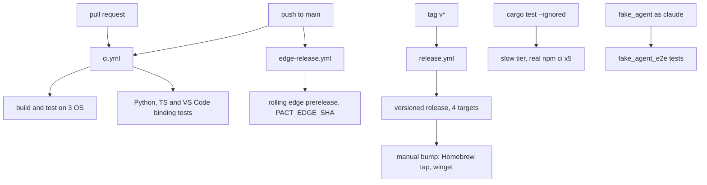

# CI, release channels, packaging and the test infrastructure

## Current design

Three GitHub workflows, one test harness and two package-manager listings make up the delivery side.

- **`ci.yml`** (push to `main` and every PR): on ubuntu, macOS and Windows, `cargo build --workspace` and `cargo test --workspace`; the `pact-coord` Python binding tests and the TypeScript binding tests (both against a release `pact-cli` build); and the VS Code extension build and unit tests. The `#[ignore]`d slow tier does not run here.
- **`release.yml`** (a pushed `v*` tag): builds `pact` for x86_64 Windows, x86_64 Linux, x86_64 macOS and aarch64 macOS and publishes the versioned release. There is no Linux aarch64 build. Cut manually, when a headline feature merges.
- **`edge-release.yml`** (every push to `main` and manual dispatch): same four targets, builds with `PACT_EDGE_SHA` set, force-moves the `edge` tag and republishes one rolling prerelease; `cancel-in-progress` keeps overlapping pushes from colliding. It is additive and leaves `release.yml` alone.
- **Version string** (#86): `pact-cli/build.rs` turns `PACT_EDGE_SHA` into `PACT_VERSION`, so an edge build reports `<version>-edge.<short sha>` and a tagged build reports the plain Cargo version.
- **Packaging** (#125, #126): the Homebrew personal tap `zekariasasaminew/homebrew-pact` and the winget manifest `zekariasasaminew.pact` (PR microsoft/winget-pkgs#407420) both pin v0.3.0 and are bumped by hand per release. Neither was live-verified with a real `brew install` or `winget install`. The winget PR needs the account owner to sign the Microsoft CLA.

Tests and the test environment:
- **Fake agent harness** (#157): `crates/pact-cli/src/bin/fake_agent.rs` impersonates Claude Code. Its `-p` argument is a JSON script (`writes`, `sleep_ms`, `summary`, `success`, `exit_code`) and it prints real `stream-json`. Tests in `fake_agent_e2e.rs` copy it onto a scratch `PATH` as `claude` and run the real `pact` binary, so spawn, stream, parse, commit, merge and teardown run for real at no cost. Tests never launch a real agent CLI. Arbiter round-trip scenarios through the fake agent are not covered.
- **Slow tier** (#240): `tests/slow_integration.rs` is `#[ignore]`d and run explicitly (`cargo test --ignored`) or on a schedule. It runs 5 concurrent `spawn-many` tasks each doing a real `npm ci` against one global npm cache, then a `--require-passing-tests` gate. Rule of thumb: a fixture of `true` or `false` tests plumbing, not the feature.
- **State directory cleanup** (#225, building on #195): `WorkspaceManager::open` creates a sibling `.pact-<repo-name>` directory, so every test `cleanup()` must also remove `WorkspaceManager::state_dir_for(root)`.
- **Build footprint** (#384): workspace `[profile.dev]` uses `debug = "line-tables-only"` and dependencies use `debug = false`; incremental compilation stays on. Measured 5.21 GiB to 2.12 GiB on a clean test build. Nothing deletes build output automatically; `cargo clean` is documented in CONTRIBUTING.md, and `CARGO_PROFILE_DEV_DEBUG=true` restores full debug info for a debugger session.

### Superseded decisions

- `store_hit` computed by a separate unlocked `entry_exists` check, fixed in #240 by returning a populated-now flag from `populate_if_absent`: both removed by #233, which deleted the content store in favor of npm's own global cache. The slow tier test now asserts that all 5 concurrent `npm ci` runs succeed.
- The slow test's content-store name was renamed to `five_concurrent_tasks_each_run_a_real_npm_ci_under_real_contention` once the store was gone (#233).
- Releases only on a `v*` tag: supplemented, not replaced, by the rolling `edge` prerelease. `cargo-dist` and raw CI artifacts were considered and rejected.
- The #195 fix patched only `demo::run`'s cleanup; the test suite's own leak (about 5800 directories) was fixed separately in #225.
- Homebrew and winget automated bumps (WinGet Releaser, a tap workflow) are noted as follow-ups, not built.

## History

The sections below are the issue-by-issue record, moved verbatim from
the old single DESIGN.md. Read them for the why; the summary above is
the current design and wins where they disagree. New decisions in this
area go at the end of this file.

### winget manifest (issue #126)

Unlike Homebrew, winget has no "personal tap" equivalent -- the only
distribution path is a manifest submitted as a PR to the single, official,
Microsoft-owned `microsoft/winget-pkgs` repo. Submitted directly (user's
explicit authorization), not held for review first: PR
[microsoft/winget-pkgs#407420](https://github.com/microsoft/winget-pkgs/pull/407420).

Package identifier `zekariasasaminew.pact`, manifest schema 1.12.0 (the
version several real, recently-merged manifests in that repo are
currently on -- checked directly rather than assuming an older schema
version was still current). `InstallerType: zip` +
`NestedInstallerType: portable` matches how pact's own release workflow
actually packages the Windows binary (a bare `pact.exe` inside a `.zip`,
no real installer) -- modeled closely on `ajeetdsouza/zoxide`'s manifest,
a real merged package with the same zip+portable-exe distribution shape,
rather than guessing the schema from documentation alone.

**Not live-verified with a real `winget validate`/`winget install`** -- no
Windows Package Manager client available to run either command in this
environment. Verified instead by: validating the YAML parses cleanly
with Python's `yaml.safe_load`, and comparing field-by-field against
`ajeetdsouza.zoxide`'s real manifest (fetched directly from
`microsoft/winget-pkgs` via the GitHub API, not from memory/assumption).
Disclosed honestly in the PR's own checklist rather than checking boxes
that weren't actually done.

**The CLA check is the one step genuinely outside this session's
control** -- `microsoft/winget-pkgs` requires a signed Contributor
License Agreement before a PR can be reviewed/merged, and that's a legal
agreement only the account owner can sign (via the CLA bot's own comment
on the PR), not something completable on the user's behalf.

Same manual-per-release-bump caveat as the Homebrew tap: this manifest is
pinned to v0.3.0 and needs a new PR (or an update to this one) for every
future release -- an automated bump (winget has its own "WinGet Releaser"
GitHub Action several other projects use, visible in `ajeetdsouza/zoxide`'s
own manifest commit messages) is a reasonable follow-up, not built here.

### Homebrew tap (issue #125)

From an outside adoption/UX review: package-manager distribution turns a
5-step manual download into a 1-command install. Published as a
**personal tap** (`zekariasasaminew/homebrew-pact`, a separate repo, not
this one) rather than submitting to homebrew-core -- core has real
notability requirements and a review process; a personal tap needs
neither and is fully within this project's own control to publish and
update.

The formula (`Formula/pact.rb` in that repo) pins a specific tagged
release (`v0.3.0` at time of writing) with per-platform `url`/`sha256`
pairs -- the `sha256` values came directly from `gh release view
v0.3.0 --json assets --jq '.assets[].digest'`, GitHub's own
server-computed digest of each uploaded asset, not a locally-recomputed
hash, since that's the authoritative value and avoids a transcription
error in a hash that would otherwise just fail installs silently for
real users. No Linux `aarch64` asset exists yet (matches
`release.yml`'s current build matrix), so the formula only covers
`x86_64` Linux plus both macOS architectures and doesn't claim more
platform support than pact's own releases actually build for.

**Not live-verified against a real `brew install`** -- this development
environment has no macOS/Linux Homebrew install available. Ruby itself
also isn't installed here (no admin rights to add it via Chocolatey in
this sandbox), so the formula's syntax was verified only by hand (brace/
`do`/`end` balance) against the extremely standard, mechanical shape
every Homebrew formula follows -- not by an actual `ruby -c` parse or
`brew audit`/`brew install --build-from-source`. Worth a real
verification pass on real Mac/Linux hardware before treating this as
fully confirmed working, same "implemented, not live-verified" posture
this project already applies elsewhere (Gemini adapter, Arbiter's live
path) when a real dependency isn't available in this environment.

Per-release maintenance is a manual step for now (bump `version`/`url`/
`sha256` in the tap repo after cutting a new pact release) -- an
automated bump (e.g. a workflow in the tap repo triggered by pact's own
`release.yml`) is a reasonable follow-up, not built as part of this pass.

### Fake-agent end-to-end harness (issue #157)

Every existing agent-invoking test stubs the agent out entirely --
`ArbiterResolver`'s closure in `pact-vcs`'s tests never spawns a process,
and `pact-core`'s own tests inject a fake resolver the same way. That
leaves the real `spawn -> stream stdout -> AgentAdapter::parse_line ->
commit -> merge/conflict -> teardown` loop, including the actual
process-spawning code in `pact_agents::run_and_stream`, unexercised by
anything short of a real (paid, potentially flaky) agent CLI call --
which `CLAUDE.md` rules out for tests outright.

`crates/pact-cli/src/bin/fake_agent.rs` is a second `[[bin]]` in the
`pact-cli` package (auto-discovered from `src/bin/`, no `Cargo.toml`
change needed -- and the only way `CARGO_BIN_EXE_fake_agent` is reliably
available to `pact-cli`'s own integration tests, since Cargo only
guarantees that env var to tests in the *same* package as the binary).
It impersonates the Claude Code adapter specifically (the only one of
the four this binary stands in for -- "1-2 fake agents, not all four
adapters," matching the issue's v1 scope): it reads its `-p` argument as
a JSON `Script` (`{"writes": {...}, "sleep_ms": _, "summary": _,
"success": _, "exit_code": _}`, all fields optional) instead of a
natural-language instruction, performs the scripted file writes relative
to its CWD (the real worktree `run_and_stream` launches it in), sleeps
if asked, and prints Claude Code's real `stream-json` schema (`system`/
`init` then `result`) so `claude_code::parse_line` parses it exactly as
it would genuine output. `parse_script` also tries extracting the first
`{...}` substring before giving up to a no-op default -- Arbiter wraps a
workspace's original task text inside a larger natural-language prompt,
so the raw `-p` value isn't pure JSON in that path.

Tests in `crates/pact-cli/tests/fake_agent_e2e.rs` copy the compiled
`fake_agent` binary onto a scratch `PATH` entry as `claude`/`claude.exe`
(`shim_dir`), then run the real `pact` binary
(`env!("CARGO_BIN_EXE_pact")`) with `--agent claude` against a real
throwaway git repo -- so `spawn`/`spawn-many`/`merge-all`/`teardown` all
run through their actual code paths, just with a scripted, free,
instant "agent" on the other end of the pipe. This is the harness that
caught issue #178 (`list_workspaces` crashing on `-deps.json`/`-run.json`
sidecar files) -- the first test to drive a real `spawn -> list` round
trip, something no closure-stubbed test could have exercised.

**Regression coverage backfilled after the fact**: at the time #178 was
found and fixed, the harness itself didn't yet have a dedicated test for
the exact scenario that caught it -- a real `spawn` that goes through
real dependency prep (writing the `-deps.json` sidecar), followed by a
real `list`. `spawn_through_real_dependency_prep_then_list_does_not_crash`
closes that gap: a zero-dependency `package.json` with no lockfile
(the "plain-install-no-lockfile" prep strategy -- a real, instant,
no-network `npm install --no-package-lock`) is enough to reproduce the
exact conditions #178 needed, without needing a real network-dependent
install.

**Deliberately out of scope for this pass**: Arbiter-specific e2e
scenarios (a fake agent invoked *as* the conflict resolver, verifying
Arbiter's own prompt-wrapping and scope-enforcement against a real
subprocess round trip). Scripting a fake agent to produce a distinct
"correct resolution" versus the original conflicting edit, through
Arbiter's prompt-wrapping of the task text, adds enough complexity to
warrant its own follow-up rather than folding it into this harness's
first pass -- `ArbiterResolver`'s closure-based unit/integration tests
already cover Arbiter's decision logic; what's missing here is only the
real-subprocess round trip, which is lower-value for Arbiter
specifically since its prompt construction (not its process-spawning) is
where most of its bugs have actually been.

### Slow integration tier (issue #240)

A real production report's method-level critique, not a single bug:
`require_passing_tests` was covered only by `true`/`false` fixtures that
never needed a dependency (couldn't have caught #232's "gate can't even
run" bug by construction); `store.rs` had no test exercising real
concurrent population; nothing asserted N `spawn-many` tasks produce N
workspaces under *real* contention rather than a fast/synthetic
approximation of it. "If a test's fixture command is `true` or `false`,
it's testing the plumbing, not the feature" -- verified true of this
project's suite before this section existed.

`crates/pact-cli/tests/slow_integration.rs` is the first entry in a
deliberately separate, `#[ignore]`d tier -- not part of default `cargo
test --workspace`, run explicitly (`cargo test --ignored` or `--
--include-ignored`) or on a schedule, since a real `npm ci` and 5-way
real concurrency cost real wall time CI shouldn't pay on every push.
Its one test exercises the exact combination the original report hit:
5 concurrent `spawn-many` tasks against a repo with a real (zero-dependency,
no-network) npm lockfile, then a dependency-requiring `--require-passing-
tests` gate -- covering #230 (count fidelity under real `git worktree
add` contention), #233 (each task's real `npm ci` succeeding under real
concurrent contention), and #232 (the gate's environment-vs-code
diagnosis) together, not simulated separately.

**This tier caught a real bug on its first run, which is the whole
point of it existing.** `prepare_npm` computed `store_hit` via a
separate `ContentStore::entry_exists` check made *before* calling
`populate_if_absent`, with no lock held for that check. Under the fake-agent
harness's fast synthetic concurrency this never showed up (threads never
raced tightly enough), but real concurrent processes hitting a real,
slower `npm ci` did: all 5 concurrent tasks observed the unlocked
pre-check as "doesn't exist yet" before any of them finished populating,
so all 5 reported `store_hit: false` -- even though `populate_if_absent`'s
own locking was already correct and only one `npm ci` actually ran.
Fixed by moving the hit/miss determination *inside* `populate_if_absent`'s
lock, at the exact point `entry.exists()` is authoritative: it now
returns `(PathBuf, bool)`, the `bool` meaning "this call performed a
fresh populate." `prepare_npm` derives `store_hit` from that instead of
a separate racy check. The fast, synthetic `populate_if_absent_reuses_a_
slow_populate_instead_of_duplicating_it` unit test (issue #233) was
strengthened to assert exactly one of 4 concurrent callers reports
`populated_now: true`, so this specific race has fast, deterministic
regression coverage too -- the slow tier found it, a fast test now
guards it.

**Both `store_hit` and `populate_if_absent` are gone now** -- issue #233
later deleted the whole content store this race lived in, in favor of
npm's own global cache (see "Content store removed in favor of npm's own
cache" under pact-deps). The paragraph above is kept as history: real
concurrency finding a real bug that fast synthetic tests couldn't, which
is what justified this tier existing in the first place, independent of
whether the specific subsystem it found the bug in survived.
`five_concurrent_tasks_each_run_a_real_npm_ci_under_real_contention`
(renamed from a "content store" name that no longer fit) now asserts the
simpler post-#233 property directly: all 5 concurrent tasks' `npm ci`
report `success: true` under real contention against one shared global
cache, no pact-side lock involved at all.

### Test suite's own state-directory leak (issue #225)

Found by accident while checking scratch directories during an
unrelated session: `WorkspaceManager::open` unconditionally creates the
sibling `.pact-<repo-name>` state directory (`locks/`, `meta/`,
`workspaces/`) the moment it's called, regardless of whether a
workspace is ever actually created in it. Every integration test that
calls `open` directly, or runs the real `pact` binary (which calls it
internally), leaked one of these on every run unless its own
`cleanup()` helper explicitly removed it too -- confirmed by counting
**~5800** leaked directories accumulated in `%TEMP%` from this
project's own test runs over the prior three weeks.

Same root cause class as issue #195 (`pact demo` leaking its state
dir), but broader: #195's fix only patched `demo::run`'s own cleanup
path, never the test suite's 15 separate `cleanup()` helpers (this
codebase doesn't share a common test-utils module -- each integration
test file is self-contained, per existing convention). 14 of the 15
had the exact same blind spot (`remove_dir_all(root)` without also
removing `WorkspaceManager::state_dir_for(root)`, the same shared
derivation #195 introduced); `spawn_dry_run.rs` alone did it correctly
(via its own local reimplementation of the same path math), proof the
pattern was known but never applied everywhere. Mechanical fix, no
`pact` behavior change: every `cleanup()` now also removes
`WorkspaceManager::state_dir_for(root)`. Verified by running the full
suite once with `%TEMP%` cleared first and confirming zero `.pact-*`
directories remained afterward, not just that the code compiles.

### Build footprint (issue #384)

A long-lived Windows checkout's `target/` reached 62.5 GiB in 151,109
files, 59 GiB of it older than a week: Cargo keeps every superseded
artifact, and the default dev profile carries full debug info, which on
Windows is a PDB per crate and test binary. Not a pact runtime leak: no
pact code path builds Rust, and `pact-deps` only runs `cargo fetch`.
Measured on a clean `cargo test --workspace --no-run` (2026-11-18, the
owner's laptop): Cargo's defaults gave 5.21 GiB (3.51 deps of which 2.04
PDB, 1.32 incremental) in 256 s; `debug = "line-tables-only"` for the
workspace and `debug = false` for dependencies gave 2.12 GiB (0.39 PDB,
0.66 incremental) in 186 s. Line tables keep panics and backtraces
pointing at files and lines, which is what this project's debugging
actually uses; a debugger session that needs variables sets
`CARGO_PROFILE_DEV_DEBUG=true` for that build. Incremental compilation
stays on: it is half of what remains but is what makes the edit, test
loop fast. Nothing deletes build outputs automatically; CONTRIBUTING.md
documents `cargo clean` and `cargo clean -p`.

### Rolling `edge` release

`release.yml` only builds on a pushed `v*` tag -- deliberately manual and
infrequent, matching the "cut a release when a headline feature merges"
cadence. The gap that leaves: real behavioral work lands on `main`
between tags (16 commits' worth, at one point, all real fixes) with no
installable build for anyone without a Rust toolchain to test against,
which is exactly the audience the prebuilt-binary release path exists
for in the first place.

`edge-release.yml` closes that gap without touching `release.yml` at
all -- a second, additive workflow, same build matrix, triggered on every
push to `main` (plus manual `workflow_dispatch`) instead of a tag push.
Named `edge`, not `nightly`: it fires on every push, not on a daily cron,
so "nightly" would misdescribe the actual cadence. The `edge` git tag is
force-moved to the new commit each run (`git tag -f edge && git push
origin edge --force`) before `softprops/action-gh-release` republishes
the release at that tag with `prerelease: true` -- that action updates an
existing release in place (replacing same-named assets) rather than
requiring a new tag per run, which is what makes a single rolling release
possible instead of accumulating one release per push. `concurrency:
cancel-in-progress` on the workflow avoids overlapping runs stepping on
each other if pushes land in quick succession.

Considered and rejected: adopting `cargo-dist` wholesale (the ecosystem-
standard tool for this, with mature prerelease-version handling) --
real value for a project wanting installer scripts, checksums, a
Homebrew tap, but it replaces `release.yml` with its own generated
workflow and config surface, a bigger lift than this problem justified
at pact's current size. Also considered: pointing users at raw CI
artifacts from the latest `main` run instead of a release -- no new
workflow needed at all, but artifact downloads require GitHub auth even
on a public repo, and have a 90-day retention window, making the
Releases page a meaningfully better discovery path for the same
information.

### `edge` build version string (issue #86)

An `edge` binary's `--version` used to print the plain `Cargo.toml`
version (e.g. `pact 0.2.0`) -- identical to the last tagged release,
since `CARGO_PKG_VERSION` isn't bumped between tags. Found during an
outside R3 shakedown: no way to tell an `edge` download apart from a
real release, or recover which commit it was built from, after the fact.

`pact-cli/build.rs` reads `PACT_EDGE_SHA` (an env var, unset for normal
builds) and emits `cargo:rustc-env=PACT_VERSION=<version>[-edge.<short
sha>]`; `Cli`'s `#[command(version = env!("PACT_VERSION"))]` uses that
instead of clap's default `CARGO_PKG_VERSION` wiring. `edge-release.yml`
sets `PACT_EDGE_SHA: ${{ github.sha }}` on the build step; `release.yml`
sets nothing, so a tagged build's `PACT_VERSION` falls straight through
to the plain `CARGO_PKG_VERSION` with no behavior change. Confirmed by
hand: building locally with `PACT_EDGE_SHA` set produces `pact
0.3.0-edge.e4ef6a0`; building without it produces the unchanged `pact
0.3.0`.

A build script over a `const fn`/`option_env!` match was necessary, not
just convenient -- `option_env!` alone can't format a runtime string (no
owned-`String` concatenation in a `const` context without a crate like
`const_format`), so computing the final string at build time and handing
it to the binary via `env!` was the simplest path that needed no new
dependency.
