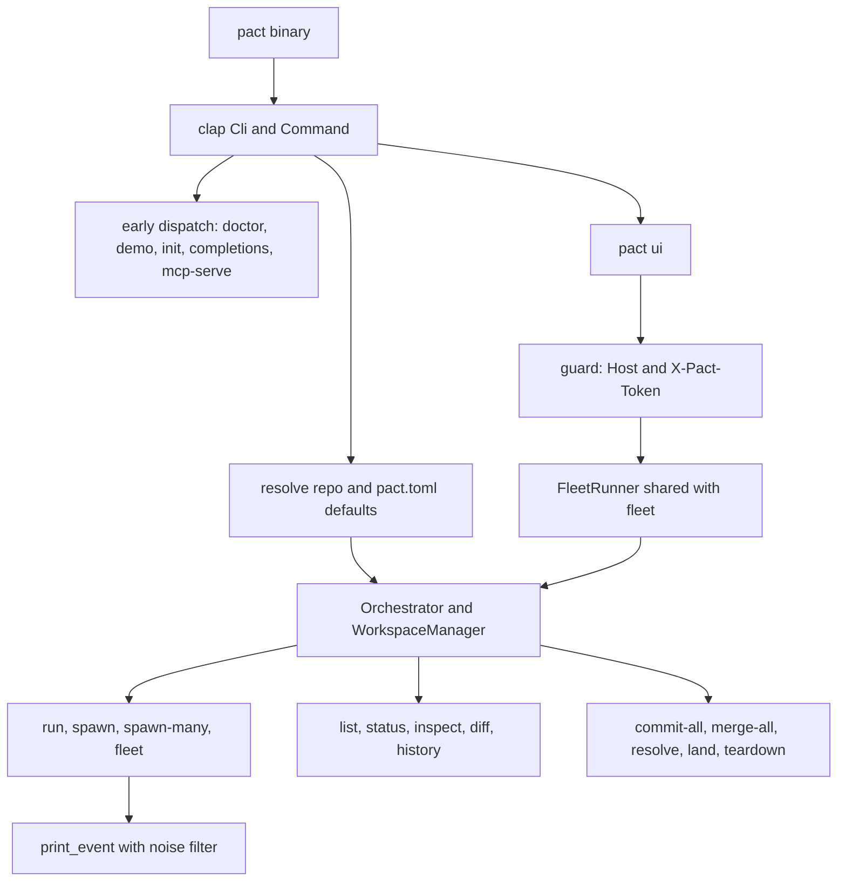

# The command-line surface: commands, flags, output and `pact ui`

## Current design

`pact-cli` is the `pact` binary: a clap `Cli`/`Command` enum in `main.rs`, plus `fleet.rs`, `ui.rs` (with the single-file `ui.html`), `demo.rs` and `config.rs`. The `///` doc comments on the enum are the product's `--help` text and are kept verbose on purpose. A second binary, `fake_agent`, exists only so tests can drive the real binary without a paid agent CLI.

Commands today: `init`, `demo`, `run` (plan, parallel lanes, verify), `spawn`, `spawn-many`, `list`, `status`, `diff`, `inspect`, `commit-all`, `conflicts`, `coord-status`, `clear-leases`, `gc`, `history`, `merge-all`, `resolve`, `land`, `discard`, `teardown`, `completions`, `doctor`, `fleet`, `ui`, plus the hidden `mcp-serve`. `doctor`, `demo`, `completions`, `init` and `mcp-serve` dispatch before the repo is resolved, so they work from anywhere (#118, #119, #17, #19).

How a command resolves its inputs:
- **Repo:** `--repo`, else `find_repo_root` walks up for `.git`. It warns, never blocks, when the root is the home directory or 4 or more levels up (#136).
- **Agent and safety:** CLI flag, then `pact.toml` `defaults.*`, then (agent only) the sole detected installed agent CLI with a printed note, then `claude`. A missing `pact.toml` is fine, a malformed one is a hard error (#118, #121). `pact init` writes it, sets `defaults.agent` only when exactly one agent is detected, and refuses to overwrite without `--force`. `init --register-skill` is opt-in and only Copilot has a confirmed mechanism (#219).
- **Tasks:** `spawn-many` takes `--task` (optional `<agent>:` prefix, `--agent` as the default for unprefixed ones, #37) and `--task-file` (the file stem names the workspace, avoids the argv length limit, #307). `--dry-run` builds the real command through the adapter and prints it shell-quoted (#16, #303); `--estimate-cost` adds an input-token floor and a rate-card range per adapter, with a stale-rates warning after 90 days (#222).
- **Cleanup and merge flags:** `teardown [id]` and `commit-all [--id]` act on every workspace when the id is omitted, reporting failures and continuing (#214). `merge-all` and `resolve` take `--append-only`, with `--union` kept as a visible alias (#11).

Read-only views are aggregation over existing accessors: `list`, `inspect <id>` (#16), `status [--json]` with pattern-matched hints (#221), `doctor [--json] [--fix-skill-dirs]` (#17, #304). `doctor` fails only when `git` is missing or older than 2.5; agent CLIs and package managers are informational.

Output: events stream as one line each. `should_print_other` hides a list of confirmed-noise raw event types (Copilot, Claude Code, ACP) unless `--verbose`; the log file always keeps everything (#38, #100, #102, #300). Error messages end with a `try: pact doctor` style hint only where one next step is obvious (#123). End-of-run reports lead with code facts: `pact run` prints the check verdicts and the run's diff stat before the plan and units, `pact fleet` has a `CHANGES` column, and agent prose in either is capped to one 160-character line pointing at `pact inspect` (`report.rs`, #463).

`pact ui` (#390) is an axum server on a current-thread runtime serving one compiled-in `ui.html`, with no framework and no network fetches. It shares `FleetRunner` with `pact fleet`, so `--max-concurrent` and the memory floor are global. It binds 127.0.0.1 only; the `guard` middleware checks the `Host` header and a 244-bit `X-Pact-Token` on every `/api/` call; the page uses a nonce CSP and never `innerHTML`. Repositories are an allow list in `ui-repos.json`. State is not stored by the server: ended tasks are rebuilt from workspaces and run records, and only live tasks and their last 300 output lines are in memory. The page polls (2 s live, 6 s idle, 15 s or never when hidden, #404). The diff comes from `workspace_patch` using a throwaway index, capped at 400 KB. Reply reruns the same agent in the same workspace with `fleet::reply_prompt`, and replies are kept in `meta/replies/<id>.json` (#395, #400, #407). `--json` prints `{"url","token"}` for editor clients (#402).

### Superseded decisions

- `demo` as the isolated-worktrees plus `merge-all` "core loop": superseded by #417, which walks through the `pact run` shape (shared batch, one lane per unit, one `commit_all`, baseline versus result check).
- Demo GIF built by the Pillow script `render_demo.py` (Phase 11): superseded by #124, `docs/record_cast.py` plus `agg` on real `pact demo` output.
- `--union` as the primary flag name: superseded by #11, `--append-only`, with `--union` as an alias.
- `teardown <id>` required: superseded by #214, id optional for bulk teardown.
- Hardcoded `claude` default for `--agent`: superseded by #118 (`pact.toml`) and then #121 (sole detected agent).
- `spawn-many` required an `<agent>:` prefix on every task: superseded by #37, `--agent` as the default.
- Doc grammar drift caught only by hand: superseded by #238, `docs_cli_grammar.rs` runs every doc example.
- The `pact status` coord-server pid and uptime header from the feature notes was rejected in #221 (no standing daemon); a lease and message count replaced it.
- `pact ui` hidden tab polled at the same rate as a visible one: superseded by #404 (15 s while a task is live, none otherwise).
- Reply prompt carried only the original task and the last message: extended by #400 to list every earlier reply.

## History

The sections below are the issue-by-issue record, moved verbatim from
the old single DESIGN.md. Read them for the why; the summary above is
the current design and wins where they disagree. New decisions in this
area go at the end of this file.

### `pact ui` (issue #390)

A page in the browser over the fleet engine: write a task, pick a
repository and an agent, watch it, read the diff, then land or discard
it. It exists because the fleet workflow is start, wait, review,
decide, repeated for many tasks, and a terminal shows one of those at a
time.

**One process, one HTML file.** `pact ui` is an axum server on a
current-thread tokio runtime inside the `pact` binary, and the page is
`ui.html`, compiled in with `include_str!`: no JavaScript framework, no
build step, no second install, nothing fetched from the network. The
server measured 23 MB of memory idle, which matters because the point
of pact is to leave the machine's memory to the agents. A desktop shell
(Tauri, Electron) would add a toolchain and a hundred megabytes to show
the same page. axum rather than a hand-written HTTP loop because header
parsing and JSON bodies are where a hand-written server grows security
bugs; it is built with `default-features = false` and only `http1`,
`tokio`, `json` and `query`. Every handler runs its git and file work
in `spawn_blocking`, and each task runs on its own OS thread through
`FleetRunner::run_one`, the same code path as `pact fleet`.

**`FleetRunner`.** `run_fleet` takes a fixed list and returns when all
of it has ended. The page starts tasks one at a time for as long as it
is open, so the `Supervisor` and `Admission` that `run_fleet` built
internally are now a `FleetRunner` value that both use. One per
process, since a second `Supervisor` cannot install a Ctrl-C handler.
Admission is therefore global to the page: `--max-concurrent` and the
memory floor hold across every repository, which is the property that
keeps the laptop usable.

**Security model.** The page can start an unattended agent in any
repository on the machine, so the server must answer only the page it
served. Three checks, all in the `guard` middleware:

- It binds `127.0.0.1` only. There is no flag to bind anything else.
- The `Host` header must be `127.0.0.1:<port>` or `localhost:<port>`.
  This stops DNS rebinding, where a hostile site points its own domain
  at 127.0.0.1 so that the browser treats the local server as part of
  that site.
- Every `/api/` request must carry `X-Pact-Token`, 244 random bits
  (two version 4 UUIDs) made at startup and written into the served page. Another site
  cannot read the page (no CORS headers are sent), so it cannot learn
  the token, and a custom header cannot be sent cross-origin without a
  preflight the server never approves. The comparison is constant-time.

The page itself is served with a Content-Security-Policy of
`default-src 'none'` plus a per-process script nonce, `connect-src
'self'`, and `frame-ancestors 'none'`, and it builds every element with
`createElement` and text nodes, never `innerHTML`, because it shows
agent output and diffs, which are untrusted text. The token is not a
defence against other programs running as the same user: they can
already run `pact` themselves.

**Repositories are an allow list.** Every request names a repository,
and the server acts only on paths the user added (or the directory
`pact ui` was started in). The list is saved to `ui-repos.json` in the
platform's local data directory so it survives a restart;
`PACT_UI_STATE_DIR` moves it, which the test uses.

**Where state lives.** Nothing new is stored. A task that has ended is
drawn from its workspace and run record through `Orchestrator::entries`,
so tasks started by `pact fleet` or `pact spawn` show up too, and tasks
started from the page survive a restart of `pact ui`. Only three things
live in the server's memory: tasks that are still setting up, waiting
or running (with the last 300 lines of their output), and a task that
could not start at all, which has no workspace to hold its error.
Stopping `pact ui` stops the agents it started, as Ctrl-C does for
`pact fleet`.

**Polling, not a push channel.** The page asks `/api/state` every 2
seconds while a task is live and every 6 otherwise. A hidden tab asks
every 15 seconds while a task is live and not at all otherwise (#404).
Server-sent events or a WebSocket would deliver output a second sooner
at the cost of connection state on both sides, reconnect logic, and one
more axum feature. Tasks run for minutes; a 2 second
delay is invisible, and a hidden tab costing nothing is worth more.

**Telling the user a task ended (#404).** The page is for starting
agents and leaving, so the hidden tab keeps the slow poll above, puts
the number of tasks waiting on the user in the tab title, and, once the
user presses Notify me, raises a desktop notification for each task
that goes from live to ended while the tab is hidden. Notifications are
opt in because a browser grants the permission only from a click, and
the choice lives in `localStorage` next to the other form memory. The
page compares task statuses between two polls, so the server keeps no
record of what was announced; the cost is that a task which ends while
`pact ui` or the tab is closed is not announced, only counted in the
title on the next load. A visible tab raises nothing: the card moving
to its new group is the signal.

**The diff is built in a throwaway index.** The review pane must show
what landing would bring: committed, uncommitted and untracked files
together. `git diff` omits untracked files, and `git add -A` in the
workspace would change the index under a running agent. So
`workspace_patch` (`pact-vcs/src/land.rs`) copies the worktree's index
to a temporary file, stages everything into the copy through
`GIT_INDEX_FILE`, diffs the copy against the merge base with the
user's branch, and deletes it. The real index is never written. The
patch is cut at 400 KB with a notice, since the page is for reading a
change, not for transporting it.

**Names.** A task's name is its workspace id and its branch, so the
page turns whatever is typed into lower-case letters, digits and
hyphens, and when no name is given makes one from the first four words
of the task plus four random hex digits. A name already in use in that
repository is refused rather than suffixed, so two tasks are never
confused.

**Discarding.** A running task is discarded by `teardown --force`,
which stops the agent. A task still waiting for admission has a
workspace but no process; its workspace is removed and it leaves the
page at once. Its thread is woken and leaves the admission line
without taking a slot or writing a run record (#394): the waiter's
cancel check is that its workspace directory is gone, so no flag has
to be passed from the page down to the launch.

**A client that is not the page (#402).** An editor extension (#397)
starts `pact ui` as a child process and calls the same API. It needs
the token, which until now existed only inside the served HTML.
`--json` prints `{"url", "token"}` as the single stdout line. It is a
flag and not the default because a terminal's scrollback and a CI log
are places a token should not land unasked; it weakens nothing, since
any program running as the user could already fetch the page and read
the token there. `/api/task` also returns `base` and `workspace`: an
editor's diff view takes two files, not a patch, and with these it
reads the old side from `git show <base>:<file>` and the new side from
the worktree. Returning the commit rather than every file's old and new
contents keeps the reply small and leaves binary and large files to
git. `base` is the same merge base `workspace_patch` diffs against, so
the two views cannot disagree. The greeting is written with `writeln!`
and its error ignored: a client that reads the first line and closes
the pipe must not take the server down, which `println!` would do by
panicking.
During the short window before the workspace exists, discard is
refused with a request to try again.

**Replying (#395).** A task that ended blocked has a question in its
report, and before this the only way to answer was to discard it and
start again with the answer in the prompt, losing the agent's work.
The Reply box runs the same agent and model again in the same
workspace, on the same branch, with a prompt made by
`fleet::reply_prompt`: the original task, the agent's last message
(its final 6000 characters, where the report is), and the reply. It is
a new agent session, not a resumed one: resuming is spelled
differently by every agent CLI and not offered by all of them, while a
fresh session that is told what happened works for all five, and the
files already changed carry most of the context. The cost is that the
agent rereads what it needs. Each reply is appended to
`meta/replies/<id>.json` and every earlier one is listed in the next
prompt (#400): the agent's own earlier messages are not kept, because
the files hold what it did, but a decision the user gave only in words
(which database to use) exists nowhere else. Unlike the run record,
the file is removed with the workspace, so a later task of the same
name does not inherit the thread. `/api/task` returns the list as
`replies` and the drawer shows it under the task text (#407), since
the card otherwise shows only the original task and nothing says what
the agent was told afterwards. The launch half of
`spawn_with_supervisor` became `run_process_lane` so that
`rerun_with_supervisor` (through `FleetRunner::rerun_one`) launches in
an existing workspace by the same code as a new task: same admission
line, log file, run record and report parsing. Dependency prep and
prepare commands are not repeated. The run record is replaced by the
new run's, so the card shows the latest result. Reply is offered on
any task that has ended, since "now also do this" on a finished task
is the same operation. It is refused for a shared-tree lane, whose
tree belongs to its batch.

### pact-cli: introduction

`--help` output for every command comes directly from `///` doc comments
on the `Cli`/`Command` struct and enum definitions in `main.rs` -- those
are user-facing product documentation, not internal narrative, so they're
intentionally kept verbose and are not subject to the comment-reduction
pass the rest of the codebase got.

### Doc/CLI grammar drift check (issue #238)

A real user following `SKILL.md` -- the file written specifically for an
agent to read and act on literally -- hit `pact diff --id <id>`
rejected: the real grammar is positional (`pact diff <id>`). Worse than
a typo: `merge-all`/`commit-all` genuinely *do* take `--id`, so the
error read as a bug in pact, not a bug in the doc. `SKILL.md` had the
same wrong shape for `resolve --id`/`teardown --id` too; `README.md` and
`GETTING_STARTED.md` already had the correct positional form in both
cases -- only `SKILL.md` had drifted.

Fixed the three wrong lines, then built the structural fix the issue
actually asked for: `crates/pact-cli/tests/docs_cli_grammar.rs` extracts
every fenced `pact`/`./pact` command from all three docs (joining `\`-
continued lines, handling double-quoted task text) and runs each against
a real scratch repo, asserting it isn't rejected as a clap usage error
(exit code 2 -- clap's own convention, distinct from `main`'s runtime
errors, which exit 1). `spawn`/`spawn-many` examples get `--dry-run`
force-appended if the doc example doesn't already have it, so a real
agent is never launched just to check argument parsing. This makes the
exact class of bug that caused this issue structurally hard to reintroduce
without noticing -- not proofread by a CI check that runs `--help` once,
but every real example, run for real, on every push.

**This check caught a second, previously-undiscovered real bug on its
first run**, not just the three known ones: `README.md`'s own
`--coord-command /path/to/alt-coord --coord-arg --some-flag` example
failed to parse -- `--coord-arg` had no `allow_hyphen_values`, so clap
rejected any flag-shaped value (`--some-flag`) as an unrecognized flag of
pact's own, even though `--coord-arg`'s whole purpose is forwarding
arbitrary arguments to an alternative coordination command that may
itself take flags. Fixed on both `spawn`/`spawn-many`'s `coord_args`
definitions, not just the doc.

`mcp-serve` gets its own, self-contained tokio runtime rather than making
the whole CLI async -- it's the only command that needs one (`rmcp`
requires async), and every other command stays exactly as synchronous as
it already is. See the README for why that tradeoff was made deliberately,
not by default.

### SKILL.md routing re-verified against a real Copilot session (issue #203)

The reworded `SKILL.md` description (leading with the user's problem
instead of the tool list, plus explicit "prefer pact over your own
built-in task tool" language) was flagged as *plausible but unconfirmed*
when it shipped -- the original fix explicitly said re-testing would
need another real, billed Copilot call, and didn't spend one
unilaterally.

**Live re-verified.** A real `copilot skill add`, in a plain scratch repo
with no prior pact context, against the exact near-verbatim trigger
prompt from the original report ("I have several independent coding
tasks I want to run concurrently on this repo, without them stepping on
each other's files. How should I do that?"): `session.skills_loaded`
confirmed the `pact` skill loaded, the assistant's very first message
explicitly invoked it ("Running the \"pact\" skill to show how to run
multiple independent coding tasks in parallel using isolated worktrees
and advisory leases"), and the follow-up response recommended concrete
`pact doctor`/`pact spawn-many --dry-run --task` commands -- a complete
reversal from the original bug (Copilot recommending `git worktree add`
plus its own built-in task tool instead). Confirmed fixed, not just
plausible.

### pact init auto-registers SKILL.md with detected agent CLIs (issue #219)

Follow-up to #203: registering `SKILL.md` used to require a manual step
per agent CLI (`copilot skill add <pact-repo>`). `pact init` now does
this automatically for every agent CLI it detects installed, reusing the
same detection `--agent` auto-default (#121) already built.

**Per-adapter mechanism, confirmed by hand, not assumed:**
- **Copilot**: shells out to `copilot skill add <repo-root>` (confirmed
  the real registration mechanism while re-verifying #203 above) --
  Copilot owns its own skills directory and registration bookkeeping, so
  pact defers to the CLI's own command rather than writing into
  `~/.copilot/skills/` directly and risking format drift from whatever
  internal manifest Copilot itself maintains alongside the raw files.
- **Claude Code, Codex, Gemini**: no confirmed, real skill-directory
  convention for any of the three as of this pass (unlike Copilot's
  `copilot skill add`, none has a discovered equivalent CLI subcommand or
  documented fixed skills path verified by hand) -- rather than guess at
  an undocumented path and silently write into the wrong place, these
  three are a no-op for now, each logged as a single `tracing::debug!`
  line naming the adapter and "no confirmed skill-registration mechanism"
  rather than failing or pretending success.

**Opt-in, not default-on**: `pact init --register-skill` -- the safer
default for a command that writes into a directory *outside* the repo it
was invoked in (a real CLI's own global config), matching this project's
general bias toward additive, no-surprise-behavior-change defaults (how
`--name`/`--no-deps` shipped, both opt-in flags rather than changed
defaults). Absence of the flag is a silent no-op, not a warning --
running `pact init` shouldn't get noisier for users who don't want this.

Failure handling: a `copilot skill add` that fails (Copilot CLI not
actually on `PATH` despite being detected via a different check, a
permissions error) is logged as a warning and does not fail `pact init`
itself -- the same "best-effort, never block the primary operation"
posture dependency prep and passthrough installs already use.

**Caught a real bug live-verifying this against the actual pact repo**:
the first implementation spawned `copilot` via a direct
`std::process::Command::new("copilot")`, which failed with "program not
found" despite `copilot` working fine typed interactively and being
correctly detected as installed moments earlier -- the same Windows
`.cmd`-shim gap `cmdutil::run` already exists to work around
(`std::process::Command` doesn't consult `PATHEXT` the way a real shell
does). Fixed by routing through `pact_deps::run_shimmed` instead of a
raw spawn, confirmed by re-running `pact init --register-skill` against
this repo's own real Copilot installation afterward (`registered
SKILL.md with copilot (copilot skill add)`, and `copilot skill list`
showed it).

`print_event_labeled` needs no extra locking beyond what `println!`'s own
internal `Stdout` lock already gives per call: each event becomes one
complete line written in one call, so concurrent threads' (`spawn-many`)
lines interleave at line granularity, never mid-line.

### `teardown` bulk mode (issue #214, outside Windows Copilot report)

`teardown` required a workspace `<id>` -- no way to tear down every active
workspace at once, asymmetric with `commit-all` (which already documented
"without --id, commits every active workspace that's dirty"). After a
run leaves several workspaces active, cleanup meant N separate `pact
teardown --force <id>` invocations, each needing the full id slug typed
out by hand.

`id` is now `Option<String>`, mirroring `commit-all`'s exact pattern:
omitted means every active workspace, torn down independently -- one
that fails (a dirty workspace without `--force`, most commonly) is
reported and the batch continues rather than aborting, same "report and
continue" shape `commit-all` already used. Cross-workspace conflict
detection (previously computed once per single `teardown` call, right
before removal since it needs the branch teardown deletes) is now
computed once for the whole batch up front instead of once per
workspace -- a minor, deliberate timing change: still informational-only
(never blocks a teardown), and avoids N redundant `detect_conflicts`
calls for a bulk invocation. `FileConflict` gained a plain `Clone` derive
to support filtering a shared snapshot per workspace in the loop.

Verified end-to-end via the fake-agent harness (issue #157): bulk
teardown removes every workspace and `list` reports none left; a bulk
teardown where every workspace is dirty (no `--force`) reports each one
failed and leaves all of them still active, rather than tearing down
none or aborting after the first failure.

### `--union` renamed to `--append-only` (issue #11)

From an outside code review (2026-07-24): "union" implies something more
general/safer than the actual implementation -- a naive append-only line
concat with limited JS/TS guardrails (rejects duplicate
`module.exports`/`export default`/redeclared bindings, nothing else --
CSS cascade, config keys set twice, non-JS/TS languages aren't checked).
The barrel-file position-loss gotcha was already documented in
`GETTING_STARTED.md`; the flag's own name didn't reflect the limitation.

`--append-only` is now the primary CLI flag name on both `merge-all` and
`resolve` (`#[arg(long = "append-only", visible_alias = "union")]`) --
`--union` still works identically, a visible alias (shown in `--help`'s
`[aliases: --union]`, not hidden), not a silent deprecation. The
underlying Rust field was renamed from `union` to `append_only` too
(not just the CLI-facing flag string) -- otherwise `--help` would have
shown a mismatched `<UNION>` value placeholder under the new
`--append-only` flag name.

Verified for real, not just that both names parse: 2 new integration
tests resolve the identical real barrel-export conflict (same shape
pact-vcs's own `merge_all.rs` tests use) once via `--append-only` and
once via `--union`, confirming both produce the same merged content, not
just that clap accepts both spellings.

### `pact doctor --json` (issue #17)

From an outside code review (2026-07-24): the human-readable `doctor`
output is fine for a person running it directly, but CI diagnostics and
bug reports need machine-readable output. Added `--json`, computing the
same data the human-readable path already does (`git_version`/
`worktree_ok` moved out of the `match` and shared by both output
branches, so they can't disagree) plus `os`/`arch` from
`std::env::consts`.

**Deliberately doesn't include** "pact state directory"/"coordination DB
path"/"config path," despite the original finding listing them --
`pact doctor` resolves *before* `--repo` is ever looked at (same early
dispatch as `Init`/`Demo`/`Completions`, ahead of `Orchestrator::open`),
by design: it's meant to work from anywhere, checking the environment,
not a specific repo. Adding repo-scoped fields would mean either forcing
doctor to resolve a repo (changing its "works from anywhere" character)
or making those fields silently absent/misleading when run outside one.
Scoped down to what's genuinely repo-independent.

Verified with 4 integration tests, including one that runs both output
modes back to back and asserts they report identical
`worktree_supported`, so a future change to one path can't silently
diverge from the other.

### `pact inspect` (issue #16)

From an outside code review (2026-07-24): users need one command that
answers "what is going on with this workspace" -- today that meant
combining `list`/`diff`/`coord-status`/`history` mentally, none of which
alone shows the full picture.

`pact inspect <id>` is pure aggregation, not new computation -- every
data point comes from an existing accessor: `get_workspace` (new, thin
wrapper over `WorkspaceManager::get_workspace`, previously only
reachable indirectly through `list`), `is_dirty`, `agent_process_alive`,
the new `dependency_prep_report`/`run_metadata` readers (issues #12/#15,
reading back the `state_dir/meta/<id>-{deps,run}.json` files those
issues started writing), `coord_status` (filtered to leases/pending
messages belonging to this workspace's own id), `open_conflict_for`
(new, thin wrapper over the existing `pact_coord::open_conflict_for_workspace`
-- the same lookup `pact resolve <id>` itself already uses, not a new
query), and `history` (filtered to this workspace, capped at 20).

`dependency_prep_report`/`run_metadata` treat a missing or unreadable
file as `None`, not an error -- a workspace that was created directly
(e.g. by a test, or one that predates these two issues) legitimately has
no such record, and that's informational, not broken.

Verified for real: 3 new integration tests build a real throwaway repo,
create a real workspace via `WorkspaceManager::create_workspace`
directly (no agent CLI involved), and drive the real `pact` binary --
one against a freshly-created workspace with nothing recorded yet (every
section correctly says so), one with the dependency-prep/run-metadata
files written directly to simulate what a real spawn would have
produced (confirms the aggregation renders real persisted data
correctly), and one confirming an unknown workspace id fails cleanly.

### Error messages suggest the next command (issue #123)

From an outside adoption/UX review: `git` suggests the closest command on
a typo, `cargo` links to docs on error, `gh` prompts login when
unauthenticated -- pact's own failure paths didn't chain back to itself.
Added a `-- try: pact doctor` (or `pact init`/`pact demo`, whichever fits)
suffix to the handful of error messages where the next useful command is
unambiguous from the failure itself: every "unknown agent" error
(`spawn`/`spawn-many`/Arbiter's `--arbiter-agent`), `spawn-many`'s
"no --agent and no prefix" error, and `find_repo_root`'s "no git
repository found" error.

Deliberately narrow -- only added a hint where there's a single, obvious
next step, not to every error path in the CLI. `pact init`'s own
"pact.toml already exists" error already had this pattern (`pass --force`)
before this issue; the ones added here follow that same shape.

While manually verifying this, incidentally found and filed issue #136
(`find_repo_root` can silently walk into an unrelated ancestor git repo) --
real, but a distinct concern from this issue's scope, not fixed here.

### Demo GIF re-recording (issue #124)

From an outside adoption/UX review: a real terminal recording near the
top of the README is the single artifact most likely to convert a reader
into a stargazer, and the existing `docs/demo.gif` (Phase 11) was known
stale -- predates the noise-suppression fixes, and was itself a Pillow
hand-render (real captured content, drawn frame-by-frame with a custom
script) rather than a genuine terminal-session recording, because the one
recording tool tried at the time (`terminalizer`) failed outright on this
Windows/Git-Bash setup.

Re-investigated the tooling gap directly rather than assuming it's still
unfixable:
- **`pip install asciinema` installs cleanly, but the CLI cannot even
  start on native Windows Python** -- `asciinema/recorder.py` does a
  top-level `import fcntl` (a Unix-only module) with no platform guard,
  so every invocation fails at import time before reaching any actual
  recording logic. Confirmed directly, not assumed from documentation --
  this is a hard blocker specific to native Windows, not something a flag
  or workaround fixes.
- **`agg`** (https://github.com/asciinema/agg, `cargo install --git`;
  not the unrelated crates.io package of the same name) **works fine
  standalone.** It only consumes an existing `.cast` (asciicast v2) file
  and renders it to GIF -- no pty involved at all, so the Windows-only
  blocker above doesn't apply to it.

This means the actual gap was narrower than "no recording tooling at
all": specifically, asciinema's own *recorder* is what's Windows-broken,
not the whole pipeline. `docs/record_cast.py` closes that gap by
constructing the `.cast` file directly from a real `pact demo` subprocess
run (real stdout content, real per-line wall-clock timestamps) instead of
going through asciinema's recorder -- `agg` doesn't care how the `.cast`
was produced, only that it's valid.

Content choice: `pact demo`'s own output (issue #119), not a hand-scripted
multi-agent session. This is a strict improvement over the original
GIF's approach for a docs asset specifically: `pact demo` is free,
deterministic, and exercises real `pact` code (`WorkspaceManager`,
`merge_all`) end-to-end, so the GIF can never go stale relative to a real
spawn/merge in the way a baked-in real-agent-output transcript could --
regenerating it after a future change is just re-running the script,
not manually re-transcribing a new session. The `render_demo.py` Pillow
script (Phase 11) is deleted, fully superseded.

One deliberate liberty: `pact demo` finishes in about 1.5 real seconds,
so genuine gaps between lines are mostly single-digit milliseconds -- too
fast to be watchable. `record_cast.py` applies a minimum per-line hold
(`MIN_HOLD_SECONDS`) that only *raises* an unreadably-short real gap,
never shortens a real one -- the two real `git worktree add` calls (the
two workspace-creation lines) still show as genuinely longer pauses than
the rest, since their real gap already exceeds the floor. Disclosed
explicitly in docs/usage.md's Known limitations, same as the previous
version's own tradeoff was.

### `pact.toml` / `pact init` (issue #118)

pact was 100% CLI-flag driven until this -- no persisted config file at
all, confirmed by grepping for any `Config`/`.toml` reference in the
codebase before starting. From an outside adoption/UX review: reaching a
successful `spawn-many` from a fresh install required knowing 7 concepts
before anything worked, `--agent`/`--safety` being two of them repeated on
every invocation.

Precedence, deliberately in this order: **CLI flag > `pact.toml`'s
`defaults.*` > built-in hardcoded default.** A flag always wins even when
`pact.toml` sets something, so nothing about existing scripted/CI usage
changes unless a `pact.toml` is added *and* the flag is dropped. Applies to
`spawn`/`spawn-many`'s `--agent`/`--safety` and `merge-all`/`resolve`'s
`--arbiter-agent`/`--arbiter-safety` -- all four flags changed from a
clap `default_value`/no-default `String`/`Option<String>` to a plain
`Option<String>`, resolved against `PactConfig` before use. The pre-existing
hardcoded `"claude"` fallback (`spawn`'s old `default_value`,
`--arbiter-agent`'s old `default_value`) is preserved as the last resort,
so a repo with no `pact.toml` behaves byte-for-byte as before.

`PactConfig::load` treats a **missing** `pact.toml` as `Self::default()`
(no error -- this is opt-in, pact must work fully without one) but a
**present, malformed** one as a hard error, not a silent fall-back to "no
config" -- a typo in `defaults.agent` should be loud, not quietly ignored.

`pact init` writes the file, refusing to overwrite an existing one without
`--force`. Agent detection reuses `pact doctor`'s own `AGENT_CHECKS`/
`doctor_check_version` (`detect_installed_agents` in `main.rs`) so the two
commands' view of "what's installed" can never drift apart. Only sets
`defaults.agent` uncommented when *exactly one* agent CLI is detected --
zero or multiple both leave it commented with an explanatory note, since
guessing between multiple installed CLIs would be worse than asking.

`defaults.safety` is never auto-populated by `pact init` (left commented
with an example) -- there's no reasonable per-machine guess for a safety
override the way there is for "which agent CLI is installed."

### `pact demo` (issue #119)

Deliberately fakes exactly one step: the agent CLI call itself. Everything
else -- the temp repo, the two `WorkspaceManager::create_workspace` calls
(via `pact-vcs` directly, not through `Orchestrator::spawn`, since spawning
means launching a real adapter/agent subprocess), the real `merge_all` --
is real pact code on a real, disposable repo.

Issue #417 changed what the demo shows. It used to call isolated
worktrees plus `merge-all` "the core loop", which was the product before
`pact run`; for disjoint work those worktrees and the merge were exactly
the overhead `pact run` removed (53.6 min against 12.5 on the benchmark).
The demo now walks through `pact run`'s shape with the same real
primitives `pact run` uses: a plan of two units owning one file each,
one shared tree (`create_shared_batch`), a lane per unit
(`create_lane`) writing its file, one `commit_all`, and a check run on
the untouched tree and again on the result, so the verdict reads
"failed on the base commit, so this run fixed it". The planner joins the
agents as the simulated steps. Driving the real `run_task` against the
bundled fake ACP agent was considered and rejected: the fake ships as a
test binary, not inside `pact`, and copying it onto PATH as `copilot`
for a demo would be a surprise on a user's machine. The closing lines
point at `pact doctor`, then `pact run --dry-run` (free), then the real
run with `--verify`, and name `fleet`, `ui` and `spawn-many` plus
`merge-all` for the cases they fit.

The reasoning for faking only that one step: `pact demo` needs to work for
a brand-new user who hasn't installed or authenticated any agent CLI yet,
on any machine, with zero cost and zero chance of hanging on an auth
prompt. A real agent call fails all three of those. Each demo "workspace"
instead gets a canned, deterministic file write standing in for what an
agent would have done -- clearly labeled as simulated in the command's own
output, never presented as a real agent run.

Runs from anywhere, not just inside a git repo -- handled the same way as
`doctor`/`completions`/`init`, before `repo_root` resolution, since `pact
demo` creates and owns its own throwaway repo entirely under
`std::env::temp_dir()` and has no use for `--repo` at all.

Cleanup (`remove_dir_all` on the whole temp repo) happens after the run
regardless of success or failure (via a captured `Result` in `demo::run`,
not a `?` that would skip cleanup on an error). Integration test
`demo_leaves_no_leftover_temp_directory` checks only the exact path this
invocation's own output names -- an earlier version swept
`std::env::temp_dir()` for any `pact-demo-*` entry before/after, which is a
real, reproducible false failure whenever this test happens to run
concurrently with `demo_succeeds_from_outside_any_git_repo` in the same
test binary (cargo parallelizes tests within one binary by default), since
the sibling test's own still-running `pact demo` shows up in the sweep.

**Real leak found and fixed (issue #195, outside R4 regression report,
2026-07-29): cleanup only ever removed the repo directory, never the
workspace state directory.** `run_inner` opens a real `WorkspaceManager`
against the temp repo, which creates its state directory (locks/meta/
workspaces) as a **sibling** of the repo root -- `.pact-<repo-name>`, not
a subdirectory of it (see "Workspace lifecycle" below). `demo::run`'s
`remove_dir_all(&repo_root)` never touched that sibling, so every single
real `pact demo` run since the feature shipped leaked one directory into
the temp dir -- confirmed by finding over 150 of them already
accumulated in this project's own dev environment. `demo_leaves_no_leftover_temp_directory`
had been checking `repo_path.exists()` the whole time, which *was*
being cleaned up correctly -- that's precisely why this shipped and
stayed broken silently: the test's own blind spot matched the bug's
blind spot. Fixed by extracting the sibling-state-dir derivation
`WorkspaceManager::open` already did inline into a new public
`WorkspaceManager::state_dir_for(repo_root) -> Result<PathBuf>` (pure
path math, no filesystem access) that `open` and `demo::run`'s cleanup
now both call, so the two can never drift apart again -- and extended
the existing test to check it too, not just the repo path.

### `--agent` auto-default (issue #121)

Extends the `pact.toml` precedence chain (issue #118, above) with one more
fallback: **CLI flag > `pact.toml`'s `defaults.agent` > sole detected
installed agent CLI > hardcoded `"claude"`.** `resolve_default_agent` in
`main.rs` implements this and is shared by both `spawn` and `spawn-many`,
reusing the same `detect_installed_agents` (and by extension `pact
doctor`'s own `AGENT_CHECKS`) as `pact init`.

Deliberately only auto-selects when *exactly one* supported agent CLI is
detected -- zero or multiple both fall through to the next fallback rather
than guessing which of several installed CLIs the user meant. When
auto-detection does fire, it prints an explicit note naming which agent
was chosen and how to override it (`--agent` or `pact.toml`) -- never a
silent guess, since a wrong guess here means launching the wrong (real,
billed) agent CLI.

Note this only ever *adds* a new fallback in front of the pre-existing
hardcoded `"claude"` default (`spawn`) / real per-task error (`spawn-many`)
-- neither of those was removed, so a machine with zero or multiple agent
CLIs installed behaves exactly as before this issue.

Verified via a real cross-platform integration test
(`tests/agent_auto_default.rs`) rather than a fake/mocked detection layer:
the test writes an actual runnable `claude` shim (`.cmd` on Windows, a
`chmod +x` shell script on Unix) into a fresh temp directory and overrides
the child `pact` process's `PATH` to exactly that directory, so `pact
doctor`'s real detection logic genuinely finds exactly one agent CLI --
the same code path a real machine with only Claude Code installed would
exercise, not a substitute for it.

### `--agent`/prefix precedence in `spawn-many` (issue #37)

`spawn` took a top-level `--agent`; `spawn-many` required every `--task`
to embed an `<agent>:...` prefix and had no `--agent` at all -- a
first-time user reasonably tried `--agent copilot --task "..."` and got an
unhelpful clap suggestion (`tip: a similar argument exists: '--safety'`).
`spawn-many` now also accepts `--agent` as a default for any `--task`
without a recognized prefix; a prefix still wins when present (mixing
agents in one batch is the original reason `spawn-many` required prefixes
at all). `parse_task_spec` falls back to the default even when a task's
colon isn't meant as an agent prefix at all (e.g. `--agent copilot --task
"fix the bug: handle empty array"` -- "fix the bug" isn't a real agent
name, so with a default set the whole string is the task text) rather
than surfacing an "unknown agent" error; without a default, that same
input still gets the specific "unknown agent" error, not a generic one.
Chosen over dropping `--agent` from `spawn` and always requiring a prefix
there, since that would break every existing `spawn` caller -- this is
purely additive to `spawn-many`.

### `--task-file`: real briefs without the argv limit (issue #307)

A worker only ever sees its own `--task` text, so a correct brief is long
(files to edit, the conventions the result must follow, acceptance
commands, "do not commit", "you cannot install or build"). A batch of
long inline `--task` strings blows past the OS command-line length limit:
the 2026-09-30 benchmark (issue #308) had a Copilot orchestrator fail with
"The filename or extension is too long" building a `pact spawn-many` with
ten multi-KB `--task` strings. `--task-file <path>` (or `<agent>:<path>`,
the same prefix rule as `--task`) reads the brief from a file, so the
outer command stays short, and uses the file's stem as the workspace name
(`briefs/hub-hooks.md` -> `hub-hooks`), which is both more readable than a
random suffix and exactly what an orchestrator producing one file per unit
wants. `--task-file` entries run after all `--task` entries; `--name`
stays positional over `--task` only, since a `--task-file` already carries
its name in its stem. The agent-prefix split reuses `--task`'s rule, which
also keeps a bare Windows path (`C:\briefs\x.md`) working because `C` is
not a known agent and falls through to the default. Only the file-delivery
half of #307 is implemented here; piping an over-long *single* brief to
the agent over stdin (for one brief above the limit, which the benchmark
did not hit) is left as follow-up.

### Copilot usage checkpoints (issue #300)

Copilot CLI emits `session.usage_checkpoint` events: 3 to 5 KB of cache
state and prompt-segment hashes each, printed as `[other]` lines that
drowned a `spawn-many` stream. They also carry the one thing a user
comparing pact with a single session needs: cumulative
`totalPremiumRequests` and `totalNanoAiu` (USD is `totalNanoAiu / 1e11`,
one AI credit being 0.01 USD), with the model under
`promptCacheBreakState.lastActiveModel` or `modelCacheState.modelId`
(field paths read from real 1.0.90 logs). The type joins the suppressed
list, and the process lane keeps the last checkpoint's totals as the
run record's `usage`, which `inspect` and the `spawn-many` summary print,
the latter with a batch total. ACP lanes report no such event, so their
`usage` stays empty.

### Streamed event filtering (issue #38)

The Copilot CLI adapter recognizes 4 event types and passes everything
else through as raw `[other]` JSON. Confirmed real noise, not a guess: a
single spawn produced 52 `[other]` lines to 1 real `[assistant]` line; a
2-agent `spawn-many` run's log ballooned to 695 KB, almost entirely
`session.background_tasks_changed`. `should_print_other` suppresses a
short, specifically-confirmed list of noisy raw `type` values
(`SUPPRESSED_OTHER_EVENT_TYPES`) from the live terminal view by default;
`--verbose`/`-v` (global flag) restores them. Anything not on that list
still prints unconditionally, same as always -- an unrecognized event is
still more likely to be a real message an adapter doesn't parse in detail
yet than something safe to drop silently, so only confirmed noise is ever
suppressed. Filtering happens at this presentation layer, not by dropping
anything from the normalized `AgentEvent::Other` stream itself, so the
full unfiltered stream is unaffected either way -- `run_and_stream`
already writes every raw line to the workspace's log file before any
filtering happens.

Every entry up through `session.skills_loaded` came from Copilot CLI
shakedowns specifically -- nobody had looked at Claude Code's *own* raw
`[other]` stream for its own noise until a real `pact spawn-many
--agent claude` run (capturing fresh output for a `docs/demo.gif`
refresh) turned up two more (issue #100): `rate_limit_event` (account
rate-limit metadata, not agent output) and `user` -- in headless mode
there's no real interactive user turn, so every `"type":"user"` event is
the SDK echoing a tool result back to itself, already covered by the
`[tool]`/`[assistant]` events. Smaller scale than issue #58's 75%+
finding (4 lines in one small 2-agent run), but the same category of
confirmed, not-agent-output noise, added to the same list.

The 2026-07-23 Claude Code stress-testing campaign found two more
(issue #102), and this time a plain string in
`SUPPRESSED_OTHER_EVENT_TYPES` wasn't the right shape for the fix:
`system` events with a `subtype` other than `init` (`thinking_tokens`,
`task_started`/`task_notification` from background bash tasks, and
presumably more not yet observed), and `assistant` turns with only a
`thinking` content block (extended thinking, `thinking` empty/redacted
by the API in every capture so far, just a large opaque `signature`
blob). Both are structurally guaranteed to reach `should_print_other`
*only* via their respective noise case -- Claude Code's real `system`/
`init` and real `assistant` text/tool-use events are already consumed
into `AgentEvent::Init`/`AssistantText`/`ToolUse` before the generic
`Other` fallback ever runs, so a blanket `Some("system") => false` /
`Some("assistant") => false` in `should_print_other` is safe, not an
overly broad suppression -- confirmed no other adapter uses either bare
string as a type discriminator at all. Re-verified against a real spawn
after the fix: zero `[other]` lines in an otherwise simple task's
default output.

### Workspace commit lifecycle (issue #35)

Neither `spawn` nor `spawn-many` commits anything -- an agent's changes
land in its workspace's working tree, and `pact list` shows it as
`[dirty]` once the agent is done. That's expected, not a sign anything
needs attention, but it was undocumented anywhere (not `spawn --help`,
not `spawn-many --help`, not `merge-all --help`, not the README) until
now documented in all of those. `commit-all` (or `merge-all`, which runs
the same commit step automatically before merging) is what actually
creates a commit. A user checking a workspace's branch with `git log`
before merging, to sanity-check what the agent did, would otherwise see
an empty branch at the same commit it forked from and could reasonably
conclude the agent did nothing.

### `--dry-run` preview (issue #16)

`spawn`/`spawn-many` immediately create a real workspace and can launch a
real, billed agent session -- a user isn't always sure what an
agent/task/safety combination will actually do before committing to it.
`Orchestrator::spawn_preview` builds the same id/branch/path
`create_workspace` would (via `WorkspaceManager::preview_workspace_location`,
refactored out of `create_workspace` so both paths generate an id the
same way), detects package managers against the *repo root*, not a
not-yet-created workspace path (a fresh worktree starts as a clean
checkout of `HEAD`, so this is a fair approximation unless the repo root's
own working tree has uncommitted package-manager-file changes that
wouldn't carry over), and calls the real `AgentAdapter::build_command` so
the printed command can never drift from what a real spawn would launch.
The arguments are printed shell-quoted for the platform (issue #303):
joined with bare spaces, a task text such as `unit A` and a rule such
as `shell(npm install:*)` read as several arguments and could not be
pasted back into a shell. Windows gets double quotes with `\"` inside,
the convention `CommandLineToArgvW` reads; elsewhere single quotes.
`inspect` prints a run record's command the same way.

That last part has a side effect to account for: `build_command` for the
Claude Code, Copilot, and Gemini adapters (not Codex, which inlines its
MCP config as `-c` flags instead) unconditionally writes the MCP
coordination config to `coord.config_path` as part of building the
command, so the printed `--mcp-config <path>`/`--additional-mcp-config
<path>` argument is real. `spawn_preview` deletes that file immediately
after building the command, rather than changing `build_command`'s
signature across every adapter just for this -- the alternative (a
`write_config: bool` on the trait) was rejected as a bigger surface
change than a single `remove_file` call justified. `state_dir`'s
subdirectories (`workspaces/`, `mcp/`, `meta/`, `locks/`) still get
created by `WorkspaceManager::open` regardless of `--dry-run` -- that's
existing `open` behavior, not something this issue introduced, and
they're confirmed empty afterward (no real workspace, no lingering MCP
config) by `crates/pact-cli/tests/spawn_dry_run.rs`.

### Shell completions (issue #19)

`pact completions <shell>` calls `clap_complete::generate` directly
against `Cli`'s own `#[derive(Parser)]` definition (via
`<Cli as clap::CommandFactory>::command()`), so the generated script can
never drift out of sync with the real flag/subcommand set the way a
hand-maintained completion script would. Handled as an early return in
`main`, before `repo_root`/`Orchestrator::open` -- same reasoning as
`McpServe`, but for a different reason: completions must work from
anywhere, not just inside a git repo, since a user configuring their
shell's completion path has no reason to be standing in one. Confirmed
by hand, not just "the script generates without error": sourced the real
generated bash script and called its completion function with the exact
positional arguments (`$1`/`$2`/`$3`) bash's own completion machinery
passes, and `pact spawn --ag<TAB>` correctly completed to `--agent`.

### `pact doctor` (issue #18)

Dead Copilot skill directories (issue #304). Before #294, every `cargo
test` on a machine with Copilot installed registered a temporary
repository's `SKILL.md`, and the entries outlived the directories in
`settings.json`. `doctor` now reads `$COPILOT_HOME/settings.json` (else
`~/.copilot/settings.json`), lists `skillDirectories` that no longer
exist (also in `--json`), and removes exactly those with
`--fix-skill-dirs`, rewriting the file with every other key kept; it
stays read-only without the flag. `init --register-skill` now refuses a
repository under the temp directory, the source of every such entry.

Reuses `pact_deps::run_shimmed` (`pact-deps`'s existing `cmd /C`
Windows-shim-resolution helper, re-exported for this rather than
re-derived) to run each tool's real version-check invocation and reports
found/not-found per item. Every check but `git` uses `--version`; `go` is
the one deliberate exception (`go version`, a subcommand, not a flag --
confirmed by hand: `go --version` actually fails with `flag provided but
not defined: -version`, so assuming a uniform `--version` convention
across every tool would have been wrong for at least this one). A
program not on `PATH` was confirmed, not assumed, to make
`run_shimmed`/`cmd /C` return a failed exit status with an "is not
recognized" stderr message rather than erroring the Rust call itself, so
"not found" is a normal `Ok` result, not a caught error.

`git`'s check additionally parses `X.Y` out of `git version X.Y.Z...` and
requires `>= 2.5` (when `git worktree` was introduced) to report
worktree support -- unparseable version strings are treated as "can't
confirm, assume fine" rather than a false failure, since a `git` that
responds to `--version` at all is already almost certainly new enough in
real use. `git` is the only check that can make the command exit
non-zero; every agent CLI and package manager is purely informational,
per the issue's own acceptance criteria -- not everyone needs all of
them, so a missing `copilot` or `poetry` isn't a failure the way a
missing `git` is.

### `find_repo_root` home-directory guard (issue #136)

Found incidentally during #123's error-hint work: `find_repo_root` walks
up from the current directory looking for the first `.git`, with no
upper bound but the filesystem root. A user running `pact` from a
directory nested under an *unrelated* git repo -- most plausibly a
dotfiles-manager home-directory repo (chezmoi, yadm, and similar all
work exactly this way) -- silently got that repo's `.pact` state
instead of an error, with no signal anything unexpected happened.
Reproduced by accident in this project's own dev environment: the home
directory happens to be an unrelated git repo, and running `pact list`
from a plain temp subdirectory under it walked all the way up and
picked it.

`unexpected_repo_root_warning` warns (never blocks -- an intentional
home-directory-as-repo setup is plausible, just unusual) on either of
two cheap signals: the found root is exactly `dirs::home_dir()`, or the
walk went up `>= 4` directories to find it. The home-directory check is
precise and covers the concrete failure mode that was actually hit; the
levels-up check is a broader, fuzzier catch-all for the same class of
mistake (an unrelated ancestor repo further from home). `--repo`
explicit is the documented way to silence the warning by being
unambiguous.

### `spawn-many --dry-run --estimate-cost` (issue #222)

Outside feature notes observed that first-time users on API-metered
adapters (Claude Code/Codex/Gemini, unlike Copilot's flat-rate plans)
hesitate to run `spawn-many` because they can't predict cost --
`--dry-run` shows what pact *would* do but nothing about tokens or
dollars. `--estimate-cost` (requires `--dry-run`) prints an input-token
count and a dollar range per adapter right after the existing per-task
preview, before `return Ok(())`.

**Simplification found while implementing, vs. the source notes**: they
suggested adding a new `preview_prompt()` method to `AgentAdapter` to get
the exact prompt string a launch would use. Not needed -- `batch:
Vec<SpawnManyTask>` (built before the dry-run branch even runs) already
holds every task's raw prompt text in memory, which is the dominant
token cost. `estimate_input_tokens` just char-counts that directly
(`chars().count() / 4`, within ~15% of cl100k for English prose/code --
no tokenizer dependency, since the estimate is already presented as a
range, not one number).

**Rate card** (`adapter_rate`): a static per-`AgentKind` table, (cheapest
model, priciest model) input/output $/MTok, verified against each
provider's own published pricing page on `RATES_LAST_UPDATED_LABEL`
(2026-08-03), not guessed -- Anthropic's Haiku 4.5/Opus 5, OpenAI's
gpt-5-nano/flagship GPT-5-class model, Google's Gemini Flash-Lite/Pro.
Copilot is `flat_rate: true` (Pro/Business is quota-bounded, not
token-metered) and prints request-quota impact instead of a dollar
range. A `RATES_STALE_AFTER_SECS` (90 days) check against the pinned
timestamp prints a `WARN` rather than silently presenting old numbers as
current.

**Mixed-adapter batches** (`claude:`/`copilot:` task prefixes) get one
breakdown per adapter (grouped in `print_cost_estimate` via a
`BTreeMap<&str, (task_count, input_tokens)>`), not one misleading
combined number -- matches the source notes' explicit "don't build
per-task rate overrides, just split by adapter" guidance.

**What's deliberately not estimated**, stated explicitly in the printed
output every time: output tokens (10x-100x input is typical but wildly
task-dependent), file-read tokens (agent-dependent, e.g. Copilot reads
more liberally than Claude Code), and MCP tool-call overhead. An honest
floor, not a total -- matches the source notes' "false precision is
worse than an honest wide range" framing.

**Out of scope for this issue**: `--json` output for the estimate.
`spawn-many` has no `--json` flag at all today (unlike `history`/
`merge-all --dry-run`/`doctor`/`status`) -- adding one just for the cost
estimate, without also JSON-ifying the existing per-task preview it sits
alongside, would be a half-measure; left for whenever `spawn-many`
itself gets a `--json` mode.

### `pact status` (issue #221)

Outside feature notes observed that understanding what pact is doing
after a `spawn-many` requires composing four separate commands (`list`,
`history`, `coord-status`, `inspect <id>`) -- a first-time user has to
already know all four exist before they can get a full picture. `pact
status [--json]` is one screen aggregating what those commands already
compute: no new data collection, just presentation. `build_status_rows`
reuses `Command::List`'s exact per-workspace logic (`Orchestrator::
is_dirty`, `run_metadata`'s `files_touched` annotation from issue #212,
`agent_process_alive`) and folds in each workspace's own coordination
claims/pending count from the same `CoordStatus` snapshot `coord-status`
already returns. `status_hints` is a small, deliberately dumb
pattern-matched rule set (N running / M touched-zero-files / any open
conflict / all-idle-suggest-merge) -- same shape as the existing
error-message hint chain (issue #123), no fuzzy logic.

**One correction made to the source notes before implementing**: they
suggested a header line like "coord server: running (pid 12744, uptime
23m)". That doesn't match pact's actual architecture -- `mcp-serve` is a
per-agent-session subprocess the agent CLI itself spawns as its own MCP
client, not a standing daemon pact owns or can query the liveness of
(see issue #201, "`coord_status` field can go stale after `mcp-serve`
dies mid-session -- confirmed by design"). There is no single
repo-wide coord-server PID to report. Replaced with an aggregate lease/
message count from the same `Orchestrator::coord_status` snapshot
`coord-status` already computes, which is real.

**Deliberately out of scope for this issue**: `--watch`/`--refresh`
polling mode. Every value `status` aggregates is a cheap filesystem/
SQLite read, so a refresh loop is straightforward to add later, but it's
a distinct small design surface (when to exit, terminal clear/reprint
vs. a plain `--refresh N`-and-exit) left for a follow-up rather than
folded into the first cut.

### Copilot CLI 1.0.114's new stream events (issue #449)

A two-task `pact fleet` and a two-unit `pact run --runtime process` on
Copilot CLI 1.0.114 printed 724 lines, about 560 of them raw `[other]`
JSON from types the list had never seen: `assistant.message_delta` (223)
and `assistant.reasoning_delta` (121) led, then tool start and complete
events, model-call and turn lifecycle events, and session metadata. Each
is a streaming fragment of an `assistant.message` pact already prints,
reasoning or tool progress (the analogues of the suppressed ACP kinds),
or metadata, so all join the list. The rule is unchanged: a type stays
visible until a real run shows it is noise, and the lane log and
`--verbose` keep everything.

### Claude Code's cost in the run record (issue #454)

Claude Code's `result` event carries what the run cost
(`total_cost_usd`, and `modelUsage` per model with its `costUSD`; seen
live on Claude Code 2.1.328), so its process lanes now record `usage`
too: USD and the costliest model, with no premium-request count, which
made `premium_requests` optional (old records still parse). Usage is now
read from the raw output line, before the adapter turns Claude's
`result` into a `Result` event, and only lines that mention
`session.usage_checkpoint` or `"total_cost_usd"` are parsed a second
time. The `spawn-many` batch total adds premium requests only when some
lane reported them.

### Codex's start and turn events (issue #456)

A one-task live `pact fleet` with Codex CLI 0.144.3 printed 13 raw lines
among 48: eleven `item.started`, each repeating the command or file
change that its `item.completed` prints as a `[tool]` line, and
`turn.started`/`turn.completed`, which carry token counts and no cost.
All three join the suppressed list.

### Reports lead with facts (issue #463)

From #396: a reviewer reads code faster than prose, so the end-of-run
reports put what changed and what fails first. `pact run` prints the
check verdicts with their failing files, then the diff stat, then the
plan, units and repairs, with the `run:` line still last so a script or a
human scanning the tail finds the outcome where it always was. The diff
stat is `git diff --numstat --no-renames` of the batch's base commit
against its branch, read after the last commit (`pact_vcs::diff_numstat`),
so build output a check leaves in the tree is not counted; it is stored
on `RunReport::diff_stat` so tests assert on data, not only on text.
Renames count as a deletion and an addition, which keeps the parser to
one record shape. `pact fleet` reads the same stat from the working tree
against the workspace's `base_commit`, untracked files included (lines
counted the way git counts them, a NUL byte in the first 8000 bytes
marks a binary), because a fleet task's changes stay uncommitted.

Agent prose in both reports goes through `report::cap_prose`: whitespace
collapsed, cut on a character boundary to 160 characters including the
`... (pact inspect <id>)` pointer, so a field never wraps into several
terminal lines. Nothing is lost: the full text stays in the lane log,
the run record and `pact inspect`. `pact ui` shows the full report in
its own panel and is unchanged.

### An 8 MiB main-thread stack on Windows (issue #461)

Adding `--check-slots` to `run` and `spawn-many` made every debug-build
`pact` command, `--version` included, die with "thread 'main' has
overflowed its stack" on Windows. The main thread there gets 1 MiB, and
the debug-build frames on the way through `main` and clap's derived
parser had grown to slightly under it; patching the built binary's stack
reserve to 1.1 MiB was enough. `build.rs` now links the `pact-cli`
binaries with an 8 MiB stack on Windows, the common Unix default, so the
next flag does not trip the same limit.
