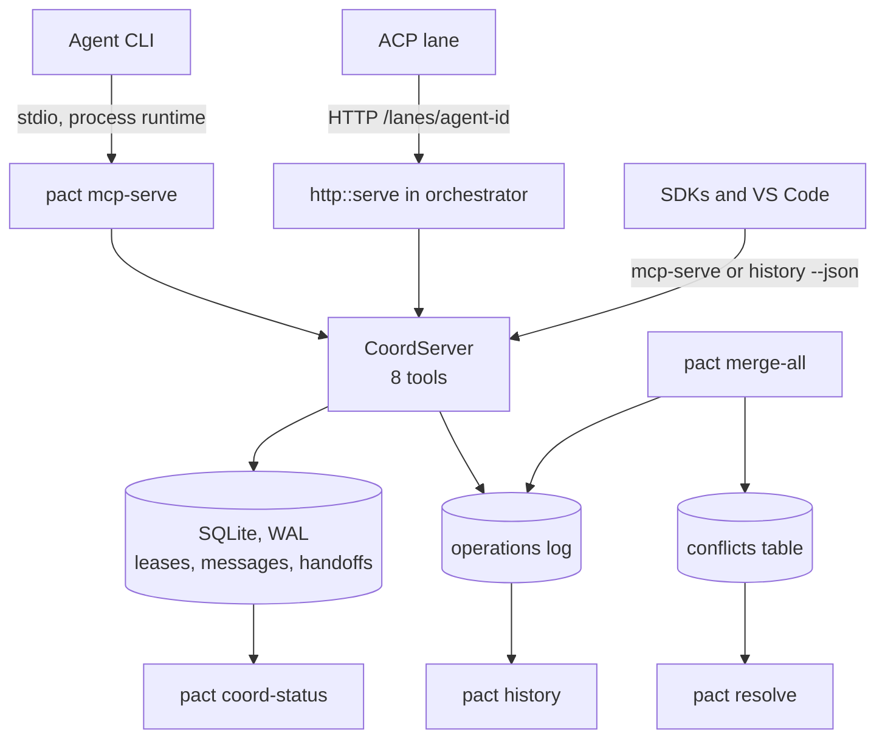

# The coordination server: leases, messages, handoffs, HTTP mode, SDKs

## Current design

`pact-coord` is the advisory coordination layer between agents in one repo session: glob-based, TTL-expiring file leases plus a threaded message log and a typed handoff protocol. It never blocks or enforces anything; it records and reports. It is an MCP server (`rmcp`) backed by one SQLite database per repo. The database lives under the platform data directory keyed by a hash of the repo root, not under `.pact-<repo>/`, so a stray relative path in a workspace cannot reach it. `PACT_COORD_DIR` overrides the root, each directory records its repo in `repo.txt`, and `pact gc` removes directories whose repo is gone (#416). Opens use WAL plus a 5 s `busy_timeout` because every agent runs its own process against the same file.

**Tools (8).** `claim_files`, `release_files`, `list_claims`, `send_message`, `check_messages`, `request_handoff`, `check_handoffs`, `respond_handoff`.
- `claim_files` always records the claim and returns `accepted: true` with `has_conflicts` and the `conflicts` list. `fail_on_conflict: true` instead returns an error before writing anything (#162). Claims are deduplicated per holder and pattern, `ttl_seconds` is bounded to (0, 24h] (default 15 min), and release matches by exact pattern or by glob overlap on disk (#31, #32, #36, #30). A literal path that does not exist yet resolves to itself so two agents claiming the same new file still conflict (#235). `list_claims` returns every active lease (#149).
- Messages use per-agent read cursors, so broadcasts reach each recipient once. `check_messages` skips the caller's own broadcasts (#25).
- Handoffs follow a Contract Net shape: `pending` to `accepted`, `rejected`, `narrowed` (with `narrowed_files`), `expired` or `cancelled`. Nothing blocks, callers poll. Rows mutate in place, so the cursor tracks `activity_seq`, not row id. Expiry is lazy, a requester only sees its own request once it leaves `pending`, and `pact teardown` cancels pending requests addressed to the removed workspace (#163).

**Transports.** The process runtime launches `pact mcp-serve` per agent over stdio. A line-level shim answers any request before `initialize` with -32601 so Copilot's `server/discover` probe does not kill the handshake (#291). The ACP runtime instead runs `pact_coord::http::serve` inside the orchestrating process: one Streamable HTTP server on `127.0.0.1:0`, one route `/lanes/<agent-id>` per lane added with `add_lane`, so identity comes from the URL and the model never chooses it (#329).

**Observability.** `operations` is an append-only log (`claim`, `release`, `broadcast`, `message`, `coord_connect`, `merge_all`, `arbiter_decision`, `teardown`, `conflict_resolve`) behind `pact history` (#84, #235). `pact coord-status` reads leases, pending counts and connected agents without moving any cursor, and warns when a finished workspace never connected (#64, #235). `conflicts` stores unresolved `merge-all` conflicts (`open`, `resolved`, `abandoned`) for `pact resolve` (#85). `pact clear-leases` wipes all leases on request (#209).

**Clients.** Python and TypeScript SDKs (`bindings/`) wrap the official MCP client SDKs, spawn `pact mcp-serve` and raise `PactCoordError` on `isError`; they are repo-local and mirror the tool surface (#127). The VS Code extension renders `pact history --json` (#128).

**Known limits.** `expand_glob` walks the whole workspace on every call (#72). A wildcard that matches nothing on disk cannot conflict (#235). Some agents still end up without a connected `pact-coord` under concurrent launches, an open issue made rarer by #184 (#105). The `operations` table has no retention.

### Superseded decisions

- `claim_files` response field `granted`: superseded by `accepted` (#36).
- `release_files` by exact pattern string only: superseded by glob-overlap matching (#32).
- Reusing `messages`' id-based cursor for handoffs: superseded within #163 by `activity_seq`.
- Coord database cleanup left to nothing: superseded by `PACT_COORD_DIR`, `repo.txt` and `pact gc` (#416).
- "No standing network-facing coordination server" (SDK design, #127): superseded for the orchestrator by the loopback HTTP server (#329). The SDKs still speak stdio only.
- SDK "four methods": superseded as the tool surface grew to eight (#149, #163).
- `expand_glob` returning nothing for a not-yet-created literal path: superseded by self-resolution (#235).
- A multi-threaded tokio runtime for `mcp-serve`: replaced by a current-thread runtime (#105), which did not change the connection-status failure rate.
- Strategic question of keeping advisory leases at all versus `pact conflicts` diffing: undecided, tracked on #227.

## History

The sections below are the issue-by-issue record, moved verbatim from
the old single DESIGN.md. Read them for the why; the summary above is
the current design and wins where they disagree. New decisions in this
area go at the end of this file.

### pact-coord: introduction

Advisory, glob-based, TTL-expiring file leases plus a threaded message log
between agents -- not enforcement, and deliberately not deep semantic
dependency analysis (see the README). Runs as its own process (`pact
mcp-serve`, launched by the agent CLI itself over stdio, not run in-process
by the orchestrator) speaking MCP via `rmcp`, backed by a SQLite database
shared across every agent in one repo's session.

### Database placement

The coordination database is *not* placed under `.pact-<repo>/` alongside
per-workspace bookkeeping (locks, metadata, logs). Those are
blast-radius-limited to the one agent whose workspace they belong to; this
database is depended on by *every* agent in the session. That directory
sits directly inside the same tree as each workspace (e.g.
`workspaces/<id>/../../state.db` is a trivially short relative path), and
headless launches default to `bypassPermissions`, so a careless broad shell
command in any one workspace could reach and corrupt state every other
agent depends on. Placing it under the platform's local data directory,
keyed by a hash of the repo root, isn't a hard security boundary (an
agent's Bash tool can still reach anywhere given an absolute or crafted
path) but removes it from being stumbled into by accident via
`../..`-style relative paths, which is the realistic risk.

The cost of that placement was that nothing ever removed a directory
(issue #416): on the owner's machine `%LOCALAPPDATA%\pact` held 6,622 of
them and 372 MB, nearly all from test runs, since every temporary
repository the suite creates gets its own hash and the tests' cleanup
helpers removed the repository and its state directory but not this.
Three changes. `PACT_COORD_DIR` overrides the root, and the repository's
`.cargo/config.toml` sets it to `target/pact-coord` through cargo's
`[env]` table, so every test process and every pact binary a test spawns
inherits it without each test helper having to remember; an installed
binary never reads that file. Each directory now records its repository
in `repo.txt`, because the hash cannot be reversed. And `pact gc` removes
directories whose recorded repository no longer exists, once nothing in
them has changed for `--older-than` and they hold no unexpired lease. A
directory with no `repo.txt` predates the record and is treated the same
way: its repository, if it still exists, writes `repo.txt` the next time
pact opens it, so only a week-idle repository could lose its history to
this, and `--dry-run` shows the list first.

### WAL mode

WAL is needed because the coordination database is opened concurrently by
a separate OS process per running agent (each `pact mcp-serve` is its own
process), not just separate threads in one process. `busy_timeout` means a
writer under real contention blocks briefly instead of immediately erroring
with `SQLITE_BUSY` -- prior art's "40-50 concurrent agents" claim implies
that contention is the normal case, not an edge case.

### Per-agent read cursors

A cursor per agent (rather than a shared `read_at` column on the message
itself) is what makes broadcasts work correctly: each recipient needs to
see a message once independently of whether other recipients have already
seen it, which a single mutable "read" flag on the row can't represent.

`check_messages` also excludes the caller's own broadcasts (issue #25) --
the original query only filtered `to_agent` against the caller, so a
broadcast (`to_agent IS NULL`) was never checked against `from_agent`,
meaning an agent got its own broadcasts echoed straight back. Real-world
effect: an agent polling `check_messages` in a loop and reacting to
broadcasts (the idiomatic pattern here) would react to its own, doubling
work or looping. The cursor advances over every recipient-matching row,
including the caller's own broadcasts, not just the ones actually
returned -- otherwise an agent that only ever broadcasts would never
advance past id 0 and would rescan the full `messages` table on every call.

### Lease system

`claim_files` is advisory, not enforced -- the response field is `accepted`
(not `granted`, renamed in issue #36), always `true`, alongside a
`has_conflicts` boolean and the `conflicts` array itself. `granted: true`
was the original name and was found to be actively misleading: an agent
LLM reading `{granted: true, conflicts: [...]}` is very likely to proceed
as though it holds the file exclusively, when the claim is recorded either
way regardless of what `conflicts` contains.

Two correctness gaps found via direct testing, both fixed:
- **No dedup (issue #31).** `claim_files` used to insert a fresh row on
  every call, even an identical repeat from the same holder -- confirmed
  at 8-agent stress-test scale (160 rows for what should have been at most
  8). Fixed via `ON CONFLICT(holder, pattern) DO UPDATE`, keyed on a
  `leases_holder_pattern` unique index added by a one-time migration in
  `db::open` that first collapses any pre-existing duplicates on an
  already-on-disk database (from before the index existed), so opening an
  older database doesn't fail outright.
- **`release_files` was exact-string-match only (issue #32).** Claiming
  `src/add.js` then releasing `src/*.js` returned "released 0 lease(s)".
  Now matches either an exact pattern-string match (kept as a fallback for
  a lease whose claimed files have since been deleted from disk, where
  glob expansion alone can't find anything to overlap against) or a real
  glob-overlap match against actual files on disk, the same expand-and-
  intersect approach `claim_files` already uses for conflict detection.

`ttl_seconds` is bounded (0, 24h] (issue #30) -- unvalidated before, a
negative TTL silently produced an already-expired lease and an unbounded
one produced an `expires_at` centuries out, both misleadingly returning
`accepted: true` either way.

### `pact clear-leases` (issue #209)

Leases persist in SQLite across `mcp-serve` process restarts by design --
coordination state needs to outlive any single sidecar process (see
"Database placement" above). Combined with the 15-minute default TTL,
this meant a fresh dev/test run's very first claim could hit a false
conflict against a *prior* run's still-live lease from minutes earlier --
a real report: `fail_on_conflict=True` raised before the reporter's own
script had claimed anything at all.

**Deliberately not fixed by shortening the default TTL or building a
"stale" detector.** Both were considered and rejected in a real design
conversation before implementing anything (this project's standing
convention for genuine forks -- see #65, #84/#85, #159-162): a shorter
default trades off against real agent sessions that legitimately run
longer than the new default without re-claiming, silently weakening real
conflict detection to fix a dev-loop annoyance; and "stale" has no clean
definition here (by age? by workspace existence? by repo?) that can't
also misclassify a real, still-relevant lease from a genuinely slow
agent.

**What shipped instead: `pact clear-leases`**, an explicit,
unconditional wipe of every lease row (active or already expired) for
the repo's coordination database -- no heuristic, no scope decision to
get wrong, purely "you, the caller, are asserting nothing real is in
flight, so nothing is." The same posture leases themselves already take
(advisory, not enforced) applied to their own lifecycle management.
Messages and history are untouched -- this is scoped to the one table
issue #209 was actually about.

### Typed handoff/negotiation protocol (issue #163)

The project's actual differentiator bet, stated directly by the user
during planning: real multi-agent *cooperation* while working -- N
agents coordinating on one feature better than any single CLI's own
built-in multi-agent mode or a third-party orchestrator -- not just
mechanical conflict detection after the fact. Coordination before this
issue was two primitives: advisory file leases and a flat message log.
Nothing let one agent formally ask another "can I take these files" or
"please hold off on this scope" and get back a real, structured answer
instead of having to parse prose.

**Given real weight, not picked unilaterally**: two research passes ran
before any schema was written -- prior art in distributed/multi-agent
negotiation protocols, and the polling-vs-blocking reliability question
specific to this system's own constraints (agents talk to `pact
mcp-serve` synchronously over stdio, no persistent connection, no
server-initiated push). Findings, synthesized into a concrete design and
confirmed before implementation:

- **Contract Net Protocol** (Reid G. Smith, 1980; FIPA-standardized) is
  the closest real prior art: `cfp -> {propose|refuse} -> {accept-
  proposal|reject-proposal} -> {inform-done|failure}`, with a `reply-by`
  deadline as a first-class protocol field -- not an external convention
  -- so the initiator never blocks past a known bound. The status
  vocabulary here (`pending -> accepted|rejected|narrowed|expired|
  cancelled`) is shaped by it directly.
- **RFC 5546 (iTIP)**, the real-world precedent for "narrowed": a
  calendar invite's `COUNTER` method carries a *modified event*, not
  prose -- modeled `narrowed` the same way, carrying a structured
  `narrowed_files` scope rather than leaving the counter-offer as free
  text the requester has to interpret.
- **MCP's own 2026-07-28 draft**, moving long-running requests to a
  stateless, poll-friendly pattern (an opaque token the caller re-submits
  to check progress) rather than a stateful in-flight wait -- confirms
  polling, not blocking, is the right shape for a protocol designed
  under this exact no-persistent-connection constraint, not just this
  project's own precedent.
- **Never block on `ask`**: an agent's own MCP tool call blocking is not
  like a stateless backend service holding a connection open -- it
  pauses that agent's entire reasoning loop, with no orchestrating
  process watching that specific call to intervene if the other side
  never responds. `pact-coord` has no background-task machinery at all
  (`mcp-serve`'s own `tokio::Runtime` exists solely to satisfy the MCP
  SDK's async-trait requirement for stdio, not to host a scheduler) --
  introducing one just for a bounded wait would cut against that
  deliberately minimal footprint for no real benefit.

**Schema**: `handoff_requests` (id, from_agent, to_agent,
requested_files JSON, message, status, created_at, expires_at,
responded_at, response_message, narrowed_files JSON, activity_seq) plus
`handoff_read_cursors`, mirroring `messages`/`read_cursors`'s existing
shape rather than inventing a new one. `activity_seq` is the one real
addition beyond that mirror -- see below for why.

**MCP tools** (`crates/pact-coord/src/server.rs`): `request_handoff`
(returns immediately with a request id and expiry, never blocks),
`check_handoffs` (cursor-based poll, same model as `check_messages`),
`respond_handoff` (accept/reject/narrow -- only the request's own
`to_agent` may respond, and only while genuinely `pending`; responding
to an already-terminal request errors rather than silently overwriting a
real prior outcome).

**A cursor bug found and fixed before it shipped, not after**: `messages`
rows are insert-only, so a simple "id > cursor" works fine there -- once
you've seen message N, there's nothing more to learn about it. A
`handoff_requests` row is *mutated in place* (status flips from
`pending` to `accepted`/etc. on the same row via `UPDATE`), so a cursor
keyed on the row's own `id` would mean the requester's cursor advances
past the row the moment it's created, and the requester would *never*
see the eventual response -- the entire point of the protocol silently
broken by reusing a pattern that only looks identical to `messages`' at
first glance. Fixed with a separate `activity_seq` column, bumped to a
fresh monotonic value on both insert and `UPDATE` (via `(SELECT
COALESCE(MAX(activity_seq), 0) + 1 FROM handoff_requests)` in the same
statement) -- the cursor tracks activity, not row identity. Caught by
writing `requester_sees_the_response_once_the_target_replies` before
trusting the design, not after a real bug report.

**Requester doesn't self-echo a still-pending request**: `check_handoffs`
returns incoming requests (`to_agent = caller`) unconditionally -- new
information the moment they exist -- but only returns outgoing requests
(`from_agent = caller`) once they've left `pending`. The requester
already knows it sent a pending request (`request_handoff`'s own return
value told it the id and expiry); there's nothing new to report until
the other side actually acts.

**Lazy expiry, no sweeper** -- same `leases::claim_files` pattern
(`DELETE FROM leases WHERE expires_at <= ?1`, evaluated inline at write
time), except an `UPDATE` to `'expired'` rather than a `DELETE`: unlike a
lease, a handoff request's history (who asked whom for what, and how it
was left) stays meaningful after expiry. Evaluated at the start of both
`check_handoffs` and `respond_handoff` -- the latter so responding to an
already-lapsed request correctly errors ("no longer pending") instead of
racing a stale row.

**`pact teardown` integration**: a torn-down workspace can never respond
to a handoff addressed to it, so every still-`pending` request with
`to_agent` equal to the departing workspace is marked `cancelled`,
best-effort (a failure here is logged, never fails teardown itself --
the workspace removal already succeeded by that point). Deliberately
scoped to *incoming* requests only -- an outgoing request the departing
workspace itself sent, still awaiting a response, is left alone: the
target may still meaningfully act on it even though the requester is
gone.

**SDK bindings kept in sync**, per this project's existing default (see
"pact-coord SDK bindings v1" below) -- both `bindings/python` and
`bindings/ts` gained matching `request_handoff`/`check_handoffs`/
`respond_handoff` methods and `HandoffRequest`/`HandoffRequestResult`
types, verified with the same real-`pact-mcp-serve`-subprocess,
no-mocking approach their existing tests already use, not just the Rust
side.

### Opt-in strict claim response (issue #162)

pact has no mechanism to physically stop an agent from writing a file --
it never sits between an agent and its own file-write tool calls, by
design (doing so would require CLI-specific integration that breaks
agent-agnosticism). The `granted`->`accepted` rename (issue #36, above)
exists precisely because pretending to lock something it can't enforce
was found actively misleading. A real queueing/blocking primitive
(`claim_files` actually waiting until a conflicting lease frees) was
considered and explicitly rejected in the same triage discussion this
issue came from -- a bigger build, real UX risk (a hung MCP tool call
needs a mandatory max-wait), not justified by current evidence of need.

Chosen direction instead: an opt-in `fail_on_conflict` boolean param on
`claim_files`. Default `false` (unchanged advisory behavior, the only
mode that existed before this). When `true` and the claim overlaps
another holder's active lease, `claim_files` now returns `Err` *before*
touching the `leases` table at all -- checked ahead of the `INSERT`
loop, not after -- so a rejected claim leaves no trace: a caller
retrying after resolving the overlap won't find its own earlier,
rejected attempt still on record. The MCP layer needed no new plumbing
for this: `leases::claim_files` returning `Err` already flows through
the exact same `error_result`/`isError: true` path a malformed glob or
invalid `ttl_seconds` already used, since it's the same `Result`
being handled. Same mechanism throughout, no new state, no
blocking/queueing.

Verified for real across the whole surface, not just the Rust layer:
3 new `pact-coord` unit tests (rejects an overlapping claim, doesn't
record it, still accepts a non-conflicting one), plus a matching real
end-to-end test in both `bindings/python` and `bindings/ts` -- two real
`pact mcp-serve` sessions, one claiming a real file first, the second
retrying with `fail_on_conflict` and asserting the SDK's own
`PactCoordError` is raised, not just that the Rust-level function
returns `Err`.

### `list_claims` MCP tool (issue #149)

From an outside code review (2026-07-24), verified against source: only
4 `#[tool]` handlers existed (`claim_files`/`release_files`/
`send_message`/`check_messages`) -- an agent had no way to ask "what's
currently claimed, by whom, until when" without inferring it indirectly
from a `claim_files` conflict response. Only the human-facing `pact
coord-status` CLI command exposed the full picture.

Added as a 5th tool, thin wrapper over the existing
`leases::list_active_leases` query (already backs `coord-status`, no new
query logic). No holder filter, same as `coord-status` -- a full
snapshot of coordination state, not scoped to "not me" the way
`check_messages` excludes an agent's own messages. `ActiveLease` gained
`Deserialize`/`PartialEq`/`Eq` derives (previously `Serialize`-only,
since nothing needed to parse it back) so both the server-side tests and
the pact-coord SDK bindings could round-trip it directly instead of
string-matching JSON output.

Shipped alongside matching `list_claims`/`listClaims` methods in both
pact-coord SDK bindings (issue #127) -- keeping the bindings in sync
with the actual tool surface as it grows is the default, not something
that needed a separate decision each time a tool gets added.

### Known scaling limit: `expand_glob` cost (issue #72)

`expand_glob` walks the entire workspace file tree (`WalkDir::new(root)`)
on every call, with no early pruning based on the glob's literal prefix.
`claim_files`' conflict-detection path calls it once per incoming pattern
*and* once per existing lease row being checked for overlap, so a single
`claim_files` call can trigger several full tree walks -- O(files in
workspace) per call, not O(1). Fine at the scale this has actually been
tested at; flagged here as a deliberate, known tradeoff rather than a
silent surprise, since the README cites MCP Agent Mail's 40-50-concurrent-
agent scale as prior art without pact itself having been tested anywhere
near that. Not optimizing preemptively -- revisit (glob-prefix-based
pruning, or caching the file list per workspace between calls) only if
real usage actually hits this as a bottleneck.

### Pre-initialize requests are answered, not fatal (issue #291)

rmcp 0.16's server handshake treats the very first client message as the
`initialize` request and exits the whole server with
`ServerInitializeError::ExpectedInitializeRequest` on anything else.
GitHub Copilot CLI 1.0.85+ opens an MCP stdio connection with the
2026-07-28 `server/discover` request *first*, and only falls back to the
legacy `initialize` after that is refused (confirmed against the real CLI
and against github/copilot-cli#4888). The two collide: `pact mcp-serve`
received `server/discover`, rmcp exited code 1, and every Copilot worker
ran the whole session with no coordination tools (the `pact-coord:
failed` line in the 2026-09-30 benchmark, issue #308).

Fix: `serve_with_io` runs a line-level shim between the client transport
and rmcp. Before the client's `initialize` has been seen, any other
*request* (has an `id`) is answered directly with JSON-RPC -32601
("method not found") and never forwarded, and any other *notification*
(no `id`) is dropped; rmcp therefore still sees `initialize` as the first
message it gets and its strict handshake is satisfied. After `initialize`
passes through, the shim is a transparent byte pump. This is deliberately
a dumb refuse-and-wait, not a real `server/discover` implementation: pact
only needs the legacy handshake to survive discovery, and answering
discover for real would mean tracking the modern protocol's capability
negotiation the SDK does not expose here. Covered by a stdio-level test
(`server/discover` -> `initialize` -> `initialized` -> `tools/list` all
on one connection) and a unit test of the classifier. An alternative,
upgrading rmcp to a version that tolerates unknown pre-initialize
requests, was not taken: 0.16 -> 3.x is a major jump across the whole
tool-router API for one handshake behavior, and the shim is independent
of the SDK version.

### Known limitation: intermittent MCP connection status under concurrency (issue #105)

Found during the 2026-07-23 Claude Code stress-testing campaign: under a
concurrent `spawn-many` batch, one or more agents can end up with their
`pact-coord` MCP connection status stuck at `pending` (or reported
`failed`) for the whole session -- silently losing all coordination
capability, no retry, no warning beyond a log line. Reproduced at 1/6
batches at 2-agent concurrency, 40% of agents at 5- and 10-agent
concurrency.

**Three concrete angles investigated, none of which reduced the rate:**

1. Switching `mcp-serve`'s tokio runtime from the default multi-threaded
   one to `new_current_thread()` (a real, worth-keeping improvement on
   its own merits -- one stdio server serving one client has no use for a
   worker thread pool -- but it didn't move the failure rate).
2. Staggering concurrent launches (400ms apart, individual `spawn` calls
   instead of one `spawn-many`) -- made it *worse* (7/10), not better.
3. Switching to a faster/cheaper model (Haiku) to keep investigation
   costs down -- made it *worse* too (6/10 vs. Sonnet's 4/10), which
   points at *why*: a faster model reaches Claude Code's own status
   snapshot sooner after subprocess launch, giving less runway either
   way -- consistent with a one-shot-snapshot explanation, not a
   pact-side slowness explanation.

**Decisive diagnostic: `pact mcp-serve` itself is confirmed fast and
100% reliable, entirely apart from Claude Code.** A small script sent a
real MCP `initialize` request directly to N concurrent `mcp-serve`
subprocesses over stdio, no agent CLI involved at all. Solo: 47ms. At
10-way concurrency: 140-203ms across all 10, zero failures. This rules
out pact's own subprocess -- database open/migration, the tokio runtime,
process startup -- as the bottleneck; it was never the slow part.

**Working theory, not confirmed further:** Claude Code reports an MCP
server's status exactly once, in its very first `system/init` event --
there's no follow-up event if the connection settles a moment later. The
actual failures are likely real OS-level CPU scheduling contention (many
concurrent, genuinely-inferencing `claude.exe` processes competing for
cores) delaying Claude Code's *own* process from promptly reading its
already-ready child's response within whatever internal timeout it
applies to that one-time snapshot -- a boundary pact's own process can't
see across or influence.

**Consequence for a real user:** running `spawn-many` with several
Claude Code agents (5+) carries a real, roughly 20-50%-per-agent (highly
environment-dependent) chance that one or more agents silently proceed
with zero coordination capability for their entire session -- no
`claim_files`/`send_message`/`check_messages` availability, no retry, no
visible signal beyond a `WARN`-level log line most users won't be
watching for. Every *other* safety net (worktree isolation, `merge-all`'s
real conflict detection, Weaver's pre-flight text-overlap warning) still
applies regardless -- this removes one layer, not all of them.

**2026-07-29 update: a different angle did present itself, from an
unrelated investigation, and it measurably helped.** Real-agent-
verifying the Arbiter Write-fresh redesign (issue #106) the same night
surfaced issue #184: `run_and_stream` never explicitly closed a spawned
agent's stdin, leaving it inherited/ambiguous, and one real Claude Code
invocation was directly observed stalling for several seconds ("no
stdin data received in 3s, proceeding without it") before apparently
misreading an empty task. An unexpected multi-second stall in an
agent's own startup path is exactly the kind of thing that could throw
off a race that's specifically timing-sensitive under concurrency --
plausible, not confirmed, as a *contributing* factor to this issue,
distinct from (and possibly compounding) the OS-scheduling-contention
theory above.

After #184 shipped, re-ran the exact same reproduction this issue's own
text describes (2-agent concurrent `spawn-many`, 6 back-to-back
batches, Haiku for cost control) against real `main`: **12/12 real
agent connections reached `connected`, zero failures** -- versus the
original 1/6 (and Haiku specifically making it *worse*, 6/10, before
#184). Not proof the underlying OS-scheduling race is gone -- a
12-for-12 run doesn't rule out a race that was already intermittent
at a ~1-in-6 rate, and the sample here is small, matched to this
session's "modest real-agent spend" brief rather than an exhaustive
re-validation. Documented honestly as a real, measured improvement
worth noting, not a confirmed fix -- left open rather than closed,
since the original OS-contention theory was never ruled out, only
found to have a real compounding factor that's now removed.

Left open, documented -- revisit with a larger real-agent sample if a
regression report comes in, or if Claude Code's own MCP client behavior
changes.

### Streamable HTTP mode: one server, one route per lane (issue #329)

Part 1 of the ACP lane runtime (issue #306). Measured on 2026-10-01 with
the real Copilot CLI (1.0.90): eight lanes as eight cold `copilot -p`
processes took 50.9 s and 2,456 MB to finish a trivial task; eight ACP
sessions inside one `copilot --acp` process took 5.6 s and 445 MB. That
is the runtime pact is moving to, and it changed how pact-coord has to be
reached. ACP lets a client name MCP servers per session, which is exactly
how pact gives every lane its own agent id, but Copilot refuses stdio
servers from the client (`Rejecting non-http/sse MCP server "pact-coord"
from client`, its debug log) and accepts `type: "http"`. Verified by
pointing two sessions at two throwaway HTTP servers: each session's
tool call landed on its own server, so a URL can carry lane identity.

`pact_coord::http::serve` (feature `http`, enabled by pact-core) binds
`127.0.0.1:0` inside the orchestrating process; `add_lane` registers one
rmcp `StreamableHttpService` per lane, reached at `/lanes/<agent-id>`.
Lanes register while the server runs rather than at construction
because `spawn-many` creates each lane's workspace, and so learns its
id, inside the lane's own thread after the server is already up; an
axum fallback dispatches on the `/lanes/<id>` prefix, which is safe
because rmcp's service reads only the HTTP method and headers, never the
path. The service factory builds the same `CoordServer` the stdio path
builds, with that lane's agent id and workspace root, opening its own
SQLite connection when the lane connects, so nothing about the tools,
the operation log or `coord-status` changes:
`each_lane_route_acts_as_its_own_agent` shows two lanes' claims recorded
under their own ids and both logged as connected through the HTTP
handshake, and `remove_lane` makes a route 404 again. Stateful mode
(rmcp's default) is kept so one MCP session maps to one `CoordServer`,
as one `mcp-serve` process does today. Identity by route rather than by
a header or a tool argument because it is the one thing the agent cannot
get wrong: the model never sees or chooses it.

Also a win on its own, before any ACP lane exists: Copilot's
`--additional-mcp-config` accepts HTTP servers too, so the process
runtime can hand every lane a URL and stop spawning one `pact mcp-serve`
child per lane. Off by default (`[features] http`) so the Python/TS
binding builds do not pull axum and hyper; the handshake shim above
stays stdio-only because over HTTP every request is answered on its own,
so a pre-initialize request gets an error response from rmcp instead of
taking the whole server down. Whether Copilot's HTTP MCP client sends
`server/discover` at all is unverified; it does not matter here.

### Coord status (issue #64)

`pact_coord::status` gives `pact coord-status` a read-only snapshot of the
coordination layer: every active (non-expired) lease, and a pending
(unread) message count per known agent. Landed because pact-coord was
otherwise a black box from outside an MCP client -- the only visibility
was indirect, via `pact conflicts`' per-file lease/message enrichment,
which only surfaces coordination context for files already flagged as
conflicting.

Two things worth knowing:

- **"Known agent" has no dedicated table.** Agent identity is implicit
  everywhere in this schema (a workspace id doubles as its MCP
  `agent_id`), so `known_agent_ids` unions every place an id can appear --
  lease holders, message senders/recipients, and `read_cursors` rows --
  rather than querying one canonical source.
- **Computing a pending count must not advance anyone's cursor.** Unlike
  `check_messages` (which is the caller *reading* its own messages, and
  correctly consumes them), a status view is a third party looking in --
  looking shouldn't change what a later real `check_messages` call from
  that agent would see. `pending_message_count` runs the identical
  recipient-matching query `check_messages` does, but only counts, never
  writes to `read_cursors`.

### Coordination reachability: "no leases" vs. "no server" (issue #235)

A real production run with GitHub Copilot CLI found `coord-status`
reporting "no active leases" / "no pending messages" for an entire
session where every task's prompt explicitly instructed the agent to
call `claim_files`. Root cause of the *ambiguity* (not necessarily of why
the agent didn't call the tool, which is a separate, larger question --
see the "strategic criticism" discussion on issue #227): pact writes an
MCP config and hands it to the agent CLI, which is responsible for
launching `pact mcp-serve` and connecting to it as an MCP client. If
that never happens -- wrong config, the agent CLI not invoking it, the
agent choosing not to call any coordination tool for the whole run --
`coord-status` reads an empty `leases`/`messages` state and prints
exactly what it prints when everything is working correctly and nobody
has claimed anything yet. Those two states were indistinguishable, and
only one of them means the coordination layer is functioning.

Fixed with a real connection signal, not a guess: `CoordServer::get_info`
(the `ServerHandler` method rmcp calls while answering the client's
`initialize` request -- the one point in the MCP protocol every real
client reaches before any tool call, whether or not it ever calls one)
now logs a `coord_connect` operation for its `agent_id`, reusing the
existing operation log (issue #84) rather than a new table.
`CoordStatus` gained `connected_agent_ids`, and both `pact coord-status`
and `pact status` cross-reference it against `pact list`'s actual active
workspaces: a workspace that's *finished* and never connected gets an
explicit warning/hint naming it, distinct from ordinary "nothing claimed
yet" silence. A still-*running* workspace is deliberately not flagged --
it may simply not have launched `mcp-serve` yet, and flagging every
in-progress run would be noise, not signal.

**Separately, `expand_glob`'s blindest spot.** `leases::expand_glob`
only ever walked the real filesystem, so a claim on a path that doesn't
exist yet -- the "I am about to create this file" case, the single most
important one for conflict avoidance between two agents -- expanded to
the empty set and could never show an overlap. Fixed narrowly: a
*literal* pattern (no glob metacharacters) that matches nothing on disk
now resolves to itself, normalized, so two agents both claiming the same
not-yet-created path see the conflict. A pattern *with* real
metacharacters (e.g. `src/generated/*.ts`) that matches nothing on disk
still can't be resolved this way -- there's no way to know what a
wildcard would match against files that don't exist -- left as a known,
narrower limitation, not attempted here.

**Explicitly not decided here:** whether the advisory-lease model's
future is worth continued investment at all, versus leaning primarily on
`pact conflicts`' mechanical, no-cooperation-required filesystem diffing
(which worked correctly on the same real run that found leases doing
nothing). That's a real strategic fork, not a bug -- see issue #227's
tracking comment for the two options as posed to the user; this pass
only fixes what makes the *current* mechanism honest and correctly
functioning, without deciding whether to keep betting on it.

### Operation log / `pact history` (issue #84)

From an outside strategic-notes review surveying jj (Jujutsu)'s data
model: jj's operation log makes every operation a versioned, replayable
event. Pact's coord DB (leases + messages, both already timestamped rows)
was most of the way to this shape already, but there was no way to ask
"what happened in this session" as a whole -- only `coord-status`'s
current-state snapshot and `conflicts`' per-file enrichment.

**What "operation" means here, precisely:** one already-happened,
significant coordination-layer event -- `claim`, `release`, `broadcast`,
`message`, `merge_all`, `arbiter_decision`, `teardown`. Deliberately
excludes `check_messages`: it's a read, not an event that changed
anything, and the issue's own proposed shape didn't list it either.
`merge_all` is logged as **one row per invocation**, not one row per
workspace merged/skipped within it -- the per-workspace outcome (merged
ids, skipped ids + reasons) lives inside that one row's JSON `detail`
column. A `merge-all` run is one event from a user's perspective ("what
happened when I ran this"); splitting it into N rows would make
reconstructing "this was one call" require correlating rows back
together for no real benefit, since the detail blob already carries the
per-workspace breakdown the issue asked for.

**Storage: reuses the existing coord SQLite DB**, not a new one -- a new
`operations` table (`id`, `created_at`, `op_type`, `workspace_id`
nullable since `merge_all` spans multiple workspaces, `detail` as a JSON
text blob) alongside `leases`/`messages`/`read_cursors` in `db::open`'s
schema. This is exactly the "reuse what's already there" option the
issue itself favored, and it means every existing concurrency guarantee
(WAL mode, `busy_timeout`, one file per repo keyed by `db::db_path`)
applies to operations for free, no new infrastructure.

**Where logging happens, by process:** `claim`/`release`/`broadcast`/
`message` are logged inside `pact-coord`'s own MCP tool handlers
(`server.rs`), right where `leases::`/`messages::` are already called
with the connection in hand. `merge_all`/`arbiter_decision`/`teardown`
happen in the main `pact` process (`pact-core`), never inside an
`mcp-serve` subprocess, so they go through a new `pact_coord::log_operation`
entry point that opens its own short-lived connection against the same
`db::open(repo_root)` path -- the same pattern `pact_coord::status`/
`leases_matching`/`message_count_involving` already use for read access
from `pact-core`, just for a write instead.

**Query surface: `pact history`** (over `pact session-log`: shorter, a
familiar git-like mental model). Filters: `--workspace <id>`, `--since
<unix-seconds>`, `--type <op_type>`, `--limit <n>`. Human-readable output
by default (one line per operation: timestamp, type, workspace, a short
summary derived from `detail`); `--json` for the raw rows. No dedicated
`--outcome` filter in this first cut -- "outcome" (success/failure) only
means something for `merge_all`/`arbiter_decision`, and extracting it
generically would mean parsing type-specific fields out of an opaque
JSON blob; `--type merge_all` plus reading the printed detail covers the
same need without that complexity. Can be added later if it's actually
missed.

**Explicit non-goals**, per the issue's own scope: read-only query only,
no undo, no "fork from any past state," no replay-as-mutation -- pact is
a single-orchestrator-per-run tool, not jj's multi-user concurrency
model, so none of jj's distributed-operation-log machinery applies here.
Also explicitly not solved here: unbounded row growth over a very
long-lived repo. The issue didn't ask for a retention/cleanup policy, and
inventing one unprompted would be scope creep past what was asked --
noted here as a known limitation, not silently ignored, revisit if a
real repo's `operations` table actually becomes a problem in practice.

### Persisted conflicts / `pact resolve` (issue #85)

Companion to issue #84 above, and explicitly sequenced after it landed --
this builds on the same coord DB and the same `db::open`-per-call
pattern, rather than inventing separate storage. See DESIGN.md ("pact-vcs
> Persisted conflicts (issue #85)") for the git-level mechanics
(`ConflictedWorkspace`, `resolve_conflict`); this section covers what's
specific to persistence and the CLI surface.

**Storage:** a new `conflicts` table, alongside `operations`/`leases`/
`messages` in the same coord DB -- `workspace_id`, `target_branch`,
`files` (JSON array), `created_at`, `status` (`open`/`resolved`/
`abandoned`), `resolved_at`. `pact-core::merge_all` persists one row per
`ConflictedWorkspace` right after the merge attempt, best-effort (a
persistence failure warns, doesn't fail the whole `merge_all` call --
same posture as operation-log writes).

**Naming:** `PersistedConflict`, deliberately not `Conflict` -- that name
is already taken by `leases::Conflict` (an advisory lease-overlap
warning inside `claim_files`'s response), a completely different
concept. A third, also-unrelated "conflict" already exists in this
codebase too: `pact_core::FileConflict` (issue #8's cross-workspace
file-touch report, driving the pre-existing `pact conflicts` command,
which is informational-only and has nothing to do with `merge_all`).
Three genuinely different concepts sharing an English word is a real
source of confusion worth naming explicitly, not just in code -- this is
exactly why the issue itself insisted `pact resolve` be a new verb
distinct from the existing `pact conflicts`, and why this section spells
out the naming collision by name.

**What "resolved" means:** a persisted conflict becomes `resolved` only
when `pact resolve <id>` retries the merge and it succeeds (cleanly, via
auto-resolve, or via Arbiter) -- not when a user manually decides it
doesn't matter anymore (that's `abandoned`, a separate explicit action,
`pact resolve <id> --abandon`). Every retry, successful or not, is logged
as a `conflict_resolve` operation (reusing issue #84's log), so `pact
history` shows the attempt happened even when it didn't resolve anything.

**Retention:** no automatic expiry, matching issue #84's own precedent of
not inventing an unprompted cleanup policy -- `abandoned` is the manual
escape hatch for "not worth resolving," not a TTL.

**CLI surface:** `pact resolve` (no workspace id) lists every open
conflict; `pact resolve <id>` retries the most recent open one for that
workspace, taking the exact same `--union`/`--test-cmd`/`--arbiter-agent`/
`--arbiter-safety` flags as `merge-all` (extracted into a shared
`build_arbiter_config` helper in `pact-cli` so the two commands can't
drift in how they parse an equivalent flag set) -- this directly answers
the issue's own open question about Arbiter's relationship to a
persisted conflict: yes, standalone, outside a live `merge-all` run,
using the identical mechanism. Exit code 2 on a still-conflicted retry,
mirroring `merge-all`'s own "skipped, not a hard failure" exit-code
convention (issue #27) rather than a plain error.

### pact-coord SDK bindings v1 (issue #127)

User's explicit framing: this is a foundation, not a quick add -- "plan
really deeply... must consider every angle" before writing any client
code. Design questions resolved, in order:

**Transport: spawn `pact mcp-serve` and speak real MCP over stdio --
not a new server.** The critical fact that decides this whole design:
`pact mcp-serve` is *not* a persistent daemon a client could connect to
-- it's a fresh subprocess launched per agent session, over stdio, backed
by the shared SQLite DB (see "Database placement" above). There is no
standing network-facing coordination server today, and inventing one for
this SDK would be new server-side surface, a new attack surface (a real
listener needs real access control; a stdio pipe implicitly scoped to
whoever spawned it doesn't), and a new maintenance burden -- none of
which the issue actually asked for. The right model: a Python/TS client
using pact-coord *is* an MCP client, exactly like Claude Code or Copilot
CLI already are, just driven by a script instead of an LLM. This also
directly reuses the existing `--coord-command`/`--coord-arg` override
(issue #10) -- pointing an agent at a custom coordination command is
already a supported extension point; the SDK is simply the first
non-agent-CLI consumer of it.

**Build on the official MCP client SDKs, don't hand-roll the wire
protocol.** `pip install mcp` (Anthropic's own Python MCP SDK) and
`@modelcontextprotocol/sdk` (npm) both install cleanly and are the
correct, protocol-compliant way to speak MCP's stdio transport and
initialize handshake -- confirmed by installing both for real and
inspecting their actual client APIs (`ClientSession`/`StdioServerParameters`
in Python; the equivalent `Client`/`StdioClientTransport` in the TS SDK),
not assumed from documentation. Re-implementing JSON-RPC framing and the
MCP handshake by hand in two more languages would be real, avoidable
protocol-compliance risk for zero benefit -- pact-coord's bindings are a
*thin, opinionated wrapper* around each language's official SDK, mirroring
how `pact-agents`' own adapters wrap each agent CLI's conventions rather
than reimplementing them.

**API shape.** One class per language (`PactCoordClient` /
`PactCoordClient`), four methods matching the four MCP tools exactly:
`claim_files`, `release_files`, `send_message`, `check_messages` --
parameters and return shapes match `pact-coord/src/server.rs`'s actual
`ClaimFilesParams`/`ReleaseFilesParams`/`SendMessageParams` and the
`ClaimResult`/`Message` types field-for-field (`accepted`/`has_conflicts`/
`conflicts`, not `granted`, matching the issue #52 rename), not a
redesigned API. Two ways to construct a client: spawn `pact mcp-serve`
itself (the common case, mirrors what pact-core's own orchestrator does
for a real agent), or accept an already-open MCP session (for a caller
that manages the subprocess itself) -- the latter is needed internally
regardless, so exposing it is free.

**Error semantics: match `isError`, don't invent a new taxonomy.** Every
pact-coord tool result already carries `isError`/text content on failure.
The binding raises a typed exception (Python: `PactCoordError`; TS: same
name) carrying that exact text, rather than a generic MCP protocol error
-- callers get the same failure message a human reading raw MCP traffic
would see.

**Auth/trust model: unchanged, explicitly a v1 non-goal to extend it.**
Since transport is a locally-spawned subprocess over stdio -- identical to
today's real agent-CLI usage -- there is no new threat model to design
for. The binding does **not** support connecting to a remote/networked
pact-coord instance, because no such thing exists; adding one would be a
materially larger feature (a real daemon, real access control) that
nothing in the original issue asked for. Worth its own design
conversation if real demand shows up, not built ahead of it.

**Packaging: repo-local for v1, not published to PyPI/npm.** Registry
publishing adds real, permanent surface (namespace squatting risk,
security-disclosure process, a release process to keep in sync with
pact's own versioning) for a v1 with no external users yet. `bindings/
python`/`bindings/ts` are installable directly (`pip install
./bindings/python`, or a git URL; `npm install <git-url>` or a local
path) -- publishing to real registries is a reasonable follow-up once
there's actual demand, not a default to reach for immediately.

**Versioning:** the binding targets whatever `pact mcp-serve` binary is
on `PATH` (or an explicit path) at call time -- same "trust the installed
CLI" model every other pact-adjacent tool already has, no separate
protocol-version negotiation invented. A minimum-compatible-pact-version
note lives in each binding's own README rather than an enforced runtime
check, matching how CLI flags document their own minimum requirements
elsewhere in this project.

**Testing:** unlike agent-CLI-invoking code, spawning `pact mcp-serve`
costs nothing and involves no LLM -- it's a deterministic Rust binary.
Both bindings' test suites spawn a real `pact mcp-serve` subprocess
against a real throwaway repo and exercise claim/release/send/check
end-to-end for real, the same "real repo, no mocking" standard this
project already holds git-interaction tests to, not stubbed out the way
a real agent-CLI call would need to be.

### VS Code extension v1 (issue #128)

From an outside adoption/UX review: `pact history`'s operation log
(issue #84) is genuinely novel among parallel-agent tools, but most CLI
users won't appreciate it as text output the way they'd immediately grok
it as a timeline in their editor. `editors/vscode/` is a minimal webview
that shells out to `pact history --json` (reusing the exact flag already
built for scripting, not a new pact-cli surface) and renders it -- one
command (`pact.showHistory`), one webview panel, a `pact.binaryPath`
setting for when `pact` isn't on `PATH`. Not published to the
Marketplace -- v1 scope per the issue itself.

**Split for testability, not just tidiness:** `render.ts` (HTML
generation -- `escapeHtml`/`formatTimestamp`/`renderHtml`) has zero
dependency on the `vscode` module; `extension.ts` is the thin glue
(command registration, `execFile`, webview lifecycle) that does. This
means the actual rendering logic has real unit tests
(`tests/render.test.ts`) that run with plain `vitest`, no VS Code
Extension Host required -- including a real captured `pact history
--json` payload (two agents claiming/releasing/messaging via the
pact-coord Python binding against a real throwaway repo) as fixture
data, not fabricated JSON, plus an explicit HTML-injection test (a
message body containing `</pre><script>...` must not survive
`escapeHtml` unescaped).

**What's verified vs. not, honestly:** TypeScript compiles clean against
real `@types/vscode`; the real `pact history --json` shape this code
depends on was captured from an actual run and matches what `render.ts`'s
tests assert against; the extension activates in a real Extension
Development Host (`code --extensionDevelopmentPath=...`) without an
immediate crash. **Not verified:** actually seeing the rendered webview
render correctly in a live VS Code window -- this environment can drive
a VS Code process but has no way to inspect a GUI window's visual output,
so the "does it look right" question is unconfirmed here, same
"implemented, not fully live-verified" honesty this project already
applies to the Gemini adapter, the Homebrew tap, and the winget
manifest. Worth a real look on a machine with an actual display before
calling this fully done.

### `gc` must not age coordination directories by looking at them

On the dev machine, with about 7,400 coordination directories, the
first `pact gc --dry-run` took 143 s, and a second one a minute later
found nothing to prune. Both came from the live-lease check (#416):
it opened every candidate's database read-only, about 16 ms each on
Windows, and a read-only open of a WAL database creates `state.db-shm`
and an empty `state.db-wal`. Those fresh files made every directory look
written to just now, so one dry run postponed the real `gc` by the whole
cutoff. Two changes: a directory untouched for longer than the 24 h
lease TTL cap cannot hold a live lease (claiming one writes the
database), so its database is not opened at all, which covers every
directory past the default 7-day cutoff; and age ignores `-shm` files
and empty `-wal` files. The same dry run now takes 3 s and finds the
same 6,405 directories.
