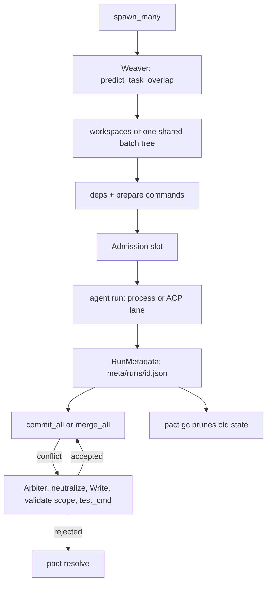

# The Orchestrator: spawn, batches, Weaver, Arbiter, run records and gc

## Current design

`Orchestrator` (`crates/pact-core/src/lib.rs`) is the layer above `pact-vcs`'s `WorkspaceManager`: it creates a workspace, launches the agent, records the run, and merges or tears the results down. `spawn_with_supervisor` runs one lane. `spawn_many` (and `spawn_many_in`, which `pact run` uses so it can supply its own batch) runs N lanes as scoped threads sharing one `Supervisor`, so one Ctrl-C stops every child, and one `Admission` (see `admission.md`). The runtime is `auto` (ACP when every agent supports it, else one process per lane; see `acp-runtime.md`). `safety_override` is one value per invocation, not per task.

Shared-tree batches (#315): `spawn-many --shared-tree`, and every `pact run`, create one worktree `batch-<suffix>`, prepared once, and N lanes in it. A lane is an ordinary workspace (own id, metadata, home, coord config, log, run record, admission slot) whose `path`, `branch` and `base_commit` are the batch's, and `Workspace::shared_batch` names the batch. That field drives the rest: `commit_all` commits the tree once, `merge_all` dedups by branch, `remove_workspace` on a lane drops only its metadata while the batch refuses teardown until no lane remains, and `detect_conflicts` skips lanes (#327). Each lane's prompt gets `shared_tree_preamble` (claim files first, stop on `has_conflicts`, release, no git or installs). Overlap is a refusal in this mode unless `--allow-overlap`.

Weaver: `predict_task_overlap` is a pure text heuristic run before any spawn. `extract_file_tokens` finds path-like tokens named by two or more tasks. It skips negated clauses, with negation carrying across a comma list until a sentence end or an affirmative pivot such as "but" (#239, #317), skips clauses with read-only verbs (`read`, `preserve`, `imitate` and similar), and rejects Title Case brand names and runtime globals like `process.env`. It warns in isolated mode and refuses in shared-tree mode. `pact conflicts` (git-diff based) is the real overlap detector.

Coordination: `coord_config` describes the pact-coord server for each adapter to wire in; `CoordServerOverride` swaps in another command (#10). `coord_warning` judges the last `CoordStatus` of the run, not the first (#28). `coord_status` is a passive relay of what the agent reported and can be stale after a sidecar dies (#201).

Preparation: `prepare` commands (`defaults.prepare` or `--prepare`, the flag replaces the list) run once per workspace or shared tree after dependency prep, regardless of `--deps none`, and in `merge_all`'s integration worktree. A failure is a warning, and results go to `meta/prepare/<id>.json` (#301).

Arbiter, the opt-in verified conflict resolver (`merge_all --arbiter-agent ... --test-cmd ...`): `pact-vcs` calls back through the `ArbiterResolver` hook, so it never depends on `pact-agents`. Per conflicted file, `attempt_arbiter_resolution` rejects lockfiles before spawning anything (#147), snapshots `changed_paths` as a baseline (#199), neutralizes the file's index state (`neutralize_conflict`) and the repo's `MERGE_HEAD` state (`neutralize_merge_state`, restored on every exit path, #185), then hands the agent clean BASE, OURS and THEIRS content to `Write` the full file (#106). `validate_arbiter_scope` accepts only if no marker line (`<<<<<<<` or `>>>>>>>`, #380) remains, no listed file is emptied or deleted, and nothing changed outside the list beyond the baseline. Then `test_cmd` must pass in the same worktree. Any rejection restores the exact unmerged state and leaves a normal conflict for `pact resolve`. Every attempt writes `logs/arbiter-<id>.jsonl` and `.decision.json` (#106, #148).

Records: `RunMetadata` (times, command, cwd, coord status, log path, `files_touched`, model, runtime) is written even when the launch fails (#15, #212). Sidecars live in `meta/deps/`, `meta/runs/` and `meta/prepare/`, so `meta/*.json` holds only workspace records; `WorkspaceManager::open` migrates older state (#343). `pact gc` prunes by age, default 7 days: a workspace's own state only once the workspace is gone, shared state (planner and arbiter logs, ACP homes, briefs, verify logs) by age alone, plans never (#351).

### Superseded decisions

- The Weaver "never blocks anything" (#150 era): superseded by #315, it is a refusal under `--shared-tree` unless `--allow-overlap`.
- Negation was evaluated per clause and "a false positive costs nothing" (#239 and earlier): superseded by #317, negation carries across lists, plus read-only verbs and member access.
- Arbiter edited conflict markers in place (#106): superseded by the Write-fresh redesign with per-file `neutralize_conflict` (#106), then repo-level `neutralize_merge_state` (#185); the first Write-based attempt, 0 of 6 resolved, is recorded in History.
- Arbiter rejected any text containing `=======` (#106): superseded by #380, only `<<<<<<<` and `>>>>>>>` marker lines count.
- Arbiter scope check ignored files git had already merged in (#147): superseded by #199, a `baseline_changed` snapshot is excluded.
- Arbiter deleted its log on early return, and only rejected attempts left a record (#106): superseded by #106 diagnosability (logs kept in `state_dir/logs`) and #148 (a decision record on every path).
- `coord_warning` on any non-connected status (before #28): superseded by #28, the last status decides.
- Sidecar records as `meta/<id>-deps.json` and `meta/<id>-run.json` (#12, #15): superseded by #343, one directory per kind.
- Per-workspace conflict report for lanes (before #327): superseded by #327, lanes are skipped and the batch stands for the tree.

## History

The sections below are the issue-by-issue record, moved verbatim from
the old single DESIGN.md. Read them for the why; the summary above is
the current design and wins where they disagree. New decisions in this
area go at the end of this file.

### spawn / spawn_many concurrency

A separate, explicit `safety_override` per task in a `spawn_many` batch
(rather than one shared across the whole batch) is deliberately not
supported yet -- issue #3's acceptance criteria don't call for it, and
`--safety`'s existing single-spawn meaning (an adapter-vocabulary
override) already applies uniformly per invocation; extending it per-task
is a plausible follow-up, not something to speculatively build now.

`spawn_many` shares one `Supervisor` across N concurrent `std::thread`
calls so a single Ctrl-C kills every still-running child at once.
`workspaces: &WorkspaceManager` (via `self`) has no interior mutability
beyond what `create_workspace` already serializes with `PidLock` -- the
same concurrency Phase 0 verified against 6 simultaneous `spawn` calls --
so sharing `&self` across scoped threads doesn't need any new
synchronization of its own. Index and agent are captured outside each
task's closure return value specifically so a panic (which loses whatever
the closure would have returned) still leaves enough to attribute the
failure to the right task afterward.

### Shared-tree batches (issue #315)

Measured, not reasoned (issues #308, #310): on a 39-file test-writing
task split into file-disjoint units, pact's worktree-per-lane model plus
`merge-all` took 53.8 min at 3 lanes and 53.6 min at 8 lanes, while the
same lean workers given the same briefs in **one shared checkout** took
26.7 min at equal or better quality (791 tests vs 768, 39/39 coverage
floors, zero source edits, zero collisions between 8 agents writing
concurrently). Every merge in the isolated runs had been conflict-free,
because the units were disjoint by construction; the isolation protected
against nothing, and the sequenced merge plus its per-merge test gate
were then paid on top. The fastest isolation is the one you skip.

`spawn-many --shared-tree` makes that a strategy pact offers rather than
an experiment: one worktree (`batch-<suffix>`, created and
dependency-prepared once) and N *lanes* that run in it. A lane is a
workspace in every sense pact already has -- its own id, metadata,
agent process, lean home, coordination MCP config and agent id, log,
`-run.json`, admission slot -- except that its `path`/`branch`/
`base_commit` are the batch's and `Workspace::shared_batch` names the
batch. That one field is what the rest of the system keys on:
`commit_all` commits the shared tree once with a message listing every
lane; `merge_all` dedups by branch so the batch is one workspace and
lanes are dropped from the selection; `remove_workspace` on a lane only
drops its metadata (and kills its agent) while the batch refuses teardown
until no lane remains, so a sweep tears lanes down first and the worktree
goes last; `list` labels lanes. Nothing per-lane had to be rewritten,
which is the argument for modelling lanes as workspaces rather than as a
new kind of thing.

Two guard rails, because the premise is disjointness and a shared tree
has no isolation to absorb a mistake. First, the existing
`predict_task_overlap` heuristic, a warning in isolated mode, is a
refusal here unless `--allow-overlap` is passed: the user asserts the
shared mention is read-only. Second, each lane's brief gets pact's one
injected preamble (`shared_tree_preamble`): you share this tree with N
other agents, touch only your files, `claim_files` before writing and
stop on `has_conflicts`, release when done, no git/installs/builds. With
#291 fixed, those lease calls actually reach pact-coord under Copilot, so
the preamble turns leases from etiquette into the mechanism that keeps
lanes from clobbering each other. The arm-S experiment ran with *no*
leases and still had zero collisions on disjoint briefs; the preamble is
belt and braces for the case where a planner's split is slightly wrong.

Not here, deliberately: choosing shared vs isolated automatically. That
is a planner decision (#305) that needs the file sets; `--shared-tree` is
the explicit knob it will turn. Also not here: in-process or
shared-runtime lanes (#306). The remaining gap to Copilot's own in-process
sub-agents (26.7 vs 15.8 min) is per-lane process cost, a separate lever.

One more place keyed on `shared_batch`, found by the first real run
(issue #327): `detect_conflicts` diffed every registered workspace
against its merge-base, and since a lane's diff *is* the batch's diff,
every committed file came back as touched by the batch plus all N lanes.
Tearing down the arm P batch printed that for 39 files times 9
workspaces, and `pact conflicts` said the same. The report now skips
lanes; the batch workspace stands for the tree, so a real overlap between
a shared-tree batch and some other active workspace is still reported,
once, against the batch id. Same dedup `merge_all` already applies.

### Coordination config wiring

`coord_config` builds the adapter-agnostic description of the
coordination server for the agent CLI to launch. What each adapter *does*
with this (a JSON file passed via a flag, or inline config overrides) is
up to it -- see `pact-agents::AgentAdapter::build_command`.
`coord_override`, if given (see `CoordServerOverride`, issue #10), points
at an alternative command/args instead of `pact mcp-serve` -- pact does no
protocol translation, it just tells the agent CLI to launch something else
instead of itself.

`coord_warning` (issue #28) decides whether to warn about the coord
connection based on the *last* `CoordStatus` reported over the whole run,
not the first. A real connection reliably goes through a transient
`pending` status before `connected` within a fraction of a second -- every
single spawn hit the old immediate-warn-on-any-non-connected-status logic,
even though the very next log line was `connected`. That trained users to
ignore pact WARNs, making the genuinely bad case (stuck on `pending`, or
`failed`, for the whole run -- e.g. the agent process dying before it
connects) read almost identically to normal. Extracted as a pure function
since `spawn_with_supervisor` itself spawns a real process and can't be
unit tested directly per this repo's testing conventions.

### Weaver: task overlap prediction

`PredictedOverlap`/`predict_task_overlap`: pure text analysis, no agent
spawned, run *before* anything is spawned at all, on the theory that
decomposition-time prevention is cheaper and more reliable than any amount
of post-hoc merge cleverness -- this is a heuristic prediction, not a
guarantee: it never blocks `spawn_many`, it only gives the caller
something to warn about (same "informational, nothing here blocks
anything" posture `Orchestrator::detect_conflicts` already established for
git-level overlap).

`predict_task_overlap` scans every task's text for file-path-like tokens
and reports any token mentioned by two or more tasks -- e.g. 5 of 10 tasks
each saying "export it from `src/index.ts`" predicts exactly the conflict
the pact v0.2 trial report hit. Deliberately conservative about false
negatives, not false positives: missing a real overlap just means this
specific prediction isn't caught (no worse than not running this at all),
while an occasional false-positive token (e.g. "next.js" read as a file)
costs nothing worse than one harmless extra line in a warning.

`looks_like_file_path` is a conservative, regex-free check: ends in a
short alphanumeric extension after the last `.`, with a non-empty stem
made of path-ish characters. Not a real path grammar -- see the false
positive/negative tradeoff above for why that's acceptable here.

The `spawn-many` CLI warning built from `predict_task_overlap` (issue
#150) says explicitly that it's a prompt-text heuristic and that no files
have been claimed yet, rather than implying real conflict prediction --
the original wording ("expect a merge conflict there") oversold a pure
text-token match as something closer to `Orchestrator::detect_conflicts`'
git-level analysis. The heuristic itself is unchanged; only the disclosure
in the printed warning changed.

### Weaver: negation and brand-name false positives (issue #239)

The "an occasional false positive costs nothing worse than one harmless
extra line" reasoning above turned out wrong in practice, confirmed by a
real production run, not just a hypothetical: **every** task's prompt
said "do NOT modify any `package-lock.json`" (careful, well-written
prompts naming the files they're avoiding), and the heuristic -- blind to
polarity -- flagged `package-lock.json` as a possible overlap across all
five tasks anyway. Combined with every task's shared "this is a Next.js
app" preamble also getting flagged (the exact `next.js`-as-a-file case
this document already predicted), the one true positive
(`package.json`) landed in the middle of two false ones. A heuristic
that fires hardest on the best-written prompts, and buries its one real
finding in noise, is worse than the "costs nothing" framing assumed.

Two fixes, both in `extract_file_tokens`:

- **Negation.** `split_into_clauses` splits task text on `,`/`;` and a
  *sentence-final* `.`/`!`/`?` (one followed by whitespace or
  end-of-string -- deliberately not a plain char split, which would also
  cut a filename's own internal dot, turning `package-lock.json` into
  `package-lock` and `json`). Any clause containing a negation cue
  (`not`, `never`, `avoid`, `without`, `except`, `no`, or a `n't`
  contraction) is skipped entirely for token extraction. Coarser than
  "strip only the text after the cue within the clause" (the issue's
  literal suggestion), but the negation cue is reliably near the start
  of its own clause in practice ("do NOT modify X"), and skipping the
  whole clause is simpler and can't under-strip.
- **Brand names.** `looks_like_brand_name`: a candidate with no `/` whose
  stem is Title Case (capital first letter, all-lowercase rest --
  `Next`, `Node`, `React`) is treated as a product name, not a file.
  Deliberately narrow: a path with a `/` is never mistaken for a bare
  brand name regardless of case, and a fully-uppercase conventional
  filename (`README.md`, `LICENSE.md`) doesn't match the Title Case
  shape, so it still gets caught correctly.

Both are still text heuristics with real, known blind spots --
`clause_is_negated` triggers on the word "no" appearing anywhere in a
clause for any reason, not just as syntactic negation of the file
mention, and `looks_like_brand_name` would just as happily reject a
real, deliberately Title-Case-named file if a repo used that
convention. Accepted for the same reason the original heuristic's
false-positive tolerance was accepted: `predict_task_overlap` is
advisory only, never blocks anything, and `pact conflicts`' real
git-diff-based detection remains the mechanism that actually matters.

### Weaver: negation lists, read-only verbs, member access (issue #317)

"Advisory only, never blocks anything" stopped being true the moment
`spawn-many --shared-tree` (issue #315) made an overlap a refusal, which
is the right call for a mode with no isolation, and it exposed how the
#239 negation fix actually behaved on real briefs. The 2026-10-01
benchmark briefs each contained one well-written sentence: "Do not edit
`vitest.config.mts`, `vitest.setup.ts`, `vitest.setup.dom.ts`,
`package.json`, `package-lock.json`, `tsconfig.json` or
`eslint.config.mjs`." Because `split_into_clauses` cuts at every comma
and `clause_is_negated` is evaluated per clause, only the first filename
sat in a clause containing "not"; the other six were each flagged as a
file "mentioned by all 8 tasks". Ten false positives, zero true ones,
and `--shared-tree` refused a perfectly disjoint batch, forcing
`--allow-overlap` on exactly the batches the mode exists for.

Three changes, all still in `extract_file_tokens`:

- **Negation carries across a list.** A clause inherits its
  predecessor's negation across `,`/`;` until a sentence-final delimiter
  resets it, unless the clause opens with an affirmative pivot (`but`,
  `then`, `instead`, `however`, `also`, `and then`, `while`). "Do not
  touch b.ts, but edit a.ts" still flips at "but" (the existing #239
  test for exactly that sentence still passes); "Do not edit a, b, c or
  d." is one negated instruction. Only the clause's first two words can
  pivot, so a "but" inside a list item does not.
- **Read-only verbs.** A clause containing `read`, `preserve`,
  `imitate`, `mirror`, `inspect`, `consult`, `study` or `reference` names
  files the task must not change ("read `vitest.config.mts`", "preserve
  the smoke tests `a.test.ts` and `b.test.tsx`"). Deliberately a short
  list of verbs that cannot introduce a write; `use`/`see`/`check` are
  excluded because "use `foo.ts` as the place to add X" is a write.
- **Member access.** `global.fetch`, `process.env`, `window.location`
  share a filename's shape. A dotless-directory candidate whose stem is
  a well-known runtime global (`RUNTIME_GLOBALS`) is not a file; a path
  with a `/` is never affected, so `src/global.css` still is.

Measured against the trigger: the 8 real briefs went from 10 flagged
tokens to 0 with no `--allow-overlap`, while all 6 prior heuristic tests
still pass. Still a text heuristic with blind spots, now with one more
known one recorded here: a negation *after* the mention in the same
clause ("read these files, never edit them" with the negation in the
next clause is handled; "edit nothing in `x.ts`" with "nothing" is not,
since `nothing` is not a cue). The guard rail is worth keeping strict
only while its false-positive rate on well-written briefs stays near
zero; if that regresses, the fix is here, not in loosening the refusal.

### Arbiter: agent invocation

`ArbiterConfig` is the "verified" half of pact's conflict story: a
one-shot headless agent proposes a resolution for a file the
mechanical/semantic auto-resolution in `merge_all` couldn't handle, but
that resolution is only ever accepted if `test_cmd` then passes in the
same worktree. Entirely opt-in -- `Orchestrator::merge_all` with `arbiter:
None` never spawns an extra agent or spends anything beyond what
`spawn_many` already would. `test_cmd` is a shell command run (`cmd /C` on
Windows, `sh -c` elsewhere) in the worktree after the agent finishes; a
non-zero exit means the resolution is rejected and the merge falls back to
a reported conflict exactly as if Arbiter hadn't run. There is
deliberately no "skip verification if no test command is configured"
path: a resolution nothing verified isn't something `merge_all` will
accept.

`Orchestrator::merge_all` wires `arbiter` in as pact-vcs's
`ArbiterResolver` hook -- pact-vcs itself has no dependency on
`pact-agents`, so this is the one place that bridges "a file
mechanical/semantic resolution couldn't handle" to "actually spawn an
agent to look at it."

`run_arbiter` gives a one-shot headless agent the conflicting file(s)
(git's own `<<<<<<<`/`=======`/`>>>>>>>` markers still in place) and the
conflicting workspace's task text, asking it to resolve them in place. The
result is accepted only if (a) no conflict markers remain, (b) the files
stage cleanly, and (c) `config.test_cmd` then exits successfully in the
same worktree -- any failure at any step returns an empty list, and the
caller (pact-vcs) aborts the whole merge attempt exactly as if this were
never called. The agent's own reported success isn't trusted on its own --
conflict markers left behind mean it didn't actually finish, no matter
what it said.

`build_arbiter_prompt` gives the agent the conflicting workspace's own
task, the exact files it's being asked to edit (and nothing else), and an
explicit instruction not to run `git` itself -- pact stages and verifies
the result afterward, not the agent.

### Arbiter diagnosability (issue #106)

Every early-return path in `run_arbiter_inner` used to delete
`.pact-arbiter.jsonl` unconditionally, win or lose -- a real Arbiter
failure left nothing to inspect afterward, not even a raw log. Fixed by
writing the log to the same stable `state_dir/logs/` location a normal
workspace's own log uses (`arbiter-<identifier>.jsonl`), not inside
`worktree_path` -- the throwaway integration/resolve worktree, which
`merge_all`/`resolve_conflict` tear down unconditionally once they
finish, so a log that merely survived Arbiter's own return paths would
still have been destroyed moments later by the *caller's* cleanup.
Deleted only on a genuinely accepted resolution; every failure path
leaves it in place, with the warning log line naming exactly where.

### Arbiter's real-world resolution rate was 0/6 before the Write-fresh redesign (issue #106)

With diagnosability restored, six real Arbiter attempts were run against
the same class of conflict (two workspaces each inserting one line/
function at the same point in a small file) -- Sonnet and Haiku, default
safety, `acceptEdits`, and `bypassPermissions`. **All six ended the same
way**: Arbiter's own sub-agent describes the correct resolution in
plain text, then says it needs permission to actually apply it, even
under `bypassPermissions` (the strongest override, meant to skip every
confirmation). This ruled out pact's own `--safety`/`--allowedTools`
plumbing as the cause -- there was no stronger override left to try.

### Arbiter Write-fresh redesign (issue #106)

The fix implemented and real-agent-verified this pass: instead of
leaving the conflicted file's raw `<<<<<<<`/`=======`/`>>>>>>>` text on
disk and asking the agent to `Edit` it in place, Arbiter now hands the
agent each conflicted file's clean three-way content (BASE/OURS/THEIRS,
read via the same `git show :N:path` machinery `pact-vcs`'s own semantic
resolvers use -- see `WorkspaceManager::conflict_stages`, now public)
directly in the prompt, and instructs it to compose the full resolved
file itself and `Write` it -- never `Edit` -- in one call.

**Confirmed by hand this alone wasn't enough.** The first real
verification attempt with a Write-based prompt still failed identically
to the old Edit-based one ("I don't have permission to edit `math.js`
yet") -- because the file was still sitting in git's actual unmerged
("UU") index state at the time, and a real agent (confirmed directly)
refuses to touch a file git reports as unmerged, regardless of which
tool is used or what permission override is set. `Edit` vs `Write` was
never the real mechanism; git's own conflict bookkeeping was.

**`WorkspaceManager::neutralize_conflict`/`restore_conflict`** (pact-vcs)
is the actual fix: before invoking Arbiter, each conflicted file's index
entry is temporarily collapsed from stages 1/2/3 down to a single plain
staged blob (`git add` of the "ours" stage's content, a valid,
marker-free placeholder), clearing the "UU" status a real agent
apparently checks for. `neutralize_conflict` returns a `ConflictSnapshot`
(the original on-disk bytes plus `git ls-files -u`'s raw index-info
lines) that `restore_conflict` uses to put the file back into its exact
original unmerged state on any rejection path -- a declined resolution
must leave the workspace exactly as conflicted as it was before the
attempt, for `pact resolve`/manual intervention. **Confirmed by hand,
non-obvious**: restoring isn't just "write the stage entries back" --
`neutralize_conflict`'s `git add` leaves a stage-0 entry behind that
`git update-index --index-info` alone doesn't clear, so a naive restore
left the index with stage 0 *and* stages 1/2/3 simultaneously, which
`git status` reports as `UM` (modified), not the real `UU` the file
actually was. `restore_conflict` explicitly `git update-index
--force-remove`s the path first to clear that stale stage-0 entry before
feeding the original index-info back in -- caught by
`crates/pact-vcs/tests/arbiter_conflict_prep.rs`, which asserts the
post-restore status is genuinely `UU`, not just that *some* status comes
back.

**Real-agent-verified, modest spend, not yet 100% reliable.** Four real
`claude`-as-Arbiter invocations against the same reproducible conflict
shape this pass: one full success (`Write` used correctly, real merged
content, test command passed -- Arbiter's first ever confirmed real
success); one rejected because the agent used `Edit` anyway despite the
prompt explicitly forbidding it (now worded more forcefully -- "never
Edit... Edit will be denied"); one rejected due to a since-separately-
fixed stdin issue (issue #184); one rejected where the agent correctly
understood the task and explicitly intended to `Write` the right
content, but the `Write` itself was still denied even though the file's
own conflict had already been neutralized. That last case is filed as
issue #185 -- leading hypothesis is that the *repository* is still
genuinely mid-merge (`.git/MERGE_HEAD` present) regardless of any one
file's own index state, and the agent may be checking for that
repo-wide signal too, not just the per-file one. Not chased further
this pass (a repo-wide `MERGE_HEAD` neutralize/restore would be a bigger
change than the per-file one already shipped, and "modest" real-agent
spend was the brief for this session). **Resolved in a later pass** --
see "Arbiter merge-state neutralization (issue #185)" below for the fix
and its own live re-verification (4/4 real successes, zero denials).

Every rejection path -- old or new -- falls back to the same existing
safety net regardless: the workspace stays a normal skipped/persisted
conflict, resumable via `pact resolve`. This redesign makes Arbiter
*capable* of succeeding against a real agent for the first time, a real
and verified improvement over a 0% success rate -- it does not yet make
every attempt succeed.

### Arbiter marker check (issue #380)

`validate_arbiter_scope` used to reject any resolution containing the
substring `=======`. reStructuredText underlines headings with runs of
`=`, so every `.rst` file with a heading of seven or more characters was
unresolvable by construction. The real-conflict benchmark (issue #379)
found 5 of 105 mined conflicts whose maintainer-committed resolution
that check would have rejected.

A leftover conflict always keeps a line that starts with `<<<<<<<` or
`>>>>>>>` followed by a space or the end of the line. A bare `=======`
line cannot be told apart from a seven-character underline, so it no
longer counts on its own; it never appears without the other two in a
real leftover.

### Arbiter merge-state neutralization (issue #185)

Follow-up to the previous section's leading hypothesis, not chased
further at the time: `neutralize_conflict`'s per-file index fix cleared
one file's own "UU" status, but the *repository as a whole* was still
genuinely mid-merge (`.git/MERGE_HEAD`/`MERGE_MSG`/`MERGE_MODE` present)
for the duration of the attempt, since the merge as a whole hasn't been
committed or aborted yet -- by design, Arbiter needs to still be
"inside" the conflict to resolve it. `WorkspaceManager::
neutralize_merge_state`/`restore_merge_state` extends the same
snapshot-then-restore pattern to that repo-level state: reads and
removes `MERGE_HEAD` (and `MERGE_MSG`/`MERGE_MODE` if present) from the
worktree's *own* git-dir -- resolved via `git rev-parse --git-dir`
rather than assumed as `.git/worktrees/<name>` by convention, since a
non-worktree checkout has no `worktrees/` subdirectory at all -- and
`Ok(None)` when the worktree isn't actually mid-merge.

**Restored unconditionally, not just on rejection** -- unlike
`neutralize_conflict`/`restore_conflict`, which stay neutralized on
acceptance (the file is genuinely no longer conflicted, that's the
desired end state). `MergeStateSnapshot` is different: `merge_branch_into`
always runs `git commit --no-edit` (accepted) or `git merge --abort`
(rejected) immediately after Arbiter returns, and both need `MERGE_HEAD`
present to behave as a real merge conclusion rather than a plain commit.
`attempt_arbiter_resolution` in pact-core wraps the entire attempt (the
pre-existing function, renamed to `attempt_arbiter_resolution_inner`) so
every exit path -- accepted or rejected -- restores the merge state
before returning control to `merge_branch_into`.

Covered by `crates/pact-vcs/tests/arbiter_conflict_prep.rs` against a
real conflicted repo: `MERGE_HEAD` actually disappears and the
mid-merge banner clears once both the per-file and repo-level state are
neutralized together; restoring puts the exact original `MERGE_HEAD`
bytes back and a real `git commit --no-edit` still succeeds afterward
(the same sequence `merge_branch_into` performs); a no-op when the
worktree isn't mid-merge at all.

**Live re-verified, real spend, resolved.** 4 independent real
`claude`-as-Arbiter attempts against the same reproducible conflict
shape as the original investigation (two branches each adding a
different function -- `add`/`multiply` -- to the same `math.js`, right
after an existing `subtract`, forcing a conflict at both the function
insertion point and the `module.exports` line): **4/4 full successes**,
zero `Write` denials. Each was a genuinely fresh repo/conflict (not the
same one retried), spawned via real `claude` agent calls for both
conflicting edits, then a real `merge-all --arbiter-agent claude
--test-cmd "node -e \"require('./math.js')\""` invocation. Every
resulting merge was inspected directly (`git show`), not just trusted
from exit code: all four contained both functions, correct syntax, and
a correctly merged `module.exports` in every case. Compare to the
pre-fix baseline this issue itself established: 1 success, 3 rejections
in 4 attempts, one of which was exactly this repo-level-state denial.
Zero for four against three-for-four is a real, verified improvement,
not a coincidence at this sample size given the fix's mechanism directly
addresses the hypothesis that was tested and confirmed.

### Arbiter scope enforcement (issue #146/#147)

From an outside code review (2026-07-24, full triage:
https://claude.ai/code/artifact/2cd644b9-b0e2-4533-9706-2034f798ff20):
prior to this, `run_arbiter_inner`'s only validation was that conflict
markers were gone from the *listed* files and the given test command
exited 0 -- confirmed by reading the actual pre-fix code before acting
on the report. Nothing checked whether the agent touched anything
*outside* that list, and nothing beyond "still has markers" caught an
agent that resolved a file by wiping it. The prompt tells the agent not
to touch anything outside the conflicted-file list, but a prompt
instruction is not enforcement -- the same "don't trust the agent's own
claim" reasoning that already applied to conflict-marker checking now
also applies to scope.

`validate_arbiter_scope` (pact-core) is the fix, extracted as a
standalone function specifically so it's testable against a real git
repo without spawning a real agent (unlike `run_arbiter_inner`, which
does). It checks, in order:

1. **Conflict markers gone** from every listed file (pre-existing check,
   unchanged).
2. **Not emptied** -- a listed file that had real content (at minimum
   its own conflict markers) before the agent ran can't come back empty
   or whitespace-only. Deliberately does *not* try to catch a merely
   *suspiciously large* shrink beyond "went to nothing": removing marker
   lines and one side's content is a normal, expected part of every
   correct resolution, so a size-based heuristic risks rejecting good
   resolutions along with bad ones. A missing file (the re-read itself
   fails) already rejects via the same code path, covering "arbiter
   deleted a conflicted file" without a separate check.
3. **Nothing changed outside the listed files** -- new public
   `pact_vcs::changed_paths(dir)` runs `git status --porcelain` and
   reuses the crate's own existing `parse_porcelain_path` (already
   relied on by `dirty_status`/`workspace_changes`) rather than
   reimplementing porcelain parsing in pact-core. Fails closed: if
   `git status` itself fails, that's treated as a violation, not "assume
   fine."

Verified for real, not just by inspection: 6 new pact-core tests build
an actual throwaway git repo with a real conflict-marker file, simulate
"the agent already ran" by writing/deleting files directly, and assert
accept/reject for each case -- clean resolution, leftover markers, an
emptied file, a deleted file, an out-of-scope change, and a
legitimately-new file created within scope (confirms `pre_run_lengths`
defaulting an unseen path to 0 doesn't itself trigger the emptied-file
check). Plus 2 new pact-vcs tests directly on `changed_paths` itself
(modified+untracked files reported, clean worktree reports empty).

**Remaining #147 item, closed out alongside the Write-fresh redesign**:
"no lockfile changed unless explicitly allowed." There's no existing
allow-mechanism for this, so the simplest correct behavior is the
strictest one -- `attempt_arbiter_resolution` now rejects up front,
*before* spawning a real agent at all, if any conflicted file is a
lockfile (reusing `pact_vcs::is_never_auto_resolve`'s existing list,
made `pub` for this). A lockfile needs the real package manager to
regenerate it correctly, not a "combine both sides' intent" hand-written
merge -- semantic auto-resolution already refuses to touch one for the
same reason; Arbiter now holds itself to the identical rule rather than
being a backdoor around it. Verified with a real fake-agent e2e test
(`merge_all_refuses_to_let_arbiter_touch_a_conflicted_lockfile`) that
also asserts no `arbiter-*.jsonl` log was ever written -- proof the real
agent process was never spawned at all for a lockfile, not just that
the outcome was rejected. Confirmed this is a genuine regression test,
not a coincidental pass: temporarily removed the guard and reran, which
failed exactly as expected.

**False-positive on the canonical fan-out workflow, fixed (issue #199, outside R5 report):**
`validate_arbiter_scope`'s out-of-scope check compared post-run `git
status --porcelain` only against the conflicted-files list -- it never
accounted for files git's own 3-way merge had *already* auto-carried
into the working tree from THEIRS before the arbiter agent ran at all
(an add-only file with no OURS counterpart merges cleanly, no conflict,
no arbiter involvement). Real repro from the report: 4 fan-out agents
each add their own `plugins/<name>.js` + `tests/<name>.test.js` and
touch a shared `app.js` registration block -- exactly the primary
README workflow. `merge-all` correctly lands one clean, leaves three
conflicted on `app.js` only; every `pact resolve` attempt on those three
rejected with "changed files outside the conflicted-file list", listing
the *other* workspaces' own `plugins/*.js`/`tests/*.js` files that git's
merge had auto-added, not anything the arbiter agent touched. Under the
Write-fresh redesign this meant `pact resolve` rejected on every attempt
against the canonical workflow -- the pre-#187 arbiter was the one
actually landing conflicts in that report's own testing.

Fix: `attempt_arbiter_resolution` now snapshots `changed_paths` *before*
`neutralize_conflict`/the agent run (`baseline_changed`), and
`validate_arbiter_scope` excludes that baseline from the post-run diff
alongside the conflicted-files list itself -- isolating "the arbiter's
model changed this" from "git's merge already left this dirty." Two new
tests cover both directions: a pre-existing baseline change is ignored,
and a change that only appears *after* the agent ran (not in the
baseline) is still correctly rejected -- the fix narrows the check, it
doesn't disable it.

### Arbiter decision records (issue #148)

Reviewer's proposed "durable audit artifact per attempt" -- a passing
test command doesn't prove semantic correctness, so a *successful*
Arbiter attempt needs the same durable record a rejected one already had
(the raw JSONL log, since issue #106). Reviewer's own proposed shape was
a new `.pact-<repo>/arbiter/<id>/<timestamp>/...` directory tree;
implemented instead as an extension of the *existing*
`state_dir/logs/arbiter-<id>.jsonl` convention -- a sibling
`arbiter-<id>.decision.json`, not a second competing directory
structure.

Required restructuring `run_arbiter_inner`, which previously logged and
`return`ed `Vec::new()` at five separate points scattered through the
function -- there was no single place to hang "write the decision record"
off of without repeating it five times. Split into `attempt_arbiter_resolution`
(the actual agent-spawn-and-validate logic, now returning one
`ArbiterOutcome` enum -- `Accepted { resolved_files }` or
`Rejected { reason, test_passed }` -- instead of scattered early
returns) and `build_arbiter_decision` (pure JSON-value construction from
an `ArbiterOutcome`, no I/O). `run_arbiter_inner` itself is now just:
run the attempt, build the decision from whatever it returned, write it
unconditionally, then act on accept/reject. Every exit path produces a
record now, not just the ones someone remembered to add a write call to.

`test_passed` is `Option<bool>`, not `bool` -- deliberately distinguishes
"the test command ran and failed" (`Some(false)`) from "rejected before
ever reaching that step" (`None`, e.g. leftover conflict markers or an
out-of-scope file change) -- collapsing those into one boolean would
lose real diagnostic information about *how far* an attempt got.

Verified with 3 new unit tests directly on `build_arbiter_decision` (no
agent spawn needed, pure function): an accepted attempt's full field
set, a rejected attempt's reason surfacing correctly, and the
`test_passed: Some(false)` vs. `None` distinction specifically.

### Repo-declared prepare commands (issue #301)

`pact-deps` makes a fresh worktree's dependencies ready; this is the
other half of "a worktree is not a working project". Found while
preparing the benchmark kit and met again in the first live `pact run`:
on capture-hub, `next-env.d.ts` is gitignored and imports generated
route types, so `npx tsc --noEmit` cannot type-check a route in any new
worktree until `npx next typegen` has run. The benchmark kit worked
around it with an npm script; `pact run`'s verification baseline read it
honestly as inconclusive. Neither is the fix. Prisma clients, codegen
output and `build.rs` artifacts have the same shape.

`SpawnOptions::prepare` (from `pact.toml` `defaults.prepare` or
`--prepare`, the flag replacing the list so a one-off run can opt out)
is a list of shell commands run by `run_prepare_commands` in the
workspace after dependency prep, inside `prepare_workspace_dependencies`
so an isolated workspace and a `--shared-tree` batch both get it exactly
once, and inside `merge_all`'s `dependency_prep` hook so the integration
worktree is a working project before the gate's preflight. It runs
regardless of `--deps none`: that flag says the task needs no install,
not that generated files already exist. A failure is a warning and the
next command still runs, matching dependency prep's posture (a
half-prepared workspace is still more useful to the agent than none),
with each command's result persisted as `meta/prepare/<id>.json` for
`inspect`. The orchestrator runs these, not the workers, because the
lean profile would have to widen its allowlist to let a worker run
arbitrary setup, and because every lane would otherwise pay for the
same generation in a shared tree.

Tested end to end with a gitignored file produced by a stand-in command:
it appears in the worktree and not in the repo root; a failing command
is reported and the next one and the agent still run; the config default
applies to `spawn` and `spawn-many` and the flag replaces it; and
`merge-all --require-passing-tests` with a gate that needs the generated
file aborts at the preflight without `--prepare` and merges both
workspaces with it.

### Structured run metadata (issue #15)

From an outside code review (2026-07-24), verified against source:
`RunOutcome` (pact-agents) is exactly `{ success: bool, summary: String }`
-- no start/end time, command/args/cwd, coordination status, or log
path. That context only ever lived in ephemeral terminal output and the
raw JSONL log file, never a queryable record.

New `RunMetadata` (pact-core) persists all of that to
`state_dir/meta/runs/<id>.json` (originally `meta/<id>-run.json` beside
the workspace's own `meta/<id>.json`; see "Sidecar records" below for
the move), the same per-workspace convention as the dependency-prep
report (issue #12): workspace identity,
dependency prep, and the actual agent run. Recorded regardless of
success or failure: `spawn_with_supervisor` used to propagate
`run_and_stream`'s `Err` straight up via `?` with nothing captured first,
meaning a run that failed to even start left no durable trace at all,
the exact case most worth one. `coord_status` is `Option<String>` --
`None` means no coordination config was attached to this run in the
first place, distinct from a status that was reported but never settled
on `connected` (a real, different failure mode already surfaced by the
existing `coord_warning` check).

Verified with 2 round-trip unit tests on the struct itself (serialize,
deserialize, field-for-field check) -- the write-to-disk mechanics
themselves follow the exact same `std::fs::write` + `serde_json::
to_vec_pretty` pattern already exercised for Arbiter's `decision.json`
(issue #148) and the dependency-prep report (issue #12), not
independently re-verified here. The actual `spawn_with_supervisor`
integration wasn't end-to-end tested against a real agent CLI -- doing
so would mean a real, billed agent spawn, which this project's test
conventions explicitly avoid (see CLAUDE.md).

**`coord_status` can go stale mid-session, confirmed by design, not a bug
(issue #201, outside R5 report):** an outside tester killed the
`mcp-serve` sidecar 8s into a 66s run and found `coord_status:
"connected"` still reported at the end, expecting something like
`"disconnected"`. Investigated and confirmed this is the field's actual,
already-documented semantics working as intended, not broken wiring:
`coord_status` is a passive relay of the *last* `AgentEvent::CoordStatus`
the agent CLI itself chose to report via its own event stream -- pact
never independently polls the sidecar's liveness because pact doesn't
own that process at all. The agent CLI spawns `mcp-serve` itself as its
own MCP client (per `--additional-mcp-config`/equivalent), so pact has
no process handle on it to check. Whether the field ever updates past
its first "connected" depends entirely on whether the agent notices the
pipe died -- which it only has occasion to do on its *next* coordination
tool call. A task that makes no further coordination call after a
mid-session sidecar death, like the report's repro, gives the agent
nothing to notice or report. Doc comment on the field tightened to spell
this out explicitly. A true independent liveness check would mean pact
supervising the sidecar itself instead of the agent CLI owning it -- a
real architectural change, not attempted here.

**`files_touched`: a ground-truth signal for "did the run actually do
anything," independent of the agent's own success claim (issue #212,
outside Windows Copilot report):** a task told an agent its target file
must already exist, and to exit non-zero if it didn't -- the file was
missing, Copilot's own prose said "I will exit with a non-zero code,"
but its `type: "result"` event reported `exitCode: 0` anyway. Root cause
isn't Copilot-specific: its contract (like Codex's `turn.completed`,
already documented above) has no task-semantic success channel at all,
only "did the CLI process exit cleanly." Rather than trying to override
`exit_success` with a heuristic (the reporter's own report flags this as
unreliable -- a legitimate read-only/inspect task also touches zero
files, so "zero files touched" alone can't safely demote a run to
failure without risking false negatives on correct runs), added a
separate, adapter-agnostic `files_touched: bool` computed from a real
`pact_vcs::changed_paths` check on the workspace right after the run --
ground truth, not any agent's self-report. Deliberately kept out of
`exit_success` entirely; `pact list` surfaces `[clean, no files
touched]` distinctly from plain `[clean]` (which still covers the
completely normal case of a workspace that's clean because it was
already committed/merged), and `pact inspect` prints an explicit note
alongside a "last run" that succeeded without touching anything.
Verified end-to-end via the fake-agent harness (issue #157): a
scripted no-op-but-successful spawn shows the distinct annotation, a
real scripted file write does not.

### Sidecar records live in directories of their own (issue #343)

The three per-workspace observability records (dependency prep, run
metadata, prepare report) used to sit beside the workspace records as
`meta/<id>-deps.json` and `meta/<id>-run.json`, and `list_workspaces`
told them apart from `meta/<id>.json` by that suffix, justified by
"every id ends in a random hex suffix, which can never end in -deps or
-run". That stopped being true three times over: `--name` (#234),
`--task-file` stems (#307) and `pact run`'s unit names (#305) all let a
workspace be called `smoke-run` or `db-deps`, and such a workspace
silently vanished from `list`, the teardown sweep, `merge-all` and
conflict detection while its worktree and branch lived on. Found while
adding the prepare report (#301), which already took its own
`meta/prepare/` directory to stay out of the suffix game.

Now each kind has a directory: `meta/deps/<id>.json`,
`meta/runs/<id>.json`, `meta/prepare/<id>.json`
(`WorkspaceManager::deps_report_path` / `run_report_path`, written
through one `write_sidecar` helper that creates the directory). The top
of `meta/` holds workspace records only, so `list_workspaces` reads
every `*.json` file there as one and a parse failure is reported with
the file name instead of being mistaken for a sidecar. State
directories written before the move are migrated by
`WorkspaceManager::open`: a top-level `*-deps.json` / `*-run.json` that
does not parse as a workspace record moves to its directory (a leftover
whose new home already exists is stale and dropped), and one that does
parse is a workspace named that way and stays. Running the migration on
every `open` costs one small `read_dir` and means no command can read a
half-upgraded state directory; a rename lost to a concurrent pact doing
the same migration is not an error. The alternative, rejecting those
names in `validate_workspace_name`, would have left `pact run` unable to
use a planner's perfectly reasonable unit name.

### Pruning the state directory: `pact gc` (issue #351)

Nothing removed state once written: after about ten benchmark runs one
state directory held 100 MB, three quarters of it lane and planner
logs and a quarter ACP lean homes (each with Copilot's own session
events and its own copy of installed plugins). `teardown` is right to
leave a workspace's log and records, because `inspect` and the UI read
them after the agent is gone, so pruning is a separate command. The
rules come from who reads each item. A workspace's own state (its log,
home, MCP config and sidecar records, matched by name) is read only
while the workspace exists, so it goes once the workspace is gone and
the item is older than `--older-than`. State shared by a run (planner
and arbiter logs, ACP homes, briefs, verification logs, merge scratch)
has no owner to outlive, so age alone decides. Age is the newest
modification anywhere inside the item, so a home an ACP batch is still
writing is never old. Plans are never pruned: they are the artefact a
user edits and reruns with `--plan`. The default cutoff is a week,
long enough to come back to yesterday's run. `--dry-run` lists every
item with its size.
