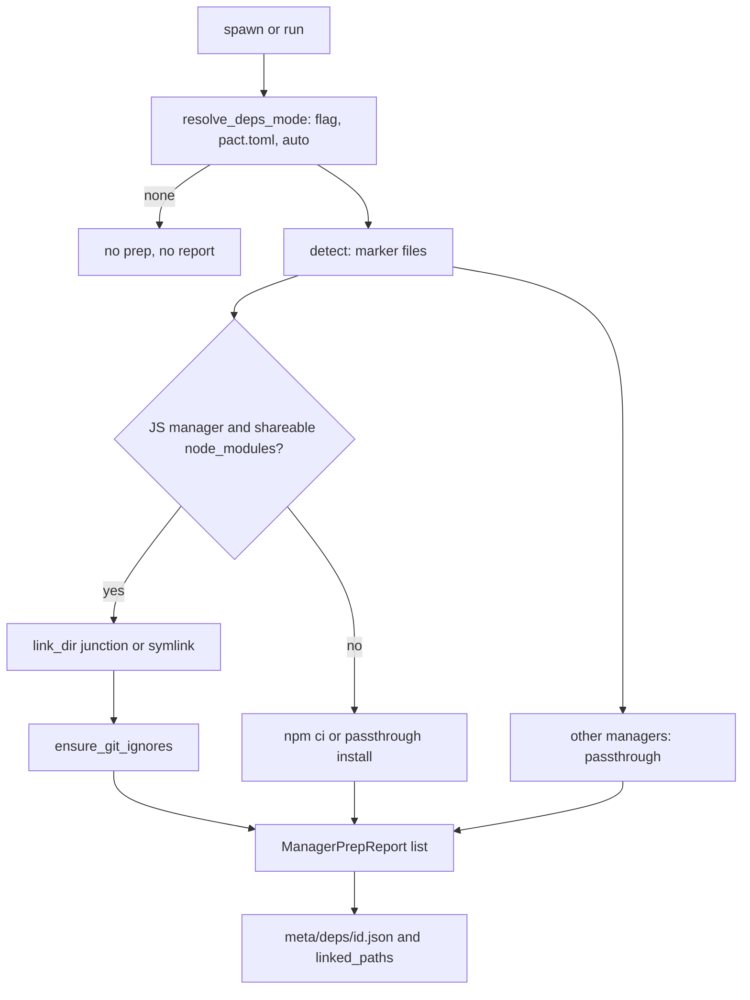

# Dependency materialization: link mode, passthrough, detectors

## Current design

`pact-deps` detects which package managers a workspace uses and gets its dependencies ready before the agent's first command. It has no store of its own. Every ecosystem already has a good global cache, so pact runs the tool's normal install and lets that cache do the sharing. Entry points: `detect`, `prepare` (always install), `prepare_with_mode` (mode-aware), `link_dir`, and `run_probe` for read-only version checks.

- **Detection.** `detect` looks for marker files and reports at most one manager per family. JavaScript: `bun.lock`/`bun.lockb` (#17), then `pnpm-lock.yaml`, `yarn.lock`, then `package-lock.json` or bare `package.json` as npm. Python: `uv.lock`, `poetry.lock`, `Pipfile`, then `requirements.txt`/`setup.py`/`pyproject.toml` as plain pip. Plus Cargo, Go modules, Maven, Gradle. A monorepo can yield several.
- **Install strategies.** npm runs `npm ci`, or `npm install --no-package-lock` when no lockfile is committed, so agents never generate competing lockfiles (#26). Bun uses `install --frozen-lockfile`; pnpm and yarn `install --prefer-offline`; uv `sync`; poetry and pipenv `install`; Cargo `fetch`; Go `mod download`; Maven and Gradle do nothing because their caches fill on first build. Plain pip is passthrough-only, with no custom venv store. A non-zero exit is reported as `success: false` with a warning, never a failed spawn: the agent can retry the install itself. Windows commands go through `cmd /C` so `.cmd` shims resolve.
- **`DepsMode`.** `Auto` (default) links when the repo root has a `node_modules` directory and installs otherwise; `Link` always tries to link; `Install` runs each manager's install; `None` skips prep and returns no reports (`--no-deps`). `--deps` overrides `pact.toml`'s `defaults.deps`, which overrides `auto` (#283).
- **Link mode.** For npm, pnpm, yarn and Bun, `<workspace>/node_modules` becomes a junction (Windows) or symlink (Unix) to the repo root's install: 0.12 s against 99 s for `npm ci` on the benchmark repo. If the root has nothing to share, it falls back to a real install and the first warning says so. After linking, `ensure_git_ignores` checks that git ignores the link and, if not, appends `/node_modules` to `info/exclude` (a `node_modules/` pattern does not match a Unix symlink). The report's `linked_paths` is saved in workspace metadata for `list`, `inspect` and teardown (see `vcs.md`). The link is not read-only; lean launch profiles deny dependency-mutating commands instead (#284). Turbopack rejects the link, so the integration worktree, which `merge_all` prepares with `prepare` for `--require-passing-tests`, stays on a real install (#269).
- **Report.** `prepare` returns one `ManagerPrepReport` per manager (`manager`, `strategy`, `success`, `warnings`, `linked_paths`), persisted at `meta/deps/<id>.json` (#12, #343). A missing file means prep never ran.
- **Probes.** `run_probe` runs in the temp dir with `COREPACK_ENABLE_AUTO_PIN=0`, so `pact doctor` cannot edit a project's `package.json` (#299). Real installs run in the workspace.

### Superseded decisions

- A lockfile-hash-keyed npm content store (`ContentStore`, reflink or read-only hardlink materialization, `PidLock` population) was the one custom cache; superseded by #233, which deleted it in favour of npm's own global cache. `pact store list`, `verify` and `clean` were removed with it.
- The store-era sections (store key components, store manifest and `pact store` commands #160, lock timeout, the MAX_PATH failure #7, the ReadOnlyHardlink tradeoff, and the `store_key`/`store_hit`/`materialization` report fields from #12) describe that deleted store; superseded by #233.
- Hardlink clones of `node_modules` as a faster install: rejected in #283 because hardlinks alias bytes and are slow to create on NTFS; replaced by link mode.
- `npm install` with a lockfile write for lockfile-less repos; superseded by `--no-package-lock` (#26).
- Running version probes in the user's cwd; superseded by `run_probe` in the temp dir (#299).
- `--no-deps` as the only opt-out (#233); superseded by `--deps auto|link|install|none`, with `--no-deps` kept as `none` (#283).
- The #233 open question whether to keep a purpose-built store was settled by the same issue's removal.

## History

The sections below are the issue-by-issue record, moved verbatim from
the old single DESIGN.md. Read them for the why; the summary above is
the current design and wins where they disagree. New decisions in this
area go at the end of this file.

### pact-deps: introduction

Detects a workspace's package manager(s) and makes sure dependencies are
ready before the agent's first real command runs. Every ecosystem this
detects (pnpm, yarn, uv, poetry, pipenv, Cargo, Go modules, Maven, Gradle,
and npm) already has a good global shared cache, so `prepare` just runs
each one's normal install/fetch command (`passthrough` for most; `npm ci`
directly for npm) and lets that cache do the sharing. Plain pip/venv is
intentionally left as passthrough-only (see "Passthrough caching strategy"
below). For JavaScript, `prepare_with_mode` can instead *link* the
workspace's `node_modules` to the repo root's existing install -- see
"Link mode" next.

### Detection probes must not write to the project (issue #299)

`pact doctor` reports each package manager's version by running its
`--version`. On a machine where `pnpm`/`yarn` are Corepack shims (the
default with a modern Node), Corepack appends a `packageManager` field to
the nearest `package.json` on *any* invocation, `--version` included,
unless `COREPACK_ENABLE_AUTO_PIN=0`. Running the probe from the user's cwd
therefore silently dirtied a real project's `package.json` -- confirmed by
hand in capture-hub, where a clean tree showed ` M package.json` the
instant `pact doctor` ran, with a `pnpm@...` pin it never had. `run_probe`
(used only by detection, never by a real install) runs in `temp_dir()`
with that env var set, so a read-only probe stays read-only; `run_shimmed`
keeps running real installs in the workspace as before. The split matters:
an install *should* run in the workspace, a probe must not touch it.

### Link mode (issue #283)

The cache-backed `npm ci` above still writes every file of `node_modules`
into every workspace. Measured 2026-09-29 on the owner's machine (Windows
11, NTFS, Defender real-time on, NVMe) against a 287-file Next.js 16 repo
with a warm npm cache:

| Strategy | Wall | Notes |
|---|---|---|
| `npm ci` per worktree | 99.2 s | 32,104 files, 540 MB written |
| robocopy /MT:32 | 29.1 s | +540 MB disk per workspace |
| hardlink clone, 16 threads | 29.8 s | NTFS + Defender make link creation ~1-2 ms each; and hardlinks are not copy-on-write, so an in-place write through one clone changes every clone |
| junction (`mklink /J`) | 0.12 s | one reparse point |

With several concurrent workspaces the installs saturate the disk before
any agent starts. This was the single largest startup cost after the
agent CLI's own boot, and the concrete reason the owner ran one agent at
a time on a 14 GB laptop instead of several.

`DepsMode::Link` creates `<workspace>/node_modules` as a junction (Windows;
no privilege needed, unlike a directory symlink) or symlink (Unix) to
`<repo_root>/node_modules`. `Auto` (the default) links when the repo root
has a `node_modules` directory and installs otherwise; `Install` is the
pre-#283 behavior; `None` skips prep (the old `--no-deps`). Non-JavaScript
managers keep their cheap, cache-backed passthrough in every mode. A
`Link` request against a repo root with nothing to share falls back to a
real install and says so as the first warning in the report, rather than
leaving the workspace without dependencies. Reports carry `linked_paths`,
which `pact-core` persists into the workspace's metadata for `list`/
`inspect` and for teardown (see "pact-vcs > Reparse points and worktree
removal").

**What was verified through the link, by hand, on the benchmark repo:**
`vitest run`, `eslint`, and `tsc --noEmit` all work unchanged. **What does
not:** Turbopack (`next build`, `next dev` on Next.js 16) rejects it with
`Symlink [project]/node_modules is invalid, it points out of the
filesystem root` -- the repo's `next.config.ts` pins `turbopack.root:
__dirname`, and pact must not edit a user's production config. Placing a
real `node_modules` in the worktrees' parent directory (Node resolves
upward) fails the same way. Turbopack needs a real directory; that is
the integration/verifier worktree's job (which stays on `Install`), not
the editor workspaces'.

**A trailing-slash ignore pattern does not match the link on Unix.**
Found by an independent code review of the first cut and confirmed by a
red ubuntu/macOS CI run: git's `dir.c` only lets a `node_modules/`
pattern (GitHub's own Node template) match `DT_DIR` entries, and a
symlink is `DT_LNK`, so on Linux/macOS the freshly linked `node_modules`
showed up as `?? node_modules` -- `pact list` called every linked
workspace dirty, `teardown` refused without `--force`, and `commit_all`
would have committed the link (an absolute path into the user's install)
onto the workspace branch. Git for Windows treats a junction as a
directory, so nothing showed locally. `ensure_git_ignores` runs `git
check-ignore` after linking and, only when the link is not ignored,
appends `/node_modules` (anchored, slash-free) to the repository's
`info/exclude` -- the file git provides for exactly this, shared by every
worktree of the repo and never committed -- and records that as a note in
the prep report. A repo whose `.gitignore` already uses a slash-free
`node_modules` needs nothing. The end-to-end test asserts a linked
workspace whose agent wrote nothing reads `[clean]` and tears down
without `--force`.

**The shared install is mutable through the link.** An agent running
`npm install` in a linked workspace writes into the repo root's real
`node_modules`. pact does not try to make the link read-only (an ACL is
not a security boundary, and it would break tools that write caches
under `node_modules/.cache`). Instead the lean launch profiles (issue
#284) deny dependency-mutating commands at the agent CLI's own tool
gate, which was confirmed to deny cleanly rather than hang, and the
`list`/`inspect` output names what is shared so a human never mistakes
it for a private copy. Hardlink-cloning as an "unshare" step was
considered and rejected: hardlinks alias the same bytes, so a mutating
install through a hardlinked tree corrupts every consumer -- the same
reason the deleted content store (see below) made its hardlinks
read-only. A workspace that genuinely needs a private, writable install
gets a real copy (`--deps install`), not a cleverer link.

### Content store removed in favor of npm's own cache (issue #233)

npm didn't always get this treatment. Through issue #233, it was the one
ecosystem pact built its own sharing for: a lockfile-hash-keyed content
store (`ContentStore` in `store.rs`), populated once per (platform,
lockfile) pair via a real `npm ci` under a `PidLock`, then materialized
into each workspace via reflink or read-only hardlink. Every section
below through "npm store manifest, verification, cleanup" documents that
subsystem's real history -- issues found, fixes shipped, all verified at
the time. It's kept for that history, not as current documentation:
**that entire subsystem is deleted.**

The removal decision itself (not a new problem found, a re-evaluation of
whether purpose-built sharing was worth its maintenance cost) landed once
`prepare_npm` already had a documented open question along exactly these
lines (see "Content store lock timeout, and --no-deps" below: "whether
the content-store subsystem should exist at all... left for a real
conversation rather than decided here"). That conversation happened: npm
already has a global cache (`~/.npm`, or wherever `npm config get cache`
points) shared automatically across every concurrent `npm ci` call on the
machine, with npm's own locking, no pact-side coordination needed --
which is exactly the property the custom store existed to provide, built
from scratch instead of reused. Verified by hand before deleting
anything (this project's standing discipline for every git/OS-level
assumption): 5 concurrent `npm ci` calls into 5 separate workspace
directories, sharing one global cache, run twice (a cold cache, then a
second pass with a warm one) -- both runs succeeded for all 5, no
corruption, no errors, comparable wall time to what the custom store's
own Phase 1 verification measured.

What this trades away, honestly: reflink/hardlink materialization meant a
second-plus workspace's `node_modules` came from an already-extracted
copy rather than npm re-extracting from its cache archive per workspace.
`npm ci` against a warm cache still avoids the network, just not the
per-workspace extraction step. What it gains: ~250 lines of custom
lock/manifest/materialization machinery deleted, one less subsystem
carrying its own bug class (the Windows `MAX_PATH` failure below is a
direct consequence of the store's own directory-nesting depth -- a
workspace-local `node_modules` doesn't have that problem to have), and
symmetry with how every other ecosystem in this crate is already
handled: pass through to the tool's own cache, don't rebuild it.

This is a real breaking change to the CLI surface: `pact store list`,
`pact store verify`, and `pact store clean` no longer exist. Shipped
with a minor version bump and called out in that release's notes, not
silently.

### Structured prep reporting (issue #12) -- historical, superseded above

Everything from here through "npm store manifest, verification, cleanup"
documents the deleted content-store subsystem's real history. Kept for
that reason, not as current behavior -- see "Content store removed"
above.

From an outside code review (2026-07-24), verified against source:
`prepare` returned bare `Result<()>`, and every real per-manager failure
was a `tracing::warn!` and nothing else -- no way to know which managers
were detected, which strategy ran, whether the npm content store was hit
or freshly populated, or which materialization method (reflink/
read-only-hardlink/copy) was used, without reading logs.

`prepare` now returns `Vec<ManagerPrepReport>` (one per detected
manager: `manager`, `strategy`, `store_key`, `store_hit`,
`materialization`, `success`, `warnings`) instead of a bare `Result<()>`
-- callers get real data, not just a side effect. `pact-core`'s
`spawn_with_supervisor` persists it to `state_dir/meta/deps/<id>.json`
(issue #343 moved it there from `meta/<id>-deps.json`), feeding `pact inspect`
(issue #16).

Two real, previously-invisible gaps this surfaced while making the
report honest, not by design intent: `passthrough::run` and
`run_plain_npm_install` both used to swallow a real command failure into
`Ok(())` -- only `cmdutil::run`'s own spawn failure would ever surface
as `Err`, meaning a passthrough install that ran and genuinely failed
(bad exit code) was indistinguishable from one that succeeded, in the
return type. Both now return `Result<bool>` (spawn failure is still
`Err`; the command's own exit code becomes the `bool`), which the report
now actually reflects in `success`.

`store_hit` is captured by a new `ContentStore::entry_exists` check
*before* `populate_if_absent` -- calling `populate_if_absent` first and
then checking existence would always report `true` (it just got
populated), telling a hit from a miss requires looking before, not after.

Verified for real, not mocked: 3 new pact-deps tests exercise the actual
`prepare_npm`/`prepare_passthrough` functions against real scratch
workspaces -- a real `npm ci` with a zero-dependency `package.json`/
`package-lock.json` pair (fast, effectively no network needed) confirms
`store_hit: false` on the first call and `store_hit: true` on a second
call with the identical lockfile; a real `cargo fetch` against this
crate's own `Cargo.toml` (cargo is guaranteed present in this workspace's
own build environment) confirms the passthrough success path; a
lockfile-less `package.json` confirms the `plain-install-no-lockfile`
strategy and its warning.

**Deliberately not surfaced in `spawn --dry-run`** -- `--dry-run` only
ever calls the side-effect-free `pact_deps::detect` today, never
`prepare` itself (which does real installs); making dry-run show
`store_hit`/`materialization` would mean either running a real install
during a dry run (defeats the point) or building a separate
preview-only path that predicts what `prepare` would do without doing
it (a real, separate feature, not implied by this finding). Scoped down
from the original issue's broader ask for exactly this reason.

### Content store lock timeout, and --no-deps (issue #233)

A real production `spawn-many` run (5 tasks, cold npm content store) hit
~22 minutes of dead time before any agent touched a file. Root cause:
`POPULATE_LOCK_TIMEOUT` was 600s, held for the *entire* population --
one workspace won the lock and ran a real `npm ci`; the other N-1 waited,
but the install took longer than 600s, so every waiter timed out and
fell back to `run_plain_npm_install` -- a full, independent, redundant
install each. The store's own fast path (a waiter that acquires *after*
the winner finishes sees `entry.exists()` and reuses it for free) never
executed, because the timeout was shorter than the thing it was waiting
for. Net effect: the cache made this run strictly *worse* than having no
cache at all (dead waiting, plus N installs instead of N starting
immediately).

Same root cause and same fix shape as issue #230's `pact-vcs::LOCK_TIMEOUT`:
`PidLock`'s stale-lock stealing (liveness + start-time check) already
handles a populator that crashed, so a fixed short timeout was only ever
guarding against a populator that's alive but stuck -- a rare case that
deserves a generous window, not a budget shorter than a real cold-cache
install. `POPULATE_LOCK_TIMEOUT`: 600s -> 1 hour. Verified directly at
the lock level (not via a real slow `npm ci`, which would make the test
suite itself slow and flaky): `populate_if_absent_reuses_a_slow_populate_
instead_of_duplicating_it` races 4 threads against one key with an
artificially slow populate closure and asserts the closure runs exactly
once -- proving reuse, not duplication, without needing a real install.

**Separately, `--no-deps` (`spawn`/`spawn-many`).** The same report noted
every task paid dependency prep's full cost even for tasks that
explicitly said not to touch dependencies (pure version-string edits in
a manifest file) -- prep ran unconditionally, with no way to opt out.
`--no-deps` skips `pact_deps::prepare` entirely for that invocation; no
deps sidecar is written either (its absence now means "never
attempted", distinct from an empty array meaning "ran, detected zero
package managers").

**Deliberately not done in this pass (the issue's own "deep research"
item, left for a real conversation rather than decided here):** whether
the content-store subsystem should exist at all, versus delegating
entirely to npm's own local cache (`npm ci` against a warm `~/.npm` is
already reasonably fast) plus a lighter hardlink layer, or adopting
`pnpm`'s/`cacache`'s content-addressable design wholesale. The two fixes
above remove the "worse than no cache" failure mode and the unconditional
cost, which was the concrete, reported harm -- but they don't settle
whether this ~250-line subsystem is worth its own maintenance cost
relative to deleting it and leaning on the package manager's own
tooling. Real tradeoffs on both sides (a from-scratch reimplementation
carries real bugs, like issue #7's MAX_PATH failure below and #57's BOM
handling, that a mature tool like pnpm has already hardened against; but
a from-scratch store is also the only way to get reflink/hardlink
materialization across arbitrary npm projects that never opted into
pnpm themselves) -- not a default to pick silently.

### The Windows MAX_PATH failure (issue #7)

A real failure mode found while verifying issue #7's fallback path, not a
synthetic test case: the store's key (platform/arch/libc/node/npm version
plus a 64-character lockfile hash) makes store-entry paths meaningfully
longer than a plain per-workspace `node_modules` would be. Confirmed
directly on Windows: `npm ci` populating a store entry for a package with a
postinstall step (`esbuild`) failed with `ENOENT` spawning `cmd.exe` -- not
because `cmd.exe` was missing, but because the fully-qualified path to the
file being installed exceeded Windows' legacy `MAX_PATH` (260 chars) once
nested under a long store-key directory name inside an already-long
temp/state-dir root.

`prepare_npm`'s populate-failure fallback (falling back to a plain,
unshared `npm install` for that one workspace) exists exactly for this
class of precondition-not-met failure -- it was hit for real, not
hypothetically, and the fallback (a shorter path) succeeded where store
population didn't. The same fallback also covers other real causes: a
network blip, a native build tool missing on that specific machine, a
registry issue -- none of which should leave a workspace with no
`node_modules` at all.

### Store key components

`platform_info` (renamed from `platform_key` when issue #160 needed its
`node_major`/`npm_version` components as their own structured fields,
not just baked into the key string -- returning both avoids a second
`node --version`/`npm --version` subprocess spawn just to get what this
function already asked them for) distinguishes store entries by OS,
architecture, libc
flavor (Linux only), Node major version, and npm's own version -- see
issue #7's risk analysis for why each of these, beyond the original
os/arch/node-major set, turned out to matter: npm version because
different npm versions can lay out `node_modules` differently from an
identical lockfile, and libc flavor because packages that resolve a
platform-specific binary via `optionalDependencies` (esbuild, swc, sharp,
and others in that exact shape) pick a *different* one for musl (Alpine)
vs. glibc (Debian/Ubuntu) despite both reporting the same os/arch.

`libc_suffix` detects musl via the presence of a musl dynamic linker
(`ld-musl-*` in `/lib`), which is how musl libc (Alpine's default)
identifies itself; anything else on Linux is assumed glibc. Best-effort:
if detection is inconclusive, "glibc" is the safer assumption (the
overwhelming majority of non-Alpine Linux), not silently omitting the
dimension entirely.

### npm store manifest, verification, cleanup (issue #160)

From an outside code review (2026-07-24, triage discussion): the shared
npm content store had no manifest, no way to verify an entry wasn't
corrupt, and no cleanup command -- it could only grow. Marked "design
first" at the time, since the cleanup policy specifically needed
thought (LRU vs TTL, safety against a concurrently-populating entry).
Picked sensible defaults this pass rather than leaving it unbuilt
further, matching the same reasoning as issue #159 (below): none of
this is a public API commitment, easy to retune later.

**Manifest** (`ContentStore::write_manifest`/`touch_manifest`/
`read_manifest`, a sibling `<key>.manifest.json` next to each `<key>/`
entry directory, matching the existing `<key>.lock` convention): `key`,
`created_at`, `last_used_at`, `node_major`, `npm_version`,
`lockfile_hash`, `file_count`, `byte_size` -- the exact fields the
review proposed. `file_count`/`byte_size` are computed by walking the
entry directory once, but only on a real populate (a cache miss) --
a cache hit only calls `touch_manifest` (updates `last_used_at`,
no walk), since the entry's content is never expected to change again
after population. An entry populated before this feature existed, or
whose manifest write failed, simply has no manifest -- `list`/`clean`
treat it as invisible rather than erroring; the entry itself still
works fine for materialization regardless.

**`pact store list`** -- every entry with a manifest: key, node/npm
version, file count, human-readable size, and how long ago it was last
used.

**`pact store verify [key]`** (all entries with a manifest if `key` is
omitted) -- confirms the entry's current file count and total byte size
still match what its manifest recorded. Deliberately not a
byte-for-byte content hash: re-hashing a potentially large
`node_modules` tree on every verify would defeat the point of caching
it. A mismatch here means something changed since population, which
should never legitimately happen to a shared store entry (nothing is
supposed to write into one afterward), so this is a reliable-enough
corruption signal without that cost. Exits non-zero if any entry fails.

**`pact store clean --older-than-days <N> | --all [--dry-run]`** --
removes entries by `last_used_at` age or unconditionally. Chose
`last_used_at` over `created_at` for the age check specifically because
an entry that's still being hit regularly shouldn't be evicted just for
being old -- LRU-style, not pure TTL, on the theory that "still useful"
is what actually matters for a cache. Safe against a
concurrently-populating entry: `remove_entry` acquires the exact same
per-key `PidLock` `populate_if_absent` already uses before deleting
anything, so a `clean` racing a real `spawn` for the same lockfile hash
either waits for that population to finish first or the population
waits for `clean` to finish removing a *stale* entry first -- never a
torn read of a half-written `node_modules`. Removing an entry never
affects a workspace that already materialized from it (copied or
hardlinked files are independent copies at that point) -- only future
materializations from that key.

Verified for real, not synthetically: a real `pact spawn` against a
real npm workspace (zero-dependency lockfile, so `npm ci` runs
instantly with no network access) populates a real entry, then `pact
store list`/`verify`/`clean --dry-run`/`clean --all` are driven against
what was actually populated, confirming the full list -> verify ->
dry-run -> real-removal -> empty round trip end to end
(`crates/pact-cli/tests/store.rs`).

### Windows `.cmd` shim resolution

`cmdutil::run` routes every spawned package-manager command through `cmd /C`
on Windows. npm/pnpm/yarn (and sometimes poetry/pipenv, depending on install
method) ship as `.cmd` shims, not `.exe`. `std::process::Command` doesn't
consult `PATHEXT` the way a real shell does, so `Command::new("npm")` fails
with "program not found" even though `npm` works fine typed interactively.
`cmd /C` restores that resolution; other platforms get a plain, direct spawn.

### Passthrough caching strategy

`passthrough::run` warms the package manager's own global cache instead of
building pact-specific sharing, for ecosystems that already cache well:
pnpm, yarn, uv, poetry, pipenv, Cargo, and Go modules all cache once and
reuse across projects by default, so the only job here is warming that
cache before the agent's first real command. Maven and Gradle need no
command at all -- `~/.m2` and `~/.gradle/caches` populate lazily on any
build invocation, so an explicit fetch step would only add time. A
non-zero exit is logged, not returned as an error: a transient network
failure here shouldn't fail the whole `spawn`, since the agent can still
retry the install itself once it starts working.

Plain pip/venv gets no custom store (a Phase 1 decision): pip already has
its own global download cache (`~/.cache/pip`) shared across projects,
covering the expensive part (network fetch). A hardlink-based store on top
of that would mean hardlinking into freshly created venvs, which risks
embedding absolute paths from the wrong venv (activation scripts, `.pth`
files, console script shebangs) -- a correctness risk, not just extra
engineering, so it's left as future work rather than shipped provisionally.

### ReadOnlyHardlink tradeoff -- historical, superseded (issue #233)

Documents the deleted content store's materialization strategy -- see
"Content store removed in favor of npm's own cache" above. A hardlink
shares the same underlying file record as its content-store
entry, so marking the destination read-only also freezes the canonical
store copy after first use -- intentional, not a side effect to work
around. The tradeoff: a package that writes into its own installed files
after materialization (a native-build step, a binary downloader, a
git-hook installer) fails loudly instead of silently corrupting every
other workspace sharing that store entry. That failure is the point.

### Package manager detection

### Bun detector (issue #17)

Bun's own lockfile changed format between versions -- older Bun writes a
binary `bun.lockb`, current Bun (confirmed against a real installed 1.3.14
CLI, not assumed) defaults to a text `bun.lock` instead. `detect()` checks
for either, ahead of the pnpm/yarn/npm chain, so a Bun-managed project
(which always also has a `package.json`) is never misreported as npm.
Bun goes through `passthrough::run` like pnpm/yarn -- no custom content
store, since Bun already has its own global cache, the same reasoning
that keeps everything except npm on the passthrough path. Confirmed by
hand: `bun install` defaults to `bun.lock`, not `bun.lockb`, on a fresh
project; `bun install --frozen-lockfile` (verified against a real `bun
install --help`, not assumed) against a project with a committed
`bun.lock` correctly resolves `node_modules` without modifying the
lockfile, mirroring `npm ci`'s reproducibility guarantee -- pnpm/yarn use
`--prefer-offline` instead, a different (caching, not lockfile-strictness)
guarantee, so this isn't an inconsistency, just a different real flag for
a different real semantic gap Bun doesn't otherwise cover.

### No committed lockfile (issue #26)

`prepare_npm`'s no-lockfile path used to run a plain `npm install`, which
writes a fresh `package-lock.json` into the workspace. Confirmed: two
agents on the same lockfile-less repo each independently generated a
different-content lockfile (different `npm install` runs can resolve
semver ranges to different exact versions), and `merge-all`'s conflict
detection then flagged `package-lock.json` as touched-by-multiple-
workspaces on every multi-agent Node run -- even when the two workspaces'
actual task changes touched entirely disjoint source files. Now runs
`npm install --no-package-lock` instead: the agent still gets a working
`node_modules` from the start, but no lockfile is generated, since there's
no stable content across workspaces to converge on in the first place.
The store-population-failure fallback path (where a real committed
lockfile *does* exist) is unaffected -- that install can still update the
existing lockfile in place, exactly as it would outside pact.
