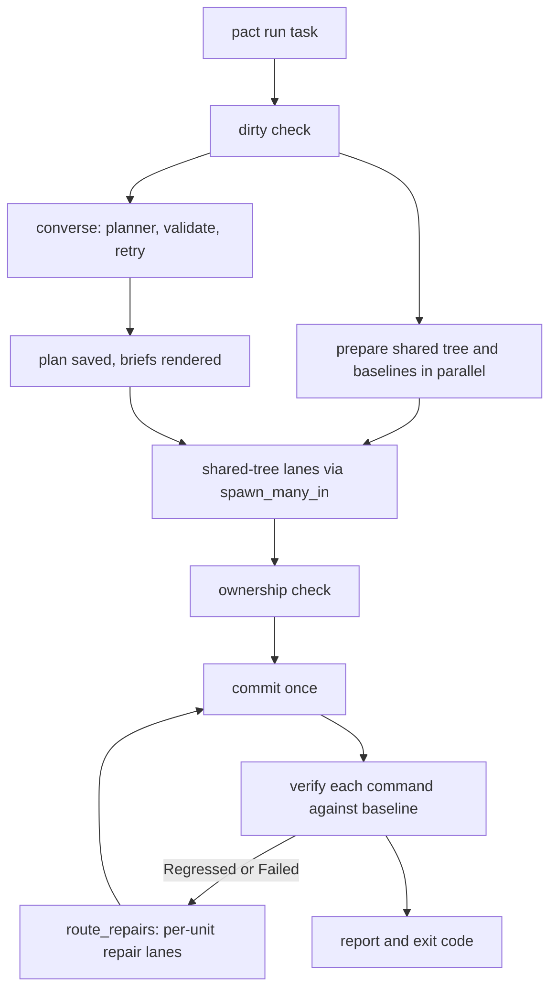

# `pact run`, `pact fleet`, `pact land` and `pact discard`

## Current design

`pact run "<task>"` takes one task and does the whole loop (#305): a planner splits it into units that own disjoint files, the units run as parallel lanes in one shared tree, pact commits once and verifies the combined result against a baseline, with repair lanes when a check regresses. `pact run --dry-run` plans, prints and stops. `--plan <file>` skips the planner. Plans are saved to `meta/plans/` and briefs to `briefs/<stamp>/`. Units are workspace names, so a rerun after a failed run needs `pact teardown` first.

Steps, in order:

1. **Preflight.** `run_task` refuses a checkout with uncommitted or untracked changes and lists them; `--allow-dirty` proceeds and the report repeats the list (#411).
2. **Plan.** `plan_task` runs the planner in the repo root with no workspace through `converse`: one ACP session in a throwaway process when the agent has ACP, else fresh headless processes. `planner_prompt` carries the rules, the JSON shape, up to six tracked test files to imitate (`discover_test_anchors`) and a unit count. Workers get the task verbatim, so the prompt tells the planner to restate nothing and keep briefs to two or three sentences (#347, #352). A planner that modifies the repo is refused. Every update goes to `logs/planner-<stamp>.jsonl` with a `t` timestamp (#348, #358).
3. **Validate.** `validate_plan` (pure) rejects shared files, duplicate or unsafe names (`[A-Za-z0-9][A-Za-z0-9._-]*`, at most 48 characters, unique by slug, #414), absolute or `..` paths, empty briefs and too many units. Violations go back to the same conversation, up to `--plan-retries` (default 2, #413). Under the process runtime the retry resends the whole prompt.
4. **Size and prepare.** Unit count and `--max-concurrent` default from `suggested_units` and the unit count (see admission, #356). While the planner works, the shared tree, its dependency prep and the baselines are prepared on a second thread (#353). `prepare` commands run once per tree (#301).
5. **Execute.** `render_brief` gives every unit its files, the planner's words and `shared_context`, and rules. When the plan has project-wide checks the brief tells workers not to run them and to run only scoped checks, since pact runs them once on the combined result (#361). The batch is a shared tree under the default runtime (#315, #337).
6. **Ownership check.** After the units finish and before the commit, `changed_since` is compared with the plan (#409): unowned files from the tree, cross-unit writes from ACP `locations` in the lane log, and for process lanes from hashes of each unit's files. Violations fail the run (exit 1) and nothing is reverted.
7. **Verify.** `verify` is a list (`--verify` is repeatable and replaces the plan's list, #360). Each command has a baseline on the untouched tree and a verdict after: pass/pass `Passed`, fail/pass `Fixed`, pass/fail `Regressed`, fail/fail `Inconclusive` (exit 3), fail with no baseline `Failed`. `worst_verdict` sets the exit code. Each command runs under `--verify-timeout` (default 20 min) with `CI=true`, stdin closed, output to `meta/verify/<run>/`, and its process tree is killed at the deadline (#410). A timed-out baseline counts as no baseline.
8. **Repair.** `Regressed` or `Failed` starts repair rounds, `--repair-attempts` (default 1, 0 disables). `failing_files` finds the files each check names (#373), `route_repairs` sends each to the unit that owns it, and the round's lanes run in parallel, each editing only its own files (#372). One extra lane takes unowned failures and timeouts, and may edit touched files no unit holds. Untouched files are never editable. Each round commits once and reruns every check. `Inconclusive` never triggers repair.

`pact fleet` runs unrelated tasks across repositories (#388): `run_fleet` opens one `Orchestrator` per repository and one thread per task, all through `spawn_with_supervisor`, with one shared `Admission` and `Supervisor`. The file carries its own `[defaults]`, `[tiers]` and `[[task]]` list; the repositories' own `pact.toml` files are ignored. Fleet lanes are always process lanes. `report_contract` appends a five-field `STATUS:` report request, and `parse_worker_report` reads the last one; a missing report is `unreported`, which counts as not done. `pact land <id>` (#389) commits the workspace and runs `git merge --no-edit` in the user's checkout (fast-forward when possible, aborted on conflict, no Arbiter); `--pr` pushes and opens a pull request through `gh`. It refuses a live agent or a shared-tree member. `pact discard` is `teardown --force` plus a count. `pact list --json` serializes `Orchestrator::entries`, with `state` derived from the pid and run record.



### Superseded decisions

- `verify` was a single command with one verdict (#305): superseded by #360, a list with a verdict per command.
- A retry went to a fresh agent with only the previous plan (#305, `ask_agent`): superseded by #413, `converse` keeps one conversation.
- `shared_context` as "conventions every unit must follow verbatim", and long per-file briefs (#305): superseded by #347 and #352, repository facts only and two or three sentence briefs.
- Balance units by file count (#305): superseded by the arm R prompt, balance by effort, with `balance_warning` advisory only.
- Shared tree, tree prep and baseline started after planning (#305): superseded by #353, prepared while the planner runs.
- `--max-units` 8 and `run`'s `--max-concurrent` 2 (#305): superseded by #356, sized from memory and cores, concurrency defaults to the unit count.
- Verification with `Command::output()` and no timeout (#305): superseded by #410.
- One repair lane fixing every failure from a 40-line output tail (#362): superseded by #372 and #373, per-unit lanes fed by failing-file excerpts.
- Plan names and lane writes trusted (#305): superseded by #414 (name validation) and #409 (ownership check).
- Running against a dirty checkout without notice (#305): superseded by #411, refused unless `--allow-dirty`.

## History

The sections below are the issue-by-issue record, moved verbatim from
the old single DESIGN.md. Read them for the why; the summary above is
the current design and wins where they disagree. New decisions in this
area go at the end of this file.

### `pact run`: pact owns the split (issue #305)

Everything above made execution cheap; the judgement still lived
outside pact. The benchmark kit needed a 2.4 KB header to get a Copilot
session to orchestrate acceptably, and every rule in that header
(disjoint file ownership per unit, verbatim conventions in every brief,
"do not commit", "you cannot install or build", verify on the result)
is something pact already knows. `pact run` moves the loop inside:

1. **Plan.** `ask_agent` runs one planner turn in the repo root with no
   workspace (an ACP session in a throwaway process when the agent has
   one, a headless process run otherwise) and collects the assistant
   text. `planner_prompt` carries the rules and the JSON shape; the
   planner reads the repository with its own tools, so pact inlines no
   tree listing. `extract_plan_json` takes the last ```json fence, or
   the outermost braces, because planners narrate before and after.
2. **Validate, mechanically.** `validate_plan` is pure and names each
   violation in words the planner can act on: a file owned by two
   units, duplicate or unusable names, absolute or `..` paths, empty
   briefs, too many units. Violations go back as `repair_prompt` with
   the previous plan, up to `--plan-retries` times; a plan that still
   cannot run is refused with the list. A planner that modified the
   repository is refused outright: `changed_paths` before and after,
   because planning is read-only by contract and a planner that writes
   is a planner that will write into the lanes' tree next.
3. **Brief.** `render_brief` gives every unit the same shape: its files
   (own these, touch nothing else), what to produce in the planner's
   words, the plan's `shared_context` verbatim, and the rules humans
   kept forgetting to repeat. The shared-tree preamble (claim first,
   leases) is added by `spawn_many` as for any lane.
4. **Execute.** The plan is disjoint by validation, so the batch is a
   shared tree (#315) under the default runtime (#337). `run_plan`
   creates the batch itself (`spawn_many_in`) rather than through
   `spawn_many`, for the next step's sake.
5. **Verify with a baseline.** The first live run told the story: the
   planner chose `npm run lint && npx tsc --noEmit`, both lanes finished
   in 90 s with correct work, and verification failed, because Next's
   generated types are gitignored and absent from any fresh worktree
   (#301). Both workers had said "pre-existing, unrelated" in their
   summaries; pact's verdict had no way to know. So the verification
   command runs once on the untouched batch tree before any lane starts,
   and the final result is read against it: pass/pass is `Passed`,
   fail/pass is `Fixed`, pass/fail is `Regressed`, fail/fail is
   `Inconclusive` (exit 3, the run neither succeeded nor failed by this
   command's lights, and the CLI says so and points at #301), fail with
   no baseline is `Failed`. The baseline runs in the batch tree, not the
   repo root, precisely because the root may hold generated files the
   worktree lacks; the first run would have misread a root baseline as
   "passes" and called the result a regression.
6. **Report and persist.** The plan is written to `meta/plans/` before
   anything runs and the briefs to `briefs/<stamp>/`, so `--dry-run` is
   "plan, print, stop" and `--plan <file>` is "skip the planner and run
   this", the edit-and-rerun loop the epic asked for. Unit names are
   workspace names; a rerun after a failed run needs `pact teardown`
   first, and the collision error says so. Names come from the planner,
   which is model output reading arbitrary repository content, so
   `validate_plan` holds them to `[A-Za-z0-9][A-Za-z0-9._-]*`, at most
   48 characters, unique by the slug their workspace id is made from
   (issue #414): `Alpha One` and `alpha-one` used to pass as different
   names and then share one workspace id, and `..\..\x` wrote its brief
   outside the state directory. Briefs are named by that slug too, and
   `create_lane` creates its metadata file with `create_new`, so lanes
   started concurrently under one id get one lane and one clean error
   instead of overwriting each other.

Arm R (issue #308) then ran it on the benchmark with the planner
deciding the split: 16.3 min, level with Copilot's in-process
sub-agents, cheaper, more tests, 57% less mean memory, and no human
brief. Two things the run showed, both about the planner's input
rather than pact's machinery. Lanes ran 4.1 to 11.8 min, and the tail
was one unit holding five UI components: the prompt had said "balance
them" and the planner balanced by file count, so it now says to
balance by effort, that a component or a route handler costs several
times a pure module, and to split rather than hold more than two or
three heavy files. And the planner-written briefs produced 722 tests
where the hand-written ones had produced 829 at the same floor
compliance; the hand-written briefs had named the two existing smoke
tests to imitate, so pact now finds the repository's tracked test files
itself (`discover_test_anchors`, via `git ls-files` so generated and
ignored files never qualify, shortest paths first, capped) and hands
them to the planner with the instruction that every test-writing brief
name the closest one. Line counts cannot weigh a test-writing plan
(the owned files are new), which is why the balance rule lives in the
prompt and `balance_warning` stays advisory.

A third finding came from the planner's own session log (issue #347).
Of the 127 s arm R spent planning, 6 s was the planner's one tool call
(a file listing) and 117 s was generating a 26 KB reply: a 5 KB
`shared_context` that rewrote the task's rules section and eight
2.2 KB briefs that re-listed per file what the task text already
enumerated per file. `render_brief` quotes the complete task into every
lane's brief, so each worker was handed the rules twice and its file
requirements twice, and every worker waited for the restating to
finish; planning was 14% of the run's wall time and nearly all of it
output tokens. The schema's description of `shared_context`
("conventions every unit must follow verbatim") had invited the copy.
The prompt now says that workers receive the task verbatim, that
nothing it already says is to be restated, that `shared_context` holds
only repository facts the task does not state (empty when there are
none), that a brief adds only what the task does not say for the
unit's files (the file to imitate, non-obvious findings in the sources,
the acceptance criteria), and that the reply is parsed rather than
read, so its length is pure delay. The rendered brief says the same
from the worker's side: do the task above for the files you own, and
here is what the planner adds. The alternative, having pact strip the
task text from the brief when the planner restates it, would have
fought the planner instead of informing it, and a planner that reads
the task once and adds only its findings is also the cheaper one.

Arm R2 measured that change (issue #352): 117 s of planning against
127, with the reply down from 26 KB to 12 KB plus 4 KB of reasoning.
Halving the output saved a fifth of the time because generation runs
at about 40 tokens a second whatever is being generated, and the
briefs had become 0.8 to 1.2 KB source summaries ("GET has two
branches: the unfiltered branch...") that a worker re-reads from the
file in seconds. The prompt now says that too: workers read their
sources themselves, a summary of a file costs every worker the time
spent writing it, and a brief is two or three sentences (the file to
imitate, the one or two non-obvious findings, the acceptance
criteria). The constraint is a prompt rule rather than a validation
limit on purpose: a rejected plan costs a whole planner turn, which is
the very thing being saved.

Reading that session meant finding Copilot's own event file by
directory timestamps, because the ACP path of `ask_agent` logged
nothing while the process path and every lane did (issue #348). The
planner now appends every raw update to `logs/planner-<stamp>.jsonl`
in the lane log's one-JSON-line shape, each attempt opened by a
`{"pact": {"planner_attempt": n, "prompt_chars": ...}}` marker so the
retries can be told apart; the report carries the path and the
planning wall time, and the CLI prints both on the plan line. Every
line pact writes to these logs, lane or planner, carries `t`, the
wall-clock in Unix milliseconds (issue #358): Copilot's updates have
no timestamp of their own, and without one the log said what happened
but not when, which sent the first timing analysis back to Copilot's
own event file, the thing the log was meant to replace.

A rejected plan used to go back to a new agent (issue #413): `ask_agent`
started a fresh ACP process and session, or a fresh headless process,
for every attempt, and `repair_prompt` carried only the previous plan
and its problems. The retrying planner never saw the task, the rules or
the test anchors, so it could shuffle the JSON but not re-split the
work, and it re-read the repository from scratch at the cost of a whole
planning turn. `converse` now holds one planner conversation for every
attempt: under ACP one process and one session, so the short repair
prompt lands in a conversation that already has everything; for the
process runtime, where a turn remembers nothing, the retry is the whole
first prompt followed by the repair. Resuming a process agent's own
session would avoid resending the prompt, but each CLI resumes
differently and the self-contained prompt is correct for all of them.

The same timeline showed the shared tree, its dependency prep and the
29 s baseline waiting behind planning for no reason (issue #353): none
of them depend on the plan, and the batch workspace only used the plan
for its summary string. `run_task` now prepares them on a second
thread while the planner works, whenever the planner is consulted and
something will be spawned; the batch is named `pact run: <task's first
line>`, and the baseline runs there only when `--verify` is known up
front (a plan-supplied `verify` still runs it after planning). If
planning fails the prepared tree is removed; if preparation fails the
plan is persisted and the error says how to rerun it with `--plan`.
The `--plan` path stays sequential, since it has nothing to overlap.

How many units to ask for was the last number a human still set
(issue #356): `--max-units` defaulted to 8 and `run`'s
`--max-concurrent` to 2, so an eight-unit plan ran four lanes deep
unless the caller knew to raise both, and neither default looked at
the machine. Arm R2's lane phase was 73% of the run with the slowest
lane deciding it, while the eight ACP lanes peaked at 3.2 GB with
3.1 GB still free and a sixth of the cores busy. Admission already
knows how many lanes fit, so `lanes_that_fit` asks it the way `decide`
will answer at launch time (the lanes whose reserves fit above the
floor, plus one, so a plan sized this way is admitted in one go), and
`suggested_units` caps that by logical cores (a lane's test run or
build is a process of its own) and clamps it to 2..16: below two there
is nothing to run in parallel, above sixteen the planner is splitting
single files and every lane re-reads the same task for a smaller share
of the work. `run`'s `--max-concurrent` then falls back to the unit
count, so what was planned can run at once, with admission still the
governor if the machine has changed by launch time. The sizing is
printed, and both flags remain overrides. On the owner's 12-core
13.7 GB laptop with 5.6 GB free this picks 12 ACP lanes against the
kit's 500 MB floor and 11 against the default 1500.

Arm R3 then ran with that sizing: 12 lanes, and no faster than 8
(issue #360 and its two dependents). The sessions' event logs showed
why: a lane spends 56% of its time in shell commands, and most of that
is project-wide type-checks and lints the worker runs because the task
says they must stay clean. Twelve lanes doing that at once on twelve
cores made a scoped `eslint` on three files take 80 to 150 s (the
type-aware rules load the whole TS program), so finer splitting
multiplied the whole-project checks and bought nothing; the
model-bound part of a lane, about three minutes of generation, was not
the bottleneck. The fix is a division of labour, and its first piece
is that `verify` becomes a list: the plan's `verify` accepts a string
or an array (old plans still load), `--verify` is repeatable and
replaces the plan's list when given, every command gets its own
baseline on the untouched tree and its own verdict afterwards, the
report prints one line per command, and `worst_verdict` decides the
exit code with a real failure outranking an inconclusive check. With
that in place the project-wide checks can belong to pact (#361) and a
repair lane can close what the workers no longer catch (#362).

The second piece (issue #361) is the division of labour itself. When
the plan carries project-wide checks, the rendered brief's rules say
that pact runs them once on the combined result after every unit
finishes, names them, tells the worker not to run the whole suite,
type-check or lint in any form because every lane doing so at once
slows every lane, and scopes the worker's own check to its files (the
unit's `verify`, or "your own test files alone" when the planner gave
none). The planner prompt says the same from its side: every check the
task demands of the whole goes in the plan's `verify` list, a unit's
`verify` is cheap and scoped. When the plan has no project-wide
checks the brief keeps the old "check your own work with" line and
promises nothing pact cannot keep. The rule is in the brief rather
than enforced by the lean profile's allowlist because the worker
still needs to run its own tests, and the difference between
`vitest run a.test.ts` and `vitest run` is not one a shell allowlist
can draw.

The third piece (issue #362) closes the combined-check gap. A Regressed
or Failed verdict starts one repair lane in the same shared tree, under
the same runtime and admission policy. Its brief contains only the real
failures, their output tails, and the files the run touched, with a rule
to preserve application behaviour and edit no file outside that set.
After a successful repair turn pact commits again and reruns the full
verification list, so the report and exit code reflect the last result,
not the pre-repair failure. `--repair-attempts` bounds the loop and
defaults to one; zero disables it. Inconclusive checks never trigger a
repair because pact has no evidence that the run caused them.

Not here: dependent units (waves, #282), balancing beyond an advisory
warning when the heaviest unit's existing lines exceed four times the
lightest (new-file units weigh nothing, so test-writing plans never
trigger it). Tested end to end through the real binary with pact-acp's
fake agent as both planner (a canned reply for prose prompts) and workers
(JSON write tasks inside the rendered briefs), never a model; the live
check against Copilot CLI produced a valid two-unit plan in one attempt
and 36 s.

#### Uncommitted changes (issue #411)

The planner runs in the user's checkout and reads whatever is there;
the lanes run in a worktree of `HEAD`. Uncommitted or untracked work was
in one and not the other, so a plan could rest on files no worker could
see, and the result branch was cut from a commit without what the user
had been looking at. A verification that depended on such a file read
as INCONCLUSIVE and pointed at generated files (#301), the wrong
diagnosis. `run_task` now checks `git status` before anything else and
refuses with the list of changed paths; `--allow-dirty` proceeds and
the report repeats the list. Refusing is the default because the
alternatives each surprise someone: copying the changes into the
shared tree commits work the user had not chosen to commit, and
planning inside the shared tree instead of the checkout would cost the
overlap of tree preparation with planning (#353) while still leaving
the result branch without the user's changes.

#### Verification timeout (issue #410)

Verification ran with `Command::output()`, which waits forever, and the
planner is told to put the full suite in `verify`, so it picks `npm test`,
which in many templates is `vitest` in watch mode. A hang there blocks
the baseline before any lane starts, or lands after every lane has been
paid for, with no report. Each command now runs under
`--verify-timeout` (`defaults.verify_timeout`, 20 minutes by default:
long enough for a real suite on a busy laptop, short enough that a hung
run is noticed the same session). At the deadline pact kills the
command's whole process tree through `command-group`, the same group
kill the Supervisor uses for agents, because killing only the shell
leaves the runner it started holding the tree. A timed-out baseline
counts as no baseline, since a command that never finished says
nothing about the base; a timed-out result is a failure whose report
line says it timed out. A timed-out result still goes to the repair
lane like any other failure: a test that hangs only after the run is
the run's doing.

Commands run with `CI=true` and stdin closed, which is what makes most
watch-by-default runners exit by themselves; the timeout is the backstop
for the rest. Output goes to a file rather than a pipe: both streams
share one handle, so the log interleaves them in write order, and a file
cannot be held open by a grandchild the way a pipe can (#253), so the
wait never depends on who still holds the output. Each run's logs live
under `meta/verify/<run>/`, one per command and phase (`baseline`,
`after`, `repair-<n>`), and a failing command's report line names its
log.

#### Failing files instead of a tail (issue #373)

The repair lane used to get the last 40 lines of each failing command,
stdout then stderr. In R5 that was useless for all three checks: for
`npm test` it was the middle of a React Testing Library DOM dump that
stderr had appended after vitest's summary, so the failing test files
never reached the repair lane; for `eslint` it was the last file's
errors; `tsc` had stopped at the first syntax error. With the
interleaved log from #410 in hand, `verify_output::failing_files` reads
the whole output and keeps every token that, cleaned of what tools add
around a path (`:line:col`, tsc's `(line,col)`, quotes, the tree's own
absolute prefix, `\` separators), names a file that exists in the tree.
Each file comes with the lines naming it and the few after each up to
a blank line, which is where eslint, vitest and cargo print the error
under its file, capped at 20 lines. Recognising files by existence
rather than by per-tool formats keeps it working for runners pact has
never seen; `node_modules` and `.git` paths are dropped because stack
traces are full of them.

Every file in the tree counts, not only the run's touched files: a test
the run did not edit can fail because of a source file it did. The
report lists the failing files per command and the path of the full
log, and keeps the tail only for a command whose output names no file.
The repair brief gives each failing file its excerpt and marks the ones
the run never changed, since the repair may only edit touched files and
has to fix those failures through them.

#### Repair lanes per unit, in parallel (issue #372)

#362's repair was one agent fixing every failure in turn. In R5 it ran
31 minutes, longer than any lane, and the checks still failed. The plan
already says which unit owns every file, and #373 says which files
failed, so `route_repairs` sends each failing file to the unit that
owns it. That unit's repair lane gets only its own files' excerpts and
may edit only its own files, so the round's lanes are disjoint the same
way the plan's units are, and they run together through `spawn_many_in`
under the run's runtime and admission policy. A failing file no unit
owns, a check whose output names no file, and a check that timed out go
to one extra lane, which may edit the touched files no unit lane holds
that round. Untouched files stay off limits for every lane: a test the
run did not edit that now fails is evidence against the run, and letting
the repair edit it would hide that. If the extra lane is left with
nothing it may edit, its checks become context for every unit lane
rather than a lane that cannot act. Each round commits once after its
lanes finish and reruns every check; `--repair-attempts` still counts
rounds, and a round in which no lane succeeded ends the loop. Lane names
are `repair-<round>-<unit>` and `repair-<round>`, suffixed if they would
collide with a unit's name.

#### Enforcing file ownership (issue #409)

`validate_plan` makes the plan disjoint and the brief tells each worker
it owns its files and nothing else, but nothing checked what the lanes
wrote. A lane that reformatted a neighbour's file, fixed an import in a
shared barrel or updated a snapshot silently replaced that work, the
commit took it, and the report said OK. After the units' lanes finish
and before the commit, pact now lists what the tree carries over its
base (`changed_since`: `git diff --name-only <base>` plus untracked
files git does not ignore, so new directories appear file by file) and
compares it with the plan. Three sources of evidence, each covering
what the one before cannot:

- A changed file no unit owns is caught from the tree alone.
- A write into another unit's file is attributed from the lane's ACP
  log: `tool_call` and `tool_call_update` updates carry `locations`,
  and those of kind `edit`, `delete` or `move` name what the lane
  changed. Reads and searches carry locations too and are ignored. The
  kind is remembered per tool call because an update need not repeat it.
- For lanes without such a log (process lanes), each unit's own files
  are hashed when its lane reports its result. A file that differs at
  the end changed after its owner finished, so one of the lanes still
  running then wrote it; the report names those lanes. This misses a
  write that lands before the owner finishes, which only the log can
  see.

Each violation names the lane, the file and the owning unit, the run
fails with exit 1, and the report ends by saying nothing was reverted.
Reverting was considered and rejected: the stray write may be the
correct fix (a barrel export the owner forgot), pact cannot tell, and
undoing it can break the owner's work instead. The commit still
happens so the result can be reviewed with `pact diff`. The check runs
once, on the units' lanes; repair lanes (#372) work across the run's
touched files by design and are not held to unit ownership. The ACP
locations path is verified with the fake agent only; whether Copilot
CLI reports `locations` for every edit is not yet verified against a
real paid run.

### `pact fleet`: independent tasks (issue #388)

`spawn-many` and `pact run` assume one repository and one result: the
lanes are merged, or share a tree. The audit in #386 found the other
common shape was being run by a PowerShell script outside pact: several
unrelated tasks, often in different repositories, each wanting its own
model and its own review. `pact fleet` is that shape. `run_fleet`
(`pact-core/src/fleet.rs`) opens one `Orchestrator` per distinct
repository and runs one thread per task through the same
`spawn_with_supervisor` every other lane uses, so a fleet task is an
ordinary workspace afterwards (`list`, `diff`, `inspect`, `teardown` all
work on it with `--repo`).

**One `Admission`, one `Supervisor`.** The memory floor is a property of
the machine, not of a repository, so the admission gate is shared across
every repository in the fleet; a per-repository gate would admit N times
the budget. One `Supervisor` because `ctrlc` allows one handler per
process, and one Ctrl-C should stop every agent.

**The file carries its own `[defaults]` and `[tiers]`.** It is parsed as
a `PactConfig` plus a `[[task]]` array, so the vocabulary is the one
`pact.toml` already taught. The task repositories' own `pact.toml` files
are not consulted: a fleet file is written by one person for one run,
and a model that changed because of a file in some other repository
would be a cost surprise. For the same reason `prepare` commands from
those files are not run. `repo` resolves through `git rev-parse
--show-toplevel`, so naming a subdirectory still puts the state
directory beside the repository root.

**Process lanes only.** An ACP batch is one agent process bound to one
repository's coordination server, and a fleet's tasks span repositories,
so every task is its own process whatever the agent.

**The worker report contract.** A process exit code says the CLI did not
crash; it does not say the task is finished: an agent that stops to ask
a question, or gives up, exits 0 the same as one that finished (#212
found the same gap for a task that touched no files). So
`SpawnOptions::report_contract`, the contract proposed in #385, appends
a five-field
report request to the prompt and `parse_worker_report` reads it back out
of the final message into `RunMetadata::report`. Done means the process
succeeded and the report says `done`; no report is `unreported`, which
counts as not done, because silence was the failure the contract exists
to catch. The parser takes the last `STATUS:` line (a model that quotes
the contract back and then answers is still read correctly), skips the
template line itself (the one with `|` between the choices), and
tolerates the markdown models wrap labels in. The contract is appended
inside `spawn_with_supervisor`, after the workspace is created, so the
workspace's recorded task stays the user's own prompt. The flag lives on
`SpawnOptions` rather than in the fleet module so other commands can opt
in later without a second code path.

Not in this slice: a read-only task mode that skips the worktree, and
the GUI (#390). Landing a task's branch is the next section.

### `pact land` and `pact discard` (issue #389)

`merge-all` answers "combine these lanes into one result": it builds a
`pact/merged-*` integration branch in a throwaway worktree and never
touches the user's checkout. Fleet tasks are not one result. Each is
reviewed alone and wanted on the user's branch, or as its own pull
request, as soon as it is approved, so `land` works on one workspace
and writes to the checked-out branch directly.

**Merging in the user's checkout.** `land_workspace`
(`pact-vcs/src/land.rs`) runs a plain `git merge --no-edit` in the
repository root. That is the one place pact merges outside an
integration worktree, and it is acceptable because git itself refuses
to start when local changes would be overwritten, and a conflicted
merge is aborted at once, which restores the checkout exactly. No
Arbiter and no semantic auto-resolution: a conflict between one task
and the user's own branch is a decision for the user, and the error
names the three ways out. The workspace is committed before the merge
is tried, so a failed landing leaves the work in a commit rather than
in a dirty tree.

**Fast-forward when possible.** No `--no-ff`: a task landed onto an
unmoved branch reads as ordinary linear history, and the workspace's
commit message already names the agent and task.

**`--pr` lives in `pact-core`.** Pushing is git and sits in `pact-vcs`
(`push_branch`); opening the pull request shells out to `gh`, which is
not version control, and needs the run record for the body, so
`Orchestrator::land_as_pull_request` owns it. `gh` rather than a GitHub
API client because it already holds the user's credentials; pact stores
none. The remote is `origin` and the base is the checked-out branch,
with no flags for either until someone needs them. The order is push,
open, then remove the worktree, so every failure leaves the workspace
intact and the command safe to run again.

**Refusals.** `land` refuses a workspace whose agent process is alive
(committing a half-written tree would land it) and any member of a
shared tree (its worktree holds other lanes' work). `discard` is
`teardown --force` under the name the fleet workflow uses, plus a count
of what was thrown away; it exists so the GUI's two buttons map to two
commands.

**`pact list --json`** serializes `Orchestrator::entries`, which joins
each workspace with its run record. `state` is derived, not stored:
`running` when the recorded pid is alive, else `finished` or `failed`
from the run record's exit status, else `idle`. The GUI (#390) reads
the same function, so the CLI and the GUI cannot disagree.

### Live check against real Copilot CLI (2026-11-18)

Three `pact run`s on a scratch Python repo (two modules, two unittest
files), `--agent copilot --model claude-haiku-5.5`, ACP runtime, Copilot
CLI 1.0.106 and then 1.0.114 (it updated itself between runs).

- Planned run: the planner made 2 units in 15 s on its first attempt,
  the lanes finished in 9 and 11 s, one commit, verify passed.
- Dirty checkout (#411): a `__pycache__` left by running the tests by
  hand was refused with the list, as designed.
- Repair (#372, #373): a `--plan` whose unit changed `add` to multiply
  regressed `python -m unittest discover`; one repair lane went to the
  owning unit, fixed `calc.py` in 14 s, and the re-verify passed.
- Ownership (#409): real `edit` tool calls carry `locations` with the
  absolute path inside the tree, which is what `edits_in_log` reads, so
  cross-unit attribution works on real data. A cross-unit write itself
  was not produced: told by its brief to also edit a file another unit
  owned, Haiku declined and reported it as left undone, so the violation
  report is still exercised by the fake agent only.
