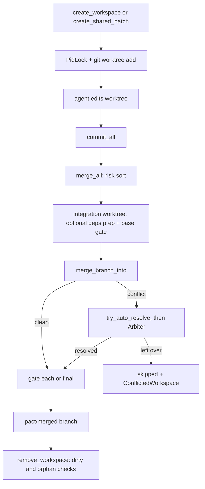

# Worktrees, shared-tree batches, commit, merge and teardown

## Current design

`pact-vcs` owns every git operation pact performs on workspaces: creating them, reading what they changed, committing, merging them together, and tearing them down. `WorkspaceManager` is the entry point; `lock.rs` holds `PidLock`, `land.rs` holds single-workspace landing, `semantic_resolvers.rs` holds the conflict resolvers. The crate has no dependency on `pact-agents`, `pact-deps` or `pact-core`; agent and dependency behaviour reaches it as closures (`ArbiterResolver`, `DependencyPrepHook`).

- **Workspaces.** `create_workspace` takes the repo-wide `PidLock` (`LOCK_TIMEOUT` is 30 minutes, #230), records `base_commit` (`git rev-parse HEAD`), runs `git worktree add -b pact/<id>`, and writes metadata. The id is `slugify(leading_phrase(task))` (ASCII, at most 32 characters, first sentence only, #271) plus a random suffix; an explicit `--name` is the whole id with no suffix and must be unique within a batch (#122, #234). `PidLock` steals a stale lock when the holder PID is dead or its recorded start time differs (#70) and treats Windows delete-pending errors as contention to retry (#318).
- **Shared-tree batches.** `create_shared_batch` makes one real workspace, and `create_lane` adds metadata-only lanes whose `path`, `branch` and `base_commit` are the batch's (`shared_batch` field, #315; lanes run as ACP sessions, #331). Lanes never own the worktree. Tearing down a lane drops its metadata and stops its agent; tearing down the batch refuses while lanes remain. `merge_all` merges a batch once, as one workspace.
- **Teardown.** `remove_workspace` refuses uncommitted changes and commits reachable from no other branch unless `force` or `keep_branch` is set (#325), force-deletes the branch with `-D`, and unlinks top-level junctions and symlinks first so `git worktree remove` cannot delete a linked `node_modules` target (#283).
- **Commit and land.** `commit_all` stages everything and commits `agent <id>: <task>`; it is a no-op on a clean tree. `land.rs` fast-forwards or merges one workspace into the checked-out branch (#389, see `run-planner.md`).
- **`merge_all`.** Phases: auto-commit each selected workspace (a failure becomes a `SkippedWorkspace`, #194; `--dry-run` no longer commits, #286); moving-base check against `base_commit`; sort ascending by `merge_risk_score`; merge each into a fresh `pact/merged-<id>` worktree (the branch survives, the worktree does not). Risk is changed-file count, +3 per central manifest or barrel basename, +5 per lockfile, +10 per file shared with another selected workspace (#159, #236); an all-equal dry run says the order is creation order. Exit code is 0 all merged, 2 any skipped, 1 hard failure (#27). A conflict is both skipped and recorded as a `ConflictedWorkspace`; `resolve_conflict` retries it through the same `merge_branch_into` path (#85).
- **Conflict resolution order.** Plain `git merge`; then per file `try_auto_resolve`: never touch lockfiles (`NEVER_AUTO_RESOLVE`), else the first matching `SemanticResolver` (#151): `PackageJsonResolver` for dependency blocks (#29), `TomlManifestResolver` for Cargo.toml and Poetry tables via `toml_edit` so comments survive (#272), `UnionResolver` for caller-named `--union` globs, with a JS/TS safety check (#24) and insertion before a `pact:union-end` marker (#87). Any leftover file aborts that merge and leaves the worktree clean for the next workspace; the Arbiter closure is the last resort.
- **Test gate.** `--require-passing-tests <cmd>` (#65) runs `GateMode::Each` by default (gate after each merge, reset and skip on failure) or `Final` (one gate on the combined branch, whole batch rejected on failure, #309). Dependencies are prepared in the integration worktree first (#269), then the command runs once on the unmodified base; a failure there aborts the run as an environment problem (#232). `GateOutcome` carries exit code, duration and the last 20 output lines.

### Superseded decisions

- One gate run on the final branch was set aside in favour of per-workspace gating (#65); superseded by #309, which adds `--gate final` while keeping `each` as the default.
- Ranking by plain changed-file count, then by file count plus central-file penalties; superseded by #236's overlap term (+10 per shared file), which the #159 note had deferred as needing a cross-crate dependency and which needed none.
- `--require-passing-tests` was left unable to run on dependency-needing projects, pending a shared store (#232); superseded by #269, which runs `pact_deps::prepare` in the integration worktree through `DependencyPrepHook`.
- `commit_all` described as auto-committing during `--dry-run`; superseded by #286, so a dry run records `would_auto_commit` instead of touching git.
- Teardown deleting any clean branch with `-D` and reasoning that reflog would keep committed work; superseded by #325, which refuses to delete a branch whose commits no other ref reaches.
- Unconditional `--force` in `git worktree remove` that discarded dirty work; replaced by the dirty-tree refusal and by unlinking reparse points first (#283).
- `PidLock` also guarded the npm content store; gone with that store (#233), so it guards git worktree operations only.
- The 30 s `LOCK_TIMEOUT` and PID-only liveness; superseded by 30 minutes (#230) and start-time comparison (#70).
- The #122 claim that `--dry-run` previews the real id; superseded by #234's explicit `--name`, since the random suffix never matched across runs.
- Teardown of the last lane removing the shared worktree (#315 field comment): the worktree is removed only by the batch workspace's own teardown, which refuses while lanes remain.

## History

The sections below are the issue-by-issue record, moved verbatim from
the old single DESIGN.md. Read them for the why; the summary above is
the current design and wins where they disagree. New decisions in this
area go at the end of this file.

### PidLock origin

Originally built because git itself races on `.git/config.lock` when `git
worktree add`/`remove` run concurrently (see
anthropics/claude-code#34645) -- but the mechanism isn't git-specific,
it's just "serialize access to a resource, and don't leave it stuck locked
forever if the holder died." `pact-deps` used to reuse it verbatim to
guard concurrent population of a shared dependency store entry -- gone
along with that store (issue #233); `PidLock` today guards git worktree
operations only.

### Lock timeout: 30s -> 30min (issue #230)

The 30s `LOCK_TIMEOUT` used to guard `git worktree add`/`remove` was tuned
as an arbitrary "don't hang forever" ceiling, not derived from anything
real. A real production `spawn-many` run (497-file repo, 5 concurrent
tasks) hit it: `git worktree add` took ~9s per checkout on that repo, so
the 5th task's wait for its turn (~4 waiters * 9s = 36s) exceeded 30s, the
lock acquisition failed, and the task silently never became a workspace --
no error text reached the report's captured output (see issue #8, the
same run's orphaned-process terminal wedge, for why). The failure
condition is `(N-1) * checkout_seconds > 30`, which is a cliff that gets
easier to hit as either N or repo size grows, on a codebase where nothing
was actually stuck.

Re-verified empirically before changing anything: 60 concurrent, unlocked
`git worktree add -b` calls across 3 rounds (12-20 way) against a 3000-file
repo on git 2.46/Windows produced zero failures and `git fsck` came back
clean -- modern git does not appear to need this serialization for
distinct paths/branches on this platform. Removing the lock entirely
(rather than just fixing the timeout) was considered and rejected for this
pass: the original anthropics/claude-code#34645 citation above predates
this verification, was not re-checked against current git on macOS/Linux
(unavailable in this environment, same standing limitation as issue #6),
and the actual reported harm was the timeout misfiring on ordinary
contention, not that the lock itself was slow or wrong. Widening the
timeout fixes the reported bug without reversing a documented safety
decision on unverified ground.

`LOCK_TIMEOUT` is now 30 minutes. The reasoning: `PidLock`'s stale-lock
stealing (liveness + start-time check, see below) already handles the
"holder crashed" case before this timeout is ever consulted -- the only
scenario left for this timeout to guard is a holder that is alive but
genuinely stuck, which is rare and deserves a generous window, not a
budget sized to one worktree checkout. When it does fire, the error is
still a hard, attributed, non-swallowable failure (`create_workspace`
returns `Err`, `spawn_many` surfaces it per-task, the CLI prints `task #N:
failed before/during launch: ...` and exits 1) -- see issue #231 for
making that reconciliation a structural invariant instead of relying on
this loop being correct.

### PID reuse (issue #70)

A PID-only liveness check has a real gap: if the original holder died and
the OS later recycles that PID for an unrelated process before anyone
tries to steal the lock, the check sees a "live" process and refuses to
steal an actually-abandoned lock. Fixed by recording the holder's process
start time (`sysinfo::Process::start_time`, cross-platform) alongside the
PID in the lock file -- a live process whose start time doesn't match the
recorded one is a different process that happens to share the PID, not
the original holder, so the lock is stolen. A lock file written before
this field existed (bare PID) falls back to the old PID-only check rather
than erroring, so it's compatible with a lock held across an upgrade.

### Windows delete-pending races are contention, not failure (issue #318)

`acquire` used to retry only on `AlreadyExists`; any other error from
`create_new` was fatal. That assumption is Unix-shaped. On Windows,
deleting a file that another handle still has open does not fail the
deleter: the file goes *delete-pending*, and the next `CreateFile` on
that name fails with `ERROR_ACCESS_DENIED` (5), `ERROR_SHARING_VIOLATION`
(32) or `ERROR_LOCK_VIOLATION` (33), which Rust maps to
`PermissionDenied` or `Uncategorized`. So when one thread's `Drop`
(`remove_file`) races another's `create_new`, or a waiter is mid-
`steal_if_stale` reading the file while the holder releases it, the
loser got a fatal "failed to create lock file" instead of waiting 50 ms
and retrying. PR #316's `build + test (windows-latest)` job hit exactly
this in `acquire_waits_out_contention_instead_of_giving_up_early` (8
threads), while the same suite passed locally and on ubuntu/macos; the PR
had not touched `lock.rs`. The probability scales with contention, and
`spawn-many --shared-tree` runs 8 lanes against one lock, so this was
going to become a real-use failure, not just a CI flake.

`is_transient_contention` now classifies `PermissionDenied`,
`Interrupted`, and (Windows only) raw OS errors 5/32/33 as "someone else
is releasing or probing it": wait and retry within the same timeout as
`AlreadyExists`. Anything else stays fatal, and that fatal error now
carries the `io::ErrorKind` and raw OS code so a future escape is
diagnosable from a CI log alone, which is how this one was not.

The regression test (`rapid_acquire_release_races_retry_instead_of_
failing`) is the existing contention test with zero hold time and many
rounds per thread, which is what makes `create_new` land on a file mid-
`remove_file`. Calibration mattered: a first draft at 40 rounds under a
10 s budget *timed out* under the fix, because 8 threads each backing off
50 ms per lost race is scheduler starvation, not the bug; 12 rounds under
30 s isolates the fatal path. Checked both directions on this Windows
machine: fails 2 of 3 runs without the fix (it is a race, so not every
run), 12 of 12 with it across single-test and full-suite runs.

### Workspace lifecycle

`create_workspace` captures `base_commit` (`git rev-parse HEAD`) under the
same `PidLock` as the `git worktree add` call immediately after it, so
it's exactly the commit the new branch forks from -- not a value that
could race against a concurrent `pact spawn` moving HEAD in between the
two calls.

`workspace_diff` and `workspace_changes` both compute the merge-base
against the *repo root's* current HEAD, not a persisted value -- correct
as long as the repo's own branch hasn't been reset past the point the
workspace's branch forked from, the same assumption `git worktree`/`git
worktree remove` themselves make about a branch's relationship to its
origin. `workspace_changes` specifically exists to detect cross-workspace
file overlap (issue #8): two workspaces sharing the same merge-base forked
from a comparable point in history, so any file both of them touched is
worth surfacing, without needing semantic/AST-level analysis -- file-path
overlap is the same restriction the MCP lease layer already accepts.

### Workspace id: task-derived slug + random suffix (issue #122)

`workspace_id` (was a bare `short_id()`, an 8-char random hex string with
no relationship to the task) now derives a readable slug from the task
text and always appends a `short_id()` suffix: `add-pagination-to-users-a1b2c3d4`.
Made `pact list`/branch names (`pact/<id>`) meaningfully more scannable
with real tasks, per an outside adoption/UX review that called the fully
opaque id out as unnecessary friction.

The random suffix is not decoration -- it's the actual collision-avoidance
guarantee, unchanged from before this issue. `slugify` alone is not unique
(two workspaces from identical or similarly-worded task text would slugify
to the same string), so `workspace_id` always appends it regardless of
whether the slug is empty, short, or long.

`slugify` is deliberately conservative:
- ASCII-alphanumeric only, lowercased, everything else collapsed to a
  single `-` (no runs of hyphens, no leading/trailing one).
- Capped at `MAX_SLUG_LEN` (32) -- this id becomes part of every path under
  the workspace (`state_dir/workspaces/<id>/...`), and Windows' MAX_PATH
  has already bitten this codebase once (the npm content store fallback);
  an unbounded slug from a long task description would make that worse,
  not better.
- Non-ASCII task text (most non-Latin scripts) slugifies to an empty
  string -- `workspace_id` falls back to the bare random suffix in that
  case, identical to every workspace's id before this issue existed. Not
  attempting transliteration (e.g. via `unidecode`) was a deliberate scope
  cut, not an oversight -- worth reconsidering only if real non-ASCII usage
  shows up.

`preview_workspace_location` (used by both `create_workspace` and
`spawn_preview`/`--dry-run`) takes `task: &str` now instead of nothing, so
`--dry-run`'s preview calls the exact same `workspace_id` function a real
spawn does. **This claim turned out to be misleading, not false but not
sufficient either** -- see issue #234 directly below: calling the *same*
function twice is not the same as it returning the *same value* twice,
and `workspace_id`'s random suffix meant it never did.

### Default slug stops at the first sentence (issue #271)

A real reported id, `cluster-next-deps-you-are-in-an-2df7ed2b`, showed the
gap left by #234's deliberate scope cut: the default (no `--name`) path
still slugified the *whole* task text and blindly truncated at
`MAX_SLUG_LEN`, landing mid-clause whenever a real prompt carried a
multi-sentence preamble ahead of the actual instruction ("You are in an
environment where...").

Orthogonal to #234's suffix-parity question -- this only changes what
text feeds `slugify` for the *default* path, not the suffix behavior
`--name` exists to fix. New `leading_phrase(text)` returns everything
before the first `.`/`!`/`?`/newline, falling back to the whole text when
none is found (unchanged behavior for the common single-clause task).
`workspace_id`'s no-`--name` branch now slugifies `leading_phrase(task)`
instead of `task` directly.

Known, accepted limitation, same "conservative, not exhaustive" tradeoff
`slugify` itself already makes: a `.` inside an abbreviation or a
version-like token (`Next.js`, `v1.2`) reads as a sentence boundary too.
Not attempting real sentence detection was a deliberate scope cut.

### Workspace names: `--name` (issue #234)

A real production report found the #122 scheme above unusable in
practice for two compounding reasons, both traced to the random suffix:
(1) `--dry-run`'s preview id and the real run's id could never agree,
since `short_id()` returns a fresh `Uuid::new_v4()` on every call -- the
same function, called twice, is not the same as it returning the same
value twice; (2) a batch of tasks sharing a long common preamble (a house
style, a templated instruction block) slugify to an identical 32-char
prefix, so every workspace in the batch looked the same except for its
opaque suffix -- exactly the scenario `slugify` was already known not to
solve on its own (see above), now confirmed in the wild, not just reasoned
about.

`workspace_id(task, name: Option<&str>)` takes an explicit name now.
When given, it drives the id **directly**: `slugify(name)`, no random
suffix at all. This is deliberately not "slug from name plus a random
suffix" -- an explicit name is exactly what the caller asked for, and a
suffix would reintroduce the same dry-run/real-run mismatch #234 exists
to fix. The tradeoff: two tasks given the same `--name` within one batch
collide on id/branch, which fails loudly at `git worktree add -b`
("branch already exists"), not silently -- accepted deliberately, and the
CLI additionally checks for a duplicate `--name` up front (before ever
spawning a thread) so the failure is immediate and clear rather than a
git error surfacing from inside a background task.

`spawn --name <name>` (one task) and `spawn-many --name <name>`
(repeatable, positionally matched to `--task` in the same order) both
require *no* name or *exactly one name per task* -- a partial count is
rejected rather than guessed at. `--name` must contain at least one ASCII
alphanumeric character (validated before `slugify` ever runs), so a
caller can't accidentally end up with the confusing empty/opaque id
`slugify` would otherwise produce.

**Deliberately not implemented**, per the original report's own
prioritization ("(c) ... I would not bother if (a) lands"): a
deterministic hash-derived suffix for the *default*, no-`--name` path.
That would only partially fix the parity problem (two separate process
invocations -- a `--dry-run` now, a real run later -- still can't
coordinate without a shared run id neither one currently has reason to
generate), and an explicit name is the actual fix for the case where
parity or readability actually matters. The default scheme (task-slug
plus random suffix) is unchanged for every caller not using `--name`.

### Workspace teardown

`remove_workspace` deletes a workspace's worktree and, unless
`keep_branch` is set, its `pact/<id>` branch. Confirmed via a real trial
run (an outside reviewer's report): `git worktree remove` does not delete
the branch it was created with -- that's standard git behavior, worktree
removal and branch deletion are independent -- so without this, every
torn-down workspace left a dead branch behind, accumulating over repeated
use. Force-deletes (`-D`, not `-d`) since an agent's workspace branch is
never merged into the *base* branch (`merge_all` lands into a fresh
`pact/merged-*` branch instead), so `-d`'s own unmerged check would refuse
every normal teardown; `keep_branch` exists for anyone who wants to
inspect or rebase a workspace's commits after tearing it down.

Before deleting the branch it asks git how many of the branch's commits
no other local or remote branch reaches (`git rev-list --count <branch>
--not --exclude=<branch> --branches --remotes`) and refuses when the
answer is non-zero, unless `force` or `keep_branch` is set (issue #325).
"Reachable from any other ref" rather than "merged into base" is what
keeps the check silent in the normal flow: after `merge_all`'s real `git
merge`, the workspace's commits are reachable from `pact/merged-*`; a
branch an agent never committed to is still at the base tip. Only
commits that `branch -D` would actually orphan refuse.

That refusal exists because of a confirmed loss, not a theoretical one.
After the shared-tree benchmark (issue #315) every lane was clean, so a
bare `pact teardown` sweep removed the lanes, then the batch, then its
branch -- the only reference to a 39-file, 9,295-line commit worth about
$22 of agent time. `git fsck --lost-found` recovered it by hand. The
earlier reasoning here, that a committed-but-unmerged branch was lower
severity because "its tip stays reachable via reflog for a while even
after `-D`", was wrong for pact's own sequence: `branch -D` deletes the
branch's reflog with the branch, and `worktree remove` deletes the
worktree's `HEAD` reflog with the worktree, so nothing was left pointing
at the commit and the next `gc` would have pruned it. The uncommitted-
change check below already judged "would silently discard work" worth a
default refusal; committed work is the same hazard one level up, and the
way out is the same shape: `merge-all` to land it, `--keep-branch` to
keep it, `--force` to discard it on purpose. Bulk teardown keeps its
"report and continue" behavior, so a sweep over a committed, unmerged
shared-tree batch drops the lanes' metadata and leaves the batch, its
worktree and its branch exactly as they were.

It refuses on a workspace with uncommitted changes unless `force` is set.
This wasn't a real check before -- confirmed directly, by spawning a
workspace, adding an uncommitted file to it, and running the old
unconditional-`--force` teardown: the file was silently gone afterward,
with no warning at all. The underlying `git worktree remove` call already
has this exact protection built in (it refuses on a dirty worktree unless
*it's* passed `--force`); `remove_worktree_retrying` was defeating that
protection unconditionally on every call. This check restores it at
pact's own layer instead, so `--force` is something the caller chooses,
not something baked in silently.

`remove_worktree_retrying` tolerates two Windows failure modes confirmed
against a real killed agent process, not theoretical: (1) killing a
process doesn't mean its handles on its own `current_dir` are released the
instant `kill()` returns, so an immediate `git worktree remove` can fail
with "Permission denied" even though the process is already gone --
retrying briefly usually clears this; (2) git unregisters a worktree from
its own metadata *before* attempting to delete the directory, so if that
deletion fails, a later `git worktree remove` on the same path fails with
"is not a working tree" even though the directory (and whatever's in it)
is still sitting there orphaned. In that case it falls back to removing
the directory directly, also with retries, since it's the same underlying
handle-release race, just past the point where git itself can help.

### Reparse points and worktree removal (issue #283)

`git worktree remove` -- plain *and* `--force`, git 2.46 on Windows --
follows a junction or directory symlink inside the worktree and deletes
the **target's** contents, not just the link. Found while building
link-mode dependency prep (see "pact-deps > Link mode"), where
`<workspace>/node_modules` is a junction to the repo root's real install:
without a fix, every `pact teardown` would have wiped the user's own
`node_modules`. Confirmed by hand three ways before any code changed: a
marker file inside the link target was gone after `git worktree remove`
with the link present; it survived when the link was removed first with
`rmdir` (cmd); and Rust's `std::fs::symlink_metadata` reports a junction
as `is_symlink() == true` while `std::fs::remove_dir` on it removes only
the link.

`remove_worktree_retrying` therefore unlinks every top-level reparse
point in the worktree (`unlink_top_level_reparse_points`) before the
first `git worktree remove` call. It lives on that path, not only in
`remove_workspace`, so the integration and resolve worktrees are covered
by the same line of code. Top-level only, deliberately: that is the only
place pact itself ever creates a link today, and the worktree is about to
be deleted anyway, so a leftover nested link is the lesser risk versus a
recursive walk of a 32,000-file tree on every teardown. The workspace's
recorded `linked_paths` exist alongside this scan so a future nested
link (a monorepo package's `node_modules`, say) has an explicit list to
work from. `crates/pact-vcs/tests/reparse_point_teardown.rs` reproduces
the exact hazard with a marker file and fails without the unlink.

### A crashed `pact` orphans its agent process tree (issue #108)

Found during the 2026-07-23 Claude Code stress-testing campaign, then
isolated further afterward: forcibly killing the top-level `pact`
process mid-run does not clean up its child process tree (a real
`cmd.exe` -> `claude.exe` -> `pact mcp-serve` chain on Windows) -- all
three survived as orphans, confirmed via live process inspection.
`pact teardown --force` *does* correctly recover afterward (a real
tree-kill of whatever PID it has recorded, confirmed working), so this
isn't unrecoverable, just not automatic.

**Isolated with zero pact code involved:** a minimal standalone program
using `command-group` directly (spawn a grouped child via
`Command::group_spawn`, do nothing else, get killed externally) showed
the exact same thing -- the grouped child (a plain `ping`) survived a
`taskkill /F` of its parent. `command-group`'s own Windows
implementation does correctly set `JOB_OBJECT_LIMIT_KILL_ON_JOB_CLOSE`
(confirmed by reading its source directly), which is supposed to
guarantee exactly this cleanup at the OS level. That it didn't fire here
is either a real `command-group`/Windows nested-job-object limitation,
or specific to the fact that this testing happened from inside another
live Claude Code session (whose own process tree may itself already sit
inside a job object pact's new job then nests under) -- not
conclusively separated from pact's own code, since there's no clean way
to test "outside any other job object" from within this environment.

**Fix shipped: visibility, not a claimed cure.** Rather than chase the
exact Windows kernel mechanics further, `pact list` now reports a
workspace's recorded `agent_pid` liveness directly
(`pact_vcs::agent_process_alive`, the same `sysinfo`-based liveness
check `PidLock` already uses, minus the start-time disambiguation --
acceptable here since this is informational display, not lock-stealing
logic a false positive could break). Deliberately not claiming to
distinguish "orphaned" from "legitimately still running" -- pact
structurally can't tell those apart from a PID alone, so it surfaces the
raw fact (running / not running) and lets the user investigate, rather
than guessing at a classification it can't back up.

### commit_all

Stages and commits everything in a workspace's working tree (staged,
unstaged, untracked) with a message derived from its task text, so `pact
diff`/`pact log` and `merge-all` always have a real commit to work with
instead of a permanently-dirty worktree -- see the trial report that
motivated this: every workspace in the trial ended `[dirty]` with nothing
to merge. `merge-all`'s first phase calls this unconditionally on every
selected workspace, which is why it's a no-op returning `Ok(false)` rather
than an error on an already-clean workspace.

`commit_message` builds the commit subject as `agent <id>: <first line of
task>`, matching the existing `pact/<id>` branch-naming convention so a
commit is traceable back to its workspace at a glance. The subject line is
capped around 72 chars (git convention); if the task is longer or spans
multiple lines, the full untruncated text follows in the commit body --
this is asserted directly by `commit_message`'s own unit tests, which is
the more reliable place to see the exact contract than a comment.

### merge_all

Closes the loop from "N workspaces are dirty" to "one clean integration
branch" -- see the trial report this is built against: 9 of 10 manual
merges failed on a shared barrel file, and strict-mode git blocked every
merge after the first conflict. Never touches the repo's own checkout --
everything happens in a throwaway worktree, same isolation model as agent
workspaces themselves, so this is safe to run regardless of what branch
(or branch-protection rules) the main checkout has.

Phases, all best-effort (one workspace's failure never blocks another's):

1. Auto-commit every selected workspace via `commit_all` -- a workspace
   whose auto-commit fails is removed from the batch here and recorded
   as `skipped` (issue #194, see below), not just logged and left in.
2. Moving-base check -- refuse a workspace whose recorded `base_commit` is
   no longer an ancestor of current HEAD, so merging never silently
   assumes a fork point that isn't real anymore (e.g. HEAD was reset since
   the workspace was created). A workspace whose changes can't be sized in
   the next phase (e.g. `workspace_changes` failed) sorts last rather than
   being dropped, so a bug in sizing never silently excludes it.
3. Sequence the rest by risk score (`merge_risk_score`, issue #159) --
   changed-file count plus a penalty for touching a central file or
   lockfile, ascending -- on the theory that landing small, low-risk
   changes before a bigger or more central one reduces cascade
   conflicts. Plain changed-file count alone (the original heuristic)
   still anchors the score; the penalty only pulls a *smaller* but
   riskier change later than a same-or-larger plain one, not the reverse.
4. Merge each into a fresh `target_branch` (default `pact/merged-<id>`)
   one at a time, skipping (not aborting the whole run on) a real
   conflict.

`dry_run` runs phases 1-3 (auto-commit still happens, since that's always
safe to call) but stops before touching git state for the actual merge,
returning the planned order instead.

`is_ancestor`'s `git merge-base --is-ancestor` exits non-zero for "not an
ancestor", which is a normal, expected outcome here, not a spawn/IO
failure -- so it returns `Ok(false)` for that case rather than treating a
non-zero exit as an error.

`pact merge-all`'s process exit code (issue #27) distinguishes three
outcomes: `0` every workspace merged, `2` one or more were skipped (a real
conflict, or the moving-base check) but nothing errored outright, `1`
reserved for a hard/unexpected failure. It used to always exit `1` on any
skip, so a CI wrapper around `merge-all` had no way to tell "half the work
landed, the rest needs a human" apart from a crash -- both looked
identical at the process level.

**A real, serious bug in phase 1 found and fixed (issue #194, outside R4
regression report, 2026-07-29): a false-green summary when auto-commit
fails.** The phase-1 loop logged `"...leaving it out"` on a `commit_all`
failure but never actually removed the workspace from the batch. Since
the intended changes never landed as a commit, that workspace's branch
had nothing new for `git merge` to do -- a trivial, conflict-free
no-op that `merge_all` reported as a normal `merged <id>`, exit `0`, on
a branch silently byte-identical to base. The original report hit this
across all 10 agents in one real 10-agent Windows run (`git add`
failing on a filename-too-long error, `node_modules` not in
`.gitignore`) -- a real data-loss shape: a green CI-friendly summary
that actually merged nothing. Fixed by recording the failure as a
`SkippedWorkspace` (the same structured pattern the moving-base check
already used) before removing it from `selected`, so it shows up in
the CLI's "skipped -- needs a human" section and flips the exit code
to `2`. Verified with a real integration test that forces a genuine
`git commit` failure via a `pre-commit` hook that always exits
non-zero (portable, not relying on a Windows-specific error), then
asserts the target branch's tree is byte-identical to base *and* the
workspace shows up in `report.skipped` -- confirmed as a real
regression test by temporarily reverting the fix and watching it fail.

**Test scenario notes** (`crates/pact-vcs/tests/merge_all.rs`): the main
conflict test has workspace A append a new line at the end of `index.ts`,
well-separated (4 lines of untouched context) from anything C/D touch;
workspace B edits a completely different file. Both are genuinely
compatible with everything else and must always merge, regardless of
order. C and D both rewrite `index.ts`'s *first* line differently -- a
real, unavoidable conflict between exactly those two, confirmed by hand
against real git before writing the test: single-line-file appends turned
out to conflict far more readily than multi-line context does (see the
trial report this whole feature is built against). Since C and D touch the
same single file, they tie on the risk-score heuristic, so which one
merges first (and therefore which one the *other* conflicts against)
isn't specified -- the test asserts that exactly one of them merged,
not which one.

### Risk-aware merge ordering (issue #159)

From an outside code review (2026-07-24, triage discussion): plain
changed-file count treats a one-file change to `package.json` the same
as a ten-file isolated feature, when the former is often the riskier
change to land in the middle of a batch. Marked "design first" at the
time -- the weighting scheme needed a decision the review flagged but
didn't resolve (what counts as "central," how much weight per factor).
Picked sensible defaults this pass rather than leaving it unbuilt
further, on the reasoning that none of it is a public API commitment
and is easy to retune later if the weights turn out wrong in practice.

`merge_risk_score(files) -> usize`: base score is still the plain
changed-file count (the original heuristic was directionally right,
just too coarse) -- `+3` per file whose basename is a common package
manifest, schema-adjacent, or barrel/router entry point
(`CENTRAL_FILE_BASENAMES`: `package.json`, `Cargo.toml`,
`pyproject.toml`, `go.mod`, `requirements.txt`, `Gemfile`,
`composer.json`, `index.{ts,tsx,js}`, `router.ts`, `routes.ts`), `+5`
per lockfile (reusing `is_never_auto_resolve`'s existing list -- lockfiles
already get the strongest "don't touch casually" treatment elsewhere in
this codebase, for the same underlying reason). Deliberately
basename-based, not path-aware or content-aware: this can't know a
repo's own conventions (a project's real barrel file could be named
anything), so it only catches the common, cross-ecosystem cases -- a
first-cut heuristic, not an attempt to model real conflict probability.

**Deliberately deferred, not half-built**: the triage's other proposed
factors --`overlap_with_other_workspaces`, `prior_conflict_history`,
`active_claim_overlap` -- would require `pact-vcs` to depend on
`pact-core`'s Weaver prediction and/or `pact-coord`'s operation log and
live lease state, a real cross-crate architectural change, not a weight
tweak. Left out of this pass rather than bolted on awkwardly just to
check the box; the four-factor file-content-only version above is a
complete, self-contained improvement on its own.

`--dry-run` now shows each workspace's computed risk score alongside
the planned order (`MergeReport::planned` changed from `Vec<String>` to
`Vec<PlannedWorkspace { id, risk_score }>`), so the reasoning behind the
order is inspectable, not just the order itself -- confirmed for real
via a `--dry-run` preview showing a workspace touching three plain
files sequenced *before* one touching only `package.json`, despite the
`package.json` workspace changing fewer files overall.

### Overlap-aware risk scoring (issue #236)

A real production run's own `--dry-run` output showed the same limitation
this document's "deliberately deferred" note above already anticipated,
confirmed in practice: four workspaces each touching one key of the same
`package.json` all scored `4` (`1` file `+3` central-file penalty),
identically -- "least risky first" had degenerated to plain creation
order, and the `--dry-run` output presented that as if it were a real
decision.

**The prior deferral reasoning turns out to have been more conservative
than necessary.** The note above assumed `overlap_with_other_workspaces`
would need `pact-vcs` to depend on `pact-core`'s Weaver prediction and/or
`pact-coord`'s live lease state -- a real cross-crate change. It doesn't:
`merge_all` already computes every selected workspace's own
`workspace_changes` locally, within `pact-vcs`, before sequencing them.
Computing each workspace's overlap against the *union of every other
selected workspace's changed files in the same batch* needs nothing
beyond data `merge_all` was already gathering, just gathered once up
front instead of one workspace at a time.

`merge_risk_score(files, other_files: &HashSet<String>)` gained a third
term: `+10` (`OVERLAP_PENALTY`) per file `files` shares with
`other_files` -- deliberately dominant over the existing `+3`/`+5`
central-file/lockfile penalties and any realistic plain file count, so a
workspace sharing anything with the rest of the batch reliably outranks
one that doesn't, matching the report's own proposed model ("merge the
workspace with fewest overlapping files against all others first").

**Still file-level, not hunk-level** (the report's proposed direction
(b), not attempted here): four workspaces editing disjoint regions of
one file (genuinely low risk) and two editing the same function
(genuinely high risk) both score as "shares this file with N others"
identically -- overlap-aware scoring narrows the gap `merge_risk_score`
can't close (four *different* files scoring identically is now fixed;
four edits to the *same* file needing hunk-level analysis to
differentiate is not, and would need real diff/hunk data this heuristic
deliberately doesn't compute). Because ties are therefore still possible
for a realistic batch (several workspaces genuinely sharing the exact
same one file), `merge-all --dry-run` now detects the all-scores-equal
case explicitly and says the order shown is creation order, not a risk
ranking -- honest about the heuristic's limits instead of presenting a
meaningless order as a decision.

### Test-gated merge (issue #65)

Batty (a nearby competitor) has test gating without N-way merge; pact had
N-way merge without test gating. `merge-all --require-passing-tests <cmd>`
closes that gap. Design decisions, made with the user directly rather
than assumed (a real fork with real tradeoffs, not a default to pick
silently):

**Gating scope: per-workspace, not a single gate on the final integration
branch.** After each workspace merges cleanly (git-level, no conflict),
`merge_all` runs `<cmd>` in the integration worktree right there, before
moving to the next workspace. A failure resets the integration worktree
back to the commit it was at before that one merge (`git reset --hard`,
safe since this worktree is never shared with anything else) and treats
the workspace as skipped -- the exact same "skip and continue" shape
`merge_all` already uses for a real conflict, no new rollback concept
needed. The alternative -- one test run against the fully-merged branch
at the end -- would catch cross-workspace interaction bugs a per-workspace
run can't see, but raises a real, unsolved question this codebase has
never had to answer anywhere else: which of N already-merged workspaces
caused a failure discovered only after all of them landed, and how do you
undo just that one? Deliberately not attempted here; per-workspace
gating ships the well-scoped half of the idea now rather than blocking on
designing rollback-after-the-fact.

**A distinct flag, not a repurposed `--test-cmd`.** Arbiter's existing
`--test-cmd` means "verify an agent-proposed conflict *resolution*
worked" -- a fundamentally different question from "should this
workspace's own clean merge be *allowed to land at all*", even though
both run a test command. Reusing the name would have silently changed
`--test-cmd`'s existing meaning for anyone already using Arbiter.
`--require-passing-tests <cmd>` is the new, separate flag; `--test-cmd`
is untouched.

**Interaction with Arbiter:** if both are given, a workspace that Arbiter
resolves (auto-resolve, `--union`, or Arbiter itself accepting a
conflict resolution) *also* has to pass `--require-passing-tests` before
being accepted -- Arbiter's own `--test-cmd` verifies its proposed
resolution compiles/passes in isolation; `--require-passing-tests` is
this feature's separate, subsequent gate on the merge as a whole, run
after Arbiter's own verification succeeds. The two commands can be the
same string or different ones; nothing requires them to match.

**Cost:** running a real test suite once per accepted workspace multiplies
wall time for a large batch -- already opt-in via the flag (`merge_all`
behaves exactly as before when it's omitted, no extra cost or behavior
change), so this is a cost a caller explicitly chooses. No cheaper
"just check it compiles" tier below "run the full suite" in this first
cut -- `<cmd>` can already be an arbitrarily cheap command (`cargo check`
instead of `cargo test`) if a caller wants that tradeoff, so a separate
tier wasn't necessary to build.

### Gate timing: `--gate each|final` (issue #309)

The "single gate on the final branch" alternative the section above set
aside came back with a number attached. The 2026-09-30 benchmark (issue
#308) merged 10 file-disjoint workspaces under `--require-passing-tests
"npm test"`: 11 full suite runs (one base preflight plus one per merge),
roughly 4 of the 5 minutes `merge-all` took, for merges that were all
trivially conflict-free and could never have interacted. Per-merge
gating was pure cost there.

`--gate final` (default stays `each`) merges every clean workspace first
and runs the gate once against the combined branch. The question that
blocked this before, "which of N merged workspaces broke it, and how do
you undo just that one", is answered by *not answering it*: a failure
rejects the whole batch (the integration branch is reset to the base
commit, every merged workspace is moved to `skipped` with a reason that
names the mode and says to re-run with `--gate each` to localize). That
is an honest tradeoff, not a rollback algorithm: `final` is for the
common case where the merges are independent and the suite is expected
to pass, and `each` remains the tool for finding a culprit. Bisecting
automatically on a `final` failure was considered and left out of this
cut, since it would re-run the per-merge cost exactly in the case the
user chose `final` to avoid, and `each` already does it on demand.

Two things `final` does not change: a real merge conflict is still
skipped on its own (the gate never sees it, and `conflicted` is
unaffected), and the #232 base preflight still runs first, so a broken
environment is still diagnosed as such rather than as a batch failure.

Tests (`crates/pact-vcs/tests/gate_mode.rs`) are deliberately
behavioral, not invocation-counting: an earlier draft counted gate runs
by having the fixture append to a log file at an absolute path, and that
silently recorded zero runs on Windows because `Command::new("cmd")
.args(["/C", cmd])` re-quotes an argument containing `"`, which breaks
cmd's parse of the redirect. Rather than fight shell quoting in a test,
the fixture is a gate whose *verdict flips between modes*: it passes
only when both `b.txt` and `c.txt` exist (or a base sentinel does, so the
preflight passes). Under `each` every merge is gated alone and fails;
under `final` the one gate sees both files and passes. A gate that
cannot be satisfied by any single merge is the proof the per-merge gate
is really skipped, and it is immune to how the shell receives it. The
same lesson as issue #11/#240: a fixture must not be able to pass or
fail for reasons unrelated to the condition under test.

### Gate diagnosability, and the environment-vs-code distinction (issue #232)

A real production run found `--require-passing-tests` reporting "merged
cleanly but failed the required test command" for every workspace in a
batch, in 27 seconds for a suite that normally takes 155s and passes.
Root cause: the integration worktree the gate runs in has no dependencies
installed (no `pact_deps::prepare()` call anywhere in that path -- issue
#233 covers actually fixing that, coupled to this one), so the command
couldn't run at all -- and `run_shell` returned a bare `Result<bool>`
that collapsed "your code failed the gate" and "the environment couldn't
even run the command" into the identical false signal, while also
capturing and then discarding the one thing (stdout/stderr) that would
have told a real user the truth in seconds.

Two changes, deliberately independent of actually fixing #233's
dependency-availability problem:

**Pre-flight, before merging anything.** `merge_all` now runs the gate
command once against the freshly-created integration worktree at the
unmodified base commit (`head`, before any workspace's branch is
touched), before entering the per-workspace merge loop. If it fails
*there*, no workspace's changes are on trial -- the whole `merge_all`
call aborts (`bail!`, integration worktree and scaffolding branch cleaned
up first) with a diagnosis explaining the environment, not any code
change, is the problem, and that no workspaces were merged. This is
cheap, general, and language-agnostic: it doesn't know or care *why* the
environment is broken (missing deps, wrong working directory, whatever),
it just refuses to blame workspace code for a command that was never
going to pass regardless of what any workspace did.

**`run_shell` returns `GateOutcome`, not `Result<bool>`.** Carries
`success`, `exit_code`, `duration`, and `output_tail` (last 20 lines of
combined stdout+stderr -- deliberately combined rather than
stderr-only, since most real test runners write failure detail to
stdout). Both the pre-flight check and the existing per-workspace gate
use `GateOutcome::diagnosis()` to put this in the abort message /
`SkippedWorkspace.reason` respectively, instead of silently discarding
the one artifact that explains the failure.

**Test fixtures fixed alongside this, per issue #11's own critique:** the
existing `require_passing_tests` tests used `always_fail_cmd()`
(`exit 1`/`false`) to represent "your code broke the gate" -- but an
unconditionally-failing command is now, correctly, indistinguishable
from a broken environment (both fail on the unmodified base), so it
would trip the new pre-flight abort instead of the per-workspace skip
path the tests expected. Replaced with a content-based gate (fails only
once a specific file the workspace under test introduces actually
exists -- passes cleanly on the untouched base) that can genuinely tell
the two cases apart, matching what a real gate command does. `PidLock`'s
same pattern from issue #71: a fixture shaped to make the test pass isn't
the same as a fixture shaped to catch the real bug.

Deliberately not done in this pass: actually running `pact_deps::prepare`
(or a hardlinked/shared equivalent) on the integration worktree before
the gate, which would make `--require-passing-tests` genuinely usable
for a dependency-needing project rather than just correctly diagnosing
why it can't run yet. That's issue #233's shared-content-store fix --
wiring dependency prep into `merge_all` before #233 lands risks
reintroducing #233's own lock-contention stall directly into the merge
path. Sequenced as its own follow-up once #233 ships.

### Dependencies for the integration worktree (issue #269)

The deferred follow-up above, landed once #233 shipped (the custom
content store was deleted; dependency prep is now just `npm ci` against
npm's own global cache, safe under real concurrent load). Two outside
reports (a retest and a strategy review, both against `edge @ 85d4cc3`)
independently confirmed the gap was still live: `--require-passing-tests`
worked correctly on the diagnosis but was unusable on any real project,
since the integration worktree it runs the gate in never got
`node_modules` any more than it did before #232's fix.

Same closure-injection shape `ArbiterResolver` already uses, for the same
reason -- `pact-vcs` has no dependency on `pact-deps` or `pact-agents`,
so it can't call `pact_deps::prepare` itself. `pact-vcs::merge_all` takes
a new `dependency_prep: Option<&DependencyPrepHook<'_>>` parameter and
calls it once, on `integration_path`, right after the worktree is
created and before the base-commit preflight -- covering both the
preflight and the per-workspace gate, since they run in the same
worktree. `pact-core::merge_all` builds the real closure over
`pact_deps::prepare`, warning (not failing) on a per-manager prep
failure, same as `spawn_with_supervisor` already does for agent
workspaces.

Only invoked when `require_passing_tests` is actually given -- a `dry_run`
or a plain merge with no gate never pays the cost, matching this
codebase's existing `--no-deps` cost-avoidance stance.

### Semantic auto-resolution

`merge_branch_into` tries a plain `git merge` first. On a real conflict, it
tries the semantic-narrow auto-resolution rules in `try_auto_resolve` on
each conflicted file before giving up: never touch a generated/structural
file (`NEVER_AUTO_RESOLVE` -- lockfiles and similar, where a naive
line-level merge is very likely to silently produce a corrupt result, so a
real conflict there always stays a real conflict for a human or a
regenerate step); JSON-aware merge for `package.json`'s dependency blocks
(`PACKAGE_JSON_DEP_KEYS` -- the only part of the file this touches; a
conflict anywhere else in the file, e.g. scripts/version/name, is left as
a real conflict); a plain line-union merge for anything matching a
caller-supplied `--union` glob (nothing is union-merged unless the caller
explicitly named it -- pact does not guess which files are safe to blindly
concatenate). If *every* conflicted file resolves, the merge completes
with a commit instead of aborting. If any file is left over, the whole
merge is aborted (so the worktree is clean for the *next* workspace's
attempt -- one conflicted workspace must not poison the rest of the batch)
and reported as a real conflict, same as if none of this existed.

As of issue #151, the two resolvers below live in `semantic_resolvers.rs`
behind a `SemanticResolver` trait (`can_handle(path) -> bool`,
`resolve(&ConflictStages) -> Result<Option<ResolvedFile>>`) instead of a
hardcoded `if is_package_json(file) { .. } else if union_globs.matches(..)
{ .. }` in `try_auto_resolve` -- a pure mechanical extraction (behavior,
including every existing test, is unchanged) meant to give a third
resolver (Cargo.toml, pyproject.toml, go.mod, a changelog's append-only
section, ...) somewhere to plug in later without `try_auto_resolve`
growing another arm. `try_auto_resolve` now: (1) picks the first resolver
whose `can_handle` matches the file, (2) reads all three conflict stages
once via the new `read_conflict_stages` (`Ok(None)` if "ours" or "theirs"
is missing; `base` alone may legitimately be absent and is left to each
resolver to require or not), (3) hands them to that resolver's `resolve`.
Deliberately left out of the trait: a `name()` method, since nothing
today consumes it -- easy to add once an actual observability/logging
consumer needs it, not before.

`PackageJsonResolver::resolve` (was `try_resolve_package_json`): a dependency name added or changed on exactly
one side is taken as-is; changed to the *same* value on both sides is
fine; changed to *different* values on both sides is a real conflict this
does not try to guess at -- returns `Ok(None)` for the whole file in that
case, same as if anything *outside* the dependency keys differs between
the two sides. Re-serializing used to alphabetize every top-level key
(`serde_json::Value` is `BTreeMap`-backed without the `preserve_order`
feature), so a file that led with `name`/`version`/`description` came
back leading with `dependencies` -- fixed (issue #29) by enabling
`preserve_order` workspace-wide (`merged_obj` is built by cloning `ours`'s
object and updating in place, so key order already matches "ours" once
the map itself preserves insertion order) and by sniffing the input's own
indent width (`detect_json_indent`) instead of hardcoding 2 spaces.

`UnionResolver::resolve` (was `try_resolve_union`): the result is "ours" lines, in order, followed by any
of "theirs" lines not already present verbatim -- the same semantics as
git's own `merge=union` attribute driver, just applied here in Rust rather
than by mutating the repo's shared (cross-worktree)
`.gitattributes`/config to register a driver. Appropriate only for
genuinely order-independent, append-only content (barrel exports,
changelog entries).

This naive line-concat is exactly wrong for anything with "final
assignment/declaration wins" semantics, and it shipped that way: a real
Windows shakedown (issue #24) had two agents each append a disjoint export
to the same CommonJS barrel, and the union merge produced two
`module.exports =` statements (second silently wins, first is dropped)
plus, in the accompanying test file, two `const { ... } = require(...)`
declarations binding the same names -- a real `SyntaxError`. `merge-all
--union` reported `exit 0`/`auto-resolved` on output that either silently
broke or didn't even parse. `union_merge_is_safe` now runs a cheap
heuristic (not a real parser, deliberately -- no external tool dependency
for the 3-platform CI matrix to install) on JS/TS-extension output before
trusting it: rejects the result if it would contain two `module.exports
=`/`export default` statements, or two declarations binding the same
identifier in the same scope. On rejection the file falls through to a
real conflict instead of a false "auto-resolved". Non-JS/TS files and
other legitimate `--union` uses (logs, CHANGELOG, ignore files) are
unaffected -- false negatives are accepted by design (this is cheap, not
exhaustive); a false positive just means a file that would otherwise
silently break instead needs a human, which is the safe direction.

`read_conflict_stage` reads one side of a conflicted file from git's index
-- stage 1 is the common ancestor, 2 is "ours" (the integration branch,
before this merge), 3 is "theirs" (the branch being merged in). `Ok(None)`
if that stage doesn't exist for this path (e.g. the file was added fresh
on only one side) is treated as "don't understand this shape well enough
to auto-resolve," not an error.

### TOML manifest structural merge (issue #272)

Two real outside reports independently proved `PackageJsonResolver`'s
pattern generalizes -- four real Copilot agents editing the same
`package.json` in disjoint regions merged correctly and automatically,
13/13 expected changes, zero conflicts -- and asked for the same
treatment on other manifest formats. Scoped down (a real fork, resolved
with the user rather than picked unilaterally) to the two closest to
`package.json`'s own shape: `Cargo.toml`'s `[dependencies]`/
`[dev-dependencies]`/`[build-dependencies]`, and Poetry's
`[tool.poetry.dependencies]`/`[tool.poetry.dev-dependencies]`/
`[tool.poetry.group.dev.dependencies]` in `pyproject.toml`. PEP 621's
`[project.dependencies]` (a flat array of version-spec strings like
`"requests>=2.0"`, not a name-keyed table) is deliberately out of scope
here -- it isn't the same shape, it's a different merge problem
(array-union keyed by the package name embedded in each string), left
for a future issue if it comes up.

**Why `toml_edit`, not the plain `toml` crate, for the write.**
`PackageJsonResolver` accepts a whole-document reserialize on every
resolved file -- reasonable for JSON, which has no comments to lose.
TOML's comment culture is real (`# pinned, see issue #1234` next to a
dependency line is completely normal in a real `Cargo.toml`), so
reserializing the whole document through the plain `toml` crate would
silently delete every comment and renormalize formatting on every merge
-- a much worse regression than anything `PackageJsonResolver` accepts.
`toml_edit::DocumentMut` is parsed from "ours" and only the specific
table entries that actually changed are written into it; everything
else (comments, unrelated keys, unrelated tables) survives byte-for-byte.
Verified directly, not assumed: a real integration test
(`merge_all_auto_resolves_cargo_toml_dependency_conflict`) plants a
comment next to an untouched dependency and asserts it's still there in
the merged output after a real 3-way git conflict, not just a direct
`resolve()` call.

**Why two TOML crates in the same resolver.** `toml_edit::Value`
deliberately doesn't implement `PartialEq` (checked directly against its
own source -- `Value`/`Item` derive only `Debug`/`Clone`), since equality
there would have to decide whether formatting/decor counts, and the crate
doesn't make that call for you. The "everything outside the dependency
tables must be identical" safety gate (same contract
`PackageJsonResolver` already has) and the per-name 3-way resolution both
need real semantic equality, so both are done against the plain `toml`
crate's `toml::Value` (parsed separately, purely for reading/comparing --
never written back). `toml_value_to_edit` bridges a resolved
`toml::Value` into the `toml_edit` document being edited; returns `None`
(falls through to a real conflict) for `Datetime`, since a dependency
table value is never realistically a datetime and guessing at an
unexercised conversion is worse than refusing.

`TomlManifestResolver` takes a dotted path per dependency table
(`&["dependencies"]` for Cargo.toml's top-level table, `&["tool",
"poetry", "dependencies"]` for Poetry's nested one) instead of
`PackageJsonResolver`'s flat `PACKAGE_JSON_DEP_KEYS` list, since Poetry's
tables aren't top-level. `toml_edit_path_table_mut` creates any missing
intermediate table along that path rather than failing -- a workspace
that never had a `[dependencies]` table until this merge introduces one
is a legitimate starting point, not a malformed file.

### N-agent-one-file benchmark as a regression test (issue #276)

Issue #268's real benchmark (5 Copilot agents, 4 editing the same root
`package.json` in disjoint regions, 1 editing a second manifest -- 13/13
expected changes, 0 conflicts) existed only as a one-off manual
verification in an issue comment, not something that runs again on the
next change. `merge_all_correctly_merges_four_agents_disjoint_edits_to_one_package_json_plus_a_second_manifest`
(`pact-vcs/tests/merge_all.rs`) reconstructs the same *shape*
deterministically -- 5 simulated workspaces via direct
`create_workspace` + file writes, no real agent CLI needed, since what's
actually under test is `merge_all`'s own correctness, not how a
workspace's changes got there.

**Placed in the fast default suite, not the `#[ignore]`d slow-integration
tier the issue suggested** (issue #240's tier exists for tests needing a
real dependency install or real concurrency contention -- this needs
neither, it's the same fast/deterministic shape as every other
JSON-merge test in the file, just scaled from 2 workspaces to 5).
Deliberately uses `PackageJsonResolver`'s 4 already-supported keys
(`dependencies`/`devDependencies`/`peerDependencies`/
`optionalDependencies`), not the real report's `overrides` key --
`overrides` was never one of `PACKAGE_JSON_DEP_KEYS`, so building the
scenario around it would either fall through to a real conflict or pass
by accident via a clean plain-git merge, neither of which would actually
prove the thing this test exists to prove. Asserts what the 2-workspace
tests above can't: more than one workspace needing JSON-aware
auto-resolution in the same batch, not just the "exactly one" case those
already cover.

### Sentinel-marker union-merge insertion (issue #87)

Plain append-at-end (above) is wrong for a barrel file whose
union-mergeable region sits *above* other code -- a `// PLUGINS-START`/
`-END` block followed by a file-final `start()`/`module.exports`.
Confirmed by an outside R3 shakedown against a synthetic 10-workspace
Fastify `app.js` barrel: only the first workspace's plugin registration
landed inside the block; the other nine landed as extra lines after the
finalizer. Still parseable, no correctness bug in the narrow sense
`union_merge_is_safe` checks for -- but a surprising structure on first
encounter, and the docs-only fix (GETTING_STARTED.md's "barrel file
gotcha" callout) only explained the limitation, it didn't remove it.

**Design, decided in a real conversation rather than picked
unilaterally** (the issue's own comment had already proposed the shape;
revisited and refined here rather than implemented as-is, per the
user's explicit "take the time to get to the right decision"): an
opt-in marker pair a caller adds to their own file activates
insertion-before-end-marker instead of append-at-end. One change from
the original proposal: **marker detection is comment-syntax-agnostic**
(`is_sentinel_marker_line` matches the literal tokens `pact:union-start`/
`pact:union-end` anywhere in a line, not a fixed `//`-prefixed pattern).
`--append-only` itself is language-agnostic -- any glob, any file type
-- so hardcoding a `//`-style marker would have silently not worked for
a Python/YAML/HTML barrel file, undermining the feature's own stated
scope for no real benefit; a caller writes whatever comment syntax is
idiomatic for their language, pact just looks for the substring.

Behavior: `ours`' raw lines (before the existing line-dedup step, see
below for why that ordering matters) are scanned for the two tokens.
Zero of either -- today's plain-append behavior, unchanged, fully
backward compatible. Exactly one well-formed pair (one start, one end,
start before end) -- `theirs`' not-yet-present lines are inserted
immediately before the end marker, in order, instead of appended at
file end; `theirs`' own copy of either marker line is never inserted as
a duplicate. Anything else (multiple pairs, an unmatched start or end, an
end before its start) -- refuses (`Ok(None)`, falls through to a real
conflict) rather than guessing which pair, if any, is the right
insertion point -- multiple named marker pairs are real future scope,
not attempted here.

**A real bug found and fixed while writing this section's own tests,
not shipped as originally coded**: the first implementation scanned for
markers against the already-deduplicated `merged_lines` list (the same
list `theirs`' unique lines get inserted into) rather than `ours`' raw
lines. Two marker pairs using byte-identical marker text (a plausible
mistake, not a contrived edge case) silently collapsed into what looked
like *one* pair once the pre-existing line-dedup step removed the
repeated marker text -- defeating the "refuse on multiple pairs" safety
net entirely, the opposite of "safe direction" this feature is supposed
to take. `union_resolve_refuses_when_ours_has_multiple_marker_pairs`
caught it on first run. Fixed by scanning `ours.lines()` directly (before
any dedup) to classify the file and locate the end marker's *text*, then
finding that text's position within the deduped `merged_lines` list
separately for the actual insertion index -- the two lists can diverge
in length (and therefore index) whenever `ours` has any other internal
duplicate line, not just around the markers.

Verified end-to-end, not just at the resolver level:
`merge_all_union_inserts_before_sentinel_end_marker_across_three_workspaces`
(`crates/pact-vcs/tests/merge_all.rs`) drives three real sequential
workspace merges against a real git repo, each registering a different
plugin inside a marked block followed by a `finalize()` call, and
confirms all three land before the end marker (in order) and the
finalizer stays last -- proving insertions compound correctly across N
workspaces, not just a single pairwise merge.

### Arbiter resolver hook

`ArbiterResolver` is a hook `merge_all`'s caller can supply to attempt
further resolution of files the mechanical/semantic auto-resolution
couldn't handle. Deliberately a plain closure, not a concrete type:
`pact-vcs` has no dependency on `pact-agents` and shouldn't need one just
to leave a slot for "maybe spawn an AI agent here" -- the caller
(`pact-core`, which does depend on `pact-agents`) builds the actual
agent-invoking closure and is entirely responsible for what "resolved"
means, including any verification (e.g. running a test command) before it
reports a file as resolved. `pact-vcs` treats anything not in the returned
list as still conflicted and aborts the merge exactly as if this hook
didn't exist.

### Persisted conflicts (issue #85)

From the same outside strategic-notes review that produced issue #84:
jj (Jujutsu) treats a conflict as a first-class object in the change
graph, resolvable later instead of a terminal error. `merge_all` today
skips a conflicted workspace and moves on (issue #27 made the skip vs.
hard-failure distinction visible at the exit-code level), but the
conflict itself didn't outlive that one `merge_all` call -- `abort_merge`
runs `git merge --abort` in the throwaway integration worktree, which
discards the three-way stage content entirely. What *is* worth
persisting isn't that stage content -- it's fully reconstructible on
demand by re-running the merge, since neither the conflicted workspace's
own branch nor its recorded base commit is ever deleted -- but a durable,
queryable record that the conflict happened and its current status
(open/resolved/abandoned), matching the issue's own "Proposed shape."

**`ConflictedWorkspace`** is the structured subset of `skipped` that was
specifically a real merge conflict (`MergeOutcome::Conflict`), not a
moving-base skip -- `merge_all` pushes to both `skipped` (existing,
freeform `reason` string, unchanged for backward compatibility) and
`conflicted` (new, structured: `id`, `branch`, `target_branch`, `files`)
at the same call site, from the same match arm, so there's no string
parsing anywhere to tell the two skip kinds apart. Only a real conflict
is resumable -- a moving-base skip means the workspace's base is no
longer part of history, which retrying the same merge wouldn't fix.

**`resolve_conflict`** retries a conflicted workspace's branch against
`target_branch` (which the caller already knows, from `ConflictedWorkspace`
or a persisted record built from it -- see DESIGN.md, "pact-coord >
Persisted conflicts / `pact resolve`"). It checks out the *existing*
`target_branch` directly (`git worktree add <path> <branch>`, no `-b`) --
deliberately different from `merge_all`'s own integration worktree, which
always creates a *new* branch. Checking out the real, existing branch
means a successful `merge_branch_into` call inside it commits directly
onto `target_branch`'s own history, with no separate "publish" step
needed the way `merge_all` doesn't need one for its own throwaway
integration branch either. Reuses `merge_branch_into` verbatim rather
than a separate resolve-specific merge implementation, so a retry
(auto-resolve, `--union`, Arbiter) behaves identically to the original
attempt -- there's exactly one merge-conflict-resolution code path in
this codebase, not two that could drift apart. Confirmed by hand against
a real repo, not just reasoned about: a genuine conflict (same line of a
multi-line file edited two ways) correctly stays `StillConflicted` on a
same-state retry, and correctly resolves once the conflicted workspace's
own branch is changed to no longer disagree with `target_branch`'s
current content -- see `crates/pact-vcs/tests/resolve_conflict.rs`.

Explicitly not attempted: two worktrees can't check out the same branch
at once, so `resolve_conflict` would fail loudly (a real `git worktree
add` error, not silent corruption) if `target_branch` somehow already had
a live worktree elsewhere -- not expected in practice, since `merge_all`
always removes its own integration worktree before returning, but worth
naming as the actual failure mode rather than assuming it can't happen.
